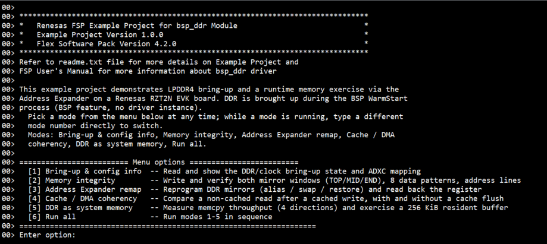
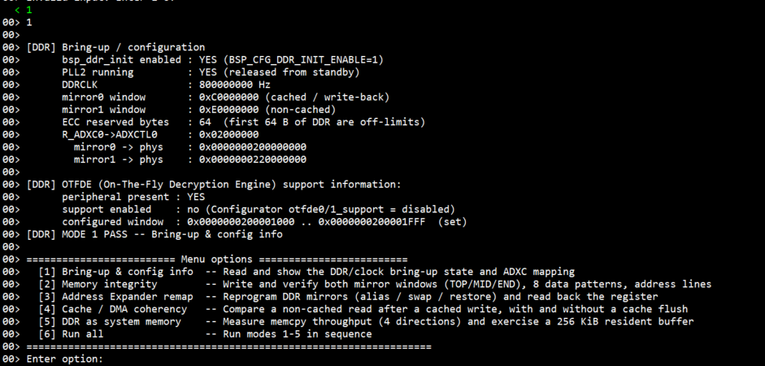
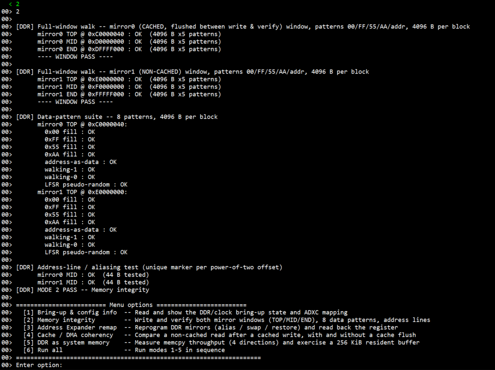
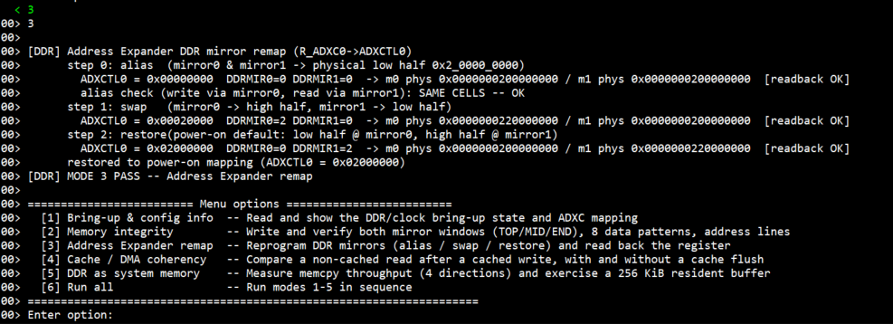
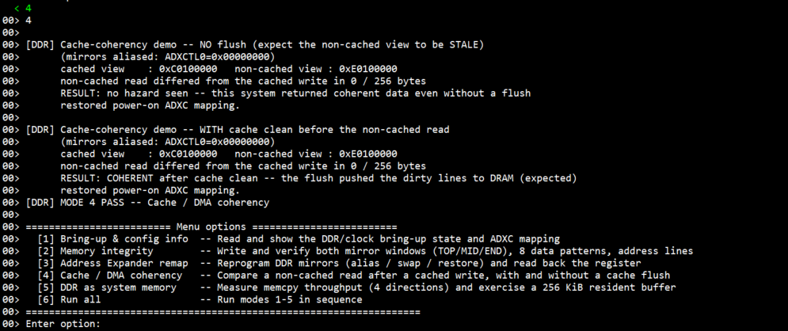
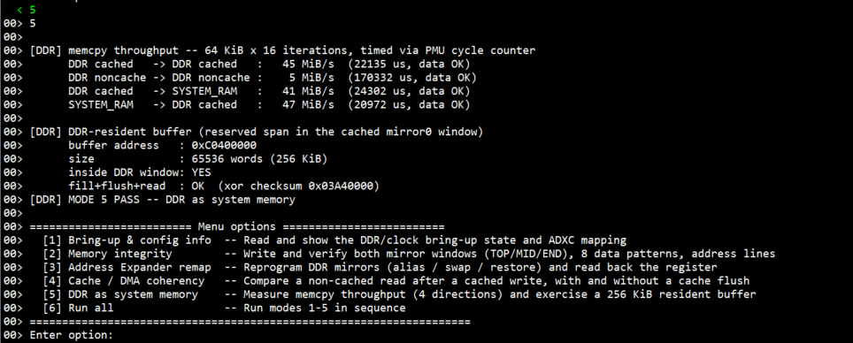
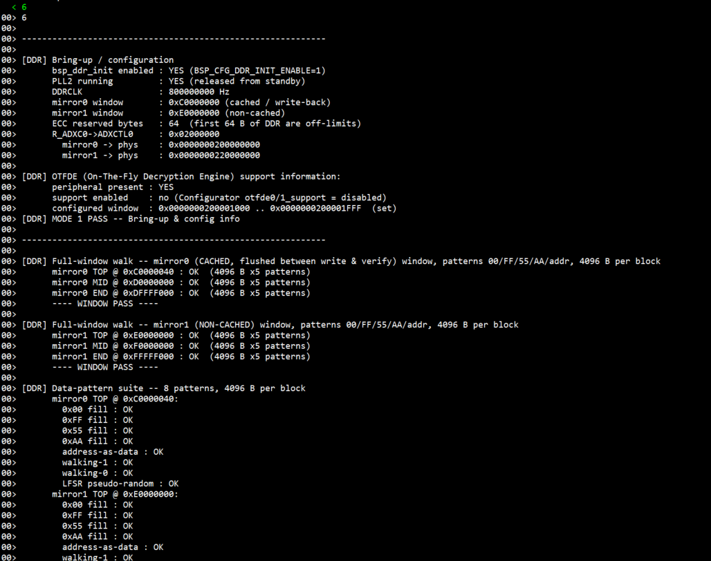
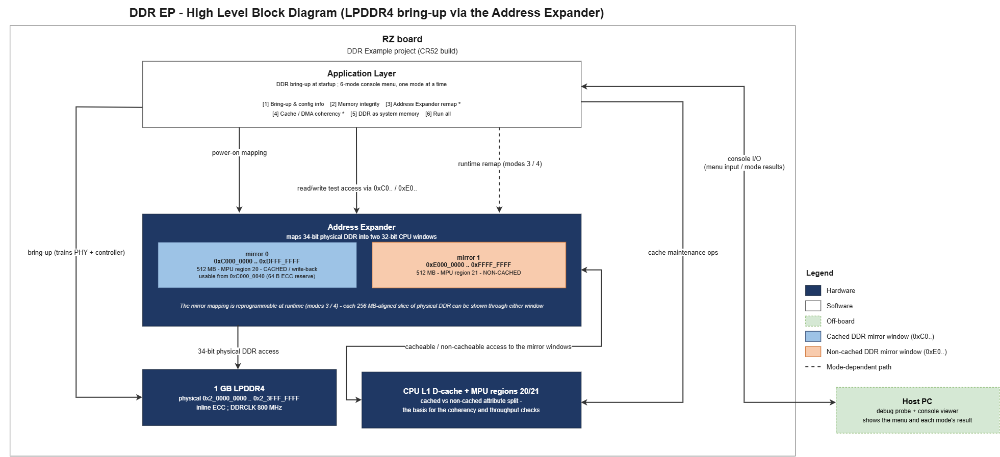
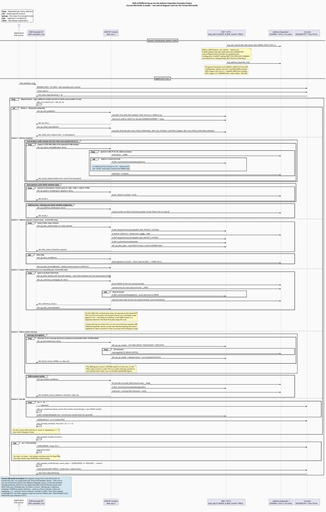

# DDR (LPDDR4) Example Project on RZ Boards

## Table of Contents
1. [Introduction](#introduction)
    1. [Supported Boards](#supported-boards)
2. [Required Resources](#required-resources)
    1. [Hardware Requirements](#hardware-requirements)
    2. [Software Requirements](#software-requirements)
3. [Application Execution](#application-execution)
4. [Project Notes](#project-notes)
    1. [System-Level Block Diagram](#system-level-block-diagram)
    2. [FSP Modules Used](#fsp-modules-used)
    3. [Module Configuration Notes](#module-configuration-notes)
    4. [API Usage](#api-usage)
    5. [Memory Usage](#memory-usage)
    6. [Clock Configuration](#clock-configuration)
    7. [Application Execution Flow](#application-execution-flow)
    8. [Console Verification Guide](#console-verification-guide)
    9. [Troubleshooting Tips](#troubleshooting-tips)
    10. [Known Limitations](#known-limitations)
5. [Special Topics](#special-topics)
6. [Conclusion and Next Steps](#conclusion-and-next-steps)
7. [References](#references)
8. [Notice](#notice)

## Introduction

The DDR example project brings up the on-board **LPDDR4** and exercises it as memory. On RZ/T2N,
DDR is a **BSP feature, not a driver** - there is no dedicated DDR driver API. The DDR PHY and
controller are trained and configured automatically during system startup, gated by a Configurator
enable setting, and require PLL2 to be released from standby before training runs. By the time
application code runs, DDR is already usable - there is no "open a driver" step, and the CPU is
not involved in any per-access DDR operation.

The CPU reaches the 34-bit physical DDR space through the **Address Expander**, which maps it into
two 32-bit CPU windows: **mirror 0** at `0xC000_0000` (512 MB, MPU region 20, cached / write-back)
and **mirror 1** at `0xE000_0000` (512 MB, MPU region 21, non-cached). The Address Expander's
DDR-mirror mapping register selects which 256 MB-aligned physical slice each window shows.

This EP supports **6 runtime-selectable modes** on the **Cortex-R52** build, chosen from a console
menu - no rebuild/reflash needed to switch between them. Each memory test runs once, prints its
result, and returns to the menu. The **Cortex-A55** build supports **4 modes** - modes `[3]` and
`[4]` below do not apply to that core (see their own descriptions), so on Cortex-A55 mode `[3]` is
"DDR as system memory" (mode `[5]` below) and mode `[4]` is "Run all" (mode `[6]` below, sweeping
modes `[1]`-`[3]`).

- **Mode `[1]` Bring-up & config info**

  Reports whether DDR bring-up succeeded, PLL2 state, DDRCLK, the live DDR-mirror mapping register
  value and the decoded mirror-window → physical-address mapping, then the OTFDE peripheral report:
  presence, the support-enable flags, and the configured address window. No decryption is
  performed - that path needs the `r_rsip` module and a provisioned key.

- **Mode `[2]` Memory integrity**

  A full-window walk of both mirror windows (start past the 64-byte inline-ECC reserve, midpoint
  and end, five patterns per block - the cached window is flushed between write and verify so the
  check reaches the real DRAM cells, the non-cached window reaches DRAM on every access); then the
  eight-pattern data suite (constant `0x00`/`0xFF`/`0x55`/`0xAA`, address-as-data, walking-1,
  walking-0, 32-bit LFSR) on both window tops; then an address-line / aliasing test (a unique
  marker at offset 0 and at every power-of-two offset) on both window midpoints.

- **Mode `[3]` Address Expander remap** *(Cortex-R52 only)*

  Reprograms the Address Expander's DDR mirror mapping at runtime through three steps - alias
  (both windows onto the low DDR memory region), swap (the two halves exchanged), restore
  (power-on mapping) - reading the mapping back after each step to confirm it took effect. The
  alias step also writes a signature through mirror 0 and reads it back through mirror 1 to prove
  both windows now address the same DDR memory region. The power-on mapping is always restored
  before the mode returns. **Not present on the Cortex-A55 build** - that core addresses the full
  physical DDR range directly and does not route through the Address Expander, so reprogramming it
  has no observable effect from Cortex-A55 (see Known Limitations).

- **Mode `[4]` Cache / DMA coherency** *(Cortex-R52 only)*

  Run as a hazard/fix pair. First pass: with both windows aliased onto the same physical DDR, a
  cached write with no cache flush followed by a non-cached read of the same cells - the
  stale-data hazard a DMA master would hit. Second pass: the identical sequence with a cache-clean
  operation before the non-cached read, which pushes the dirty lines to DRAM and makes the read
  coherent. **Not present on the Cortex-A55 build**, for the same Address Expander reason as mode
  `[3]` - the two-window aliasing this demo depends on does not exist on that core.

- **Mode `[5]` DDR as system memory**

  First, time a repeated memory copy for four directions (cached DDR ↔ cached DDR, non-cached DDR
  ↔ non-cached DDR, DDR ↔ on-chip SRAM) using the CPU's cycle counter, reporting MiB/s and
  elapsed microseconds - a cached-vs-non-cached ratio check, **not** the DDR controller's raw
  bandwidth. Then treat a fixed reserved 256 KiB span in the cached DDR window as ordinary
  runtime memory: fill it, flush the cache, read it back, and checksum it.

- **Mode `[6]` Run all**

  Runs modes 1–5 in sequence as a one-key regression sweep, paced so the console output prints
  intact. (On the Cortex-A55 build this is mode `[4]`, sweeping modes `[1]`-`[3]`.)

Please refer to the [Example Project Usage Guide](https://github.com/renesas/rz-fsp-examples/blob/main/example_projects/Example%20Project%20Usage%20Guide.pdf)
for general information on example projects.

### Supported Boards

| # | Board | MPU | J-Link OB VCOM | SEGGER_RTT Address | Board-Specific Guide |
|---|---|---|---|---|---|
| 1 | RZT2N EVK | R9A07G076M48GBG | ☑ | `0x10180000` | [RZT2N EVK Guide](ddr_board_specific_notes.md#rzt2n-evk--board-specific-guide) |

**Note:** Boards marked with ☑ under **J-Link OB VCOM** support the J-Link On-Board Virtual COM Port.

## Required Resources

### Hardware Requirements

#### Common Hardware
* RZ supported boards: RZ/T2N-EVK.
* 1 x Renesas RZ board.
* 1 x USB Type-C cable (board power).
* 1 x USB Type-A to micro USB cable.

#### Additional Hardware
* Detailed **Additional Hardware** for each supported board is described in the [Board-Specific Guide](ddr_board_specific_notes.md#rzt2n-evk--board-specific-guide).

#### Hardware Connections
* Detailed **Specific Connections** for each supported board are described in the [Board-Specific Guide](ddr_board_specific_notes.md#rzt2n-evk--board-specific-guide).
* Common Connections:
    * Connect the POWER(15V/3A) port on the evaluation board to a power source using a USB Type-C cable for board power supply.
    * Slide SW1 "POWER_SW" from OFF to ON side to turn on the power supply for the evaluation board.
    * Connect the J32 port on the evaluation board to the PC using a USB Micro-B cable for debugging.

### Software Requirements
* Renesas Flexible Software Package (FSP): Version 4.2.0
* e² studio: Version 2026-07
* FSP Smart Configurator: Version 2026-07
* IAR: Version 9.60.3
* GCC ARM Embedded Toolchain: Version 13.3.1.arm-13-24 (for cortexR-52)
* GCC ARM A-Profile (AArch64 bare-metal): Version 13.2 rel1 (for cortexA-55)
* J-Link: Version 9.44
* J-Link RTT Viewer Version 9.44 (for cortexR-52)
* Terminal Console Application: Tera Term or a similar application (for cortexA-55)

**Note:** Refer to the [FSP version requirements](https://github.com/renesas/rz-fsp-examples/blob/main/example_projects/version_info_table.md) table per IDE to correctly download the needed [FSP release](https://github.com/renesas/rz-fsp/releases).

## Application Execution

1. Import the DDR example project into e² studio / IAR.
2. Open the FSP Configuration editor / FSP Smart Configurator and generate the project content.
   Confirm in the generated headers that `BSP_CFG_DDR_INIT_ENABLE` is `1`
   (`rz_cfg/fsp_cfg/bsp/bsp_mcu_device_cfg.h`) and `BSP_CFG_PLL2` is `BSP_CLOCKS_PLL2_NORMAL`
   (`rz_gen/bsp_clock_cfg.h`). If "onDDR" is not enabled or PLL2 is not released, the build fails
   with a `bsp_ddr.h` `#error`.
3. Configure the hardware according to `ddr_board_specific_notes.md`.
4. Power on RZ board according to the 'Specific Connections' section in `ddr_board_specific_notes.md`.
5. Setup Terminal console to display.
   1. If using RTT Viewer (Cortex-R52): Open J-Link RTT Viewer for the active J-Link connection.
   2. If using Tera Term (Cortex-A55): Confirm the Renesas RZ board is recognized by the host PC as a COM port pair (e.g: COM5/COM6). Select the COM port with the higher number in the pair as the serial console port. If no output appears in the terminal while the program is running, reconnect using the other COM port in the pair.
      1. Set the configuration of Terminal Emulator (Tera Term) as follows:
          Speed: 115200 bps
          Data: 8 bit
          Parity: none
          Stop bits: 1 bit
          Flow control: none
          * Set the terminal software reception line feed code to [AUTO].
          * Keep [Local echo] disabled (default): the EP prints the entered option itself, so enabling it can show characters twice.
6. Download the DDR EP to the Renesas RZ MPU Evaluation kit and run the project.
   * In e² studio, in [Project Explorer] view, right click the node of the project to be debugged and select [Debug As]->[Debug Configurations...] menu.
   * Select "ddr_rzt2n_evk_{cortex}_ep Debug_Flat" in the Renesas GDB Hardware Debugging node
and select [Debugger]->[Connection Settings].
7. Power-cycle the RZ board.
8. Type a number to run a mode - this is the only blocking prompt. On Cortex-R52, type `1`–`6`;
   mode `[6]` runs the whole `[1]`–`[5]` sweep. On Cortex-A55, type `1`–`4`; mode `[4]` runs the
   whole `[1]`–`[3]` sweep (see Introduction for how the two builds' mode numbers line up).

### Execution Output

**Note:** Execution results are fully determined by the source and the Configurator state, except
the mode `[5]` MiB/s numbers and the mode `[5]` checksum, which are board-specific but stable
run-to-run. The example below shows the execution output on the RZT2N EVK board, Cortex-R52 core
(6 modes) - see Introduction for how the Cortex-A55 build's 4-mode numbering lines up with the
captures below.

+ Startup Banner and Menu:

  

+ Console: Mode `[1]` Bring-up & config info (+ OTFDE report):

  

+ Console: Mode `[2]` Memory integrity (window walks / pattern suite / address-line):

  

+ Console: Mode `[3]` Address Expander remap:

  

+ Console: Mode `[4]` Cache / DMA coherency (hazard then fixed):

  

+ Console: Mode `[5]` DDR as system memory (throughput + resident buffer):

  

+ Console: Mode `[6]` Run all:

  

## Project Notes

### System-Level Block Diagram

**Cortex-R52 build** - DDR reached through the Address Expander's two mirror windows:



**Cortex-A55 build** - same mirror-window addresses, reached directly through the CA55 MMU instead (no Address Expander on this core's path - see Known Limitations).

### FSP Modules Used

| Module Name | Usage | Searchable Keyword |
|---|---|---|
| BSP (Board Support Package) | `bsp_ddr_init()` DDR PHY/controller bring-up (gated by "onDDR"), `bsp_address_expander_init()` power-on `ADXCTL0` mapping, `R_BSP_Cache*` range operations, `R_BSP_RegisterProtectDisable/Enable`, `R_BSP_SoftwareDelay`, `R_FSP_VersionGet` | `bsp_ddr` |
| I/O Port | Generated port setup (default); not used by the application logic | `r_ioport` |

No HAL driver module (`r_*`) is added - DDR is a BSP feature and, like the reference project,
this EP has no DDR driver instance. The console transport for this **CR52 build** (SEGGER RTT)
is plain source under `src/SEGGER_RTT/`, not an FSP module; a **CA55 build** swaps it for a
UART / `printf` path in `common_utils.h` only, and the rest of the project is unchanged.

### Module Configuration Notes

This section describes FSP Configurator properties that are important or different from the defaults.

**Required changes from the default RZT2N EVK board configuration** - without these the project
either fails to build, or builds but does not pass every mode:

1. **BSP → onDDR = Enabled** (default: Disabled) - turns on `bsp_ddr_init()`.
2. **Clocks → PLL2 = Released** (default: Standby) - DDR training needs PLL2; enabling `onDDR`
   with PLL2 still in standby stops the build with a `bsp_ddr.h` `#error`.
3. **CA55 build only: BSP → Property → RZT2N Memory Config → CPU MMU → Region → Region 37 →
   Attribute Index = Attribute 0** (default: Attribute 1) - left at the default, the cached DDR
   window is never actually cacheable, and the DDR as system memory mode's cache-speed check fails.

Everything else (DDRCLK divider, the core clock) is left at the board-profile default. After
changing the above, **Generate Project Content** and rebuild.

Path: `configuration.xml > BSP` tab (board / MCU properties)

<div style="margin-left:2em; max-height:300px; overflow-y:auto; border:1px solid #ccc; border-radius:4px;">

| Module Property Path and Identifier | Default Value | Used Value | Reason |
| :----------------------------------: | :-----------: | :--------: | :----: |
| BSP > Property > onDDR (`config.bsp.common.ddr`) | Disabled | Enabled | Drives `bsp_ddr_init()` (`BSP_CFG_DDR_INIT_ENABLE = 1`) and pulls in the board LPDDR4 timing set. Without it, DDR is never trained and every mirror-window access faults. |
| Clocks > PLL2 (`board.clock.pll2`) | Standby | Released | Required by `bsp_ddr.h` - enabling "onDDR" while PLL2 is in standby fails the build with an `#error`. Sets `BSP_CFG_PLL2 = BSP_CLOCKS_PLL2_NORMAL`. |
| Clocks > DDRCLK divider (`board.clock.ddr_clk.div`) | /2 | /2 (confirmed) | DDRCLK 800 MHz. Left at the skeleton default; kept explicit so a future edit is a conscious choice. |
| BSP > Property > RZT2N Memory Config > CPU MMU > Region > Region 37 > Attribute Index (`config.bsp.fsp.cpu.mpu_reg37.attr_index`) | Attribute 1 (non-cacheable) | Attribute 0 (cacheable, write-back) | **CA55 build only.** Region 37 covers the cached DDR mirror window (`0xC000_0000`-`0xDFFF_FFFF`); left at the default the "cached" copy is never actually cacheable, so the DDR as system memory mode's cache-vs-non-cache speed check fails even though every data check still reads OK. |

</div><br>

On the **Cortex-R52** build, the cached (region 20) / non-cached (region 21) MPU split of the two
DDR mirror windows is part of the generated BSP memory configuration - no MPU edit is needed. The
**Cortex-A55** build gets the same split from its own MPU regions, but region 37 is generated with
the wrong attribute index (see above) and must be corrected by hand.

### API Usage

The link below is the FSP User Manual entry for the BSP DDR feature used at the application layer.

* [BSP DDR - FSP User Manual](https://renesas.github.io/rz-fsp/group___r_z_t___r_e_n_e_s_a_s___c_o_m_m_o_n.html) (BSP → DDR: `BSP_DDRTOP_ECC_START_ADDR`)

BSP / CP15 elements the application calls directly:

| # | API / element | Purpose |
|---|---|---|
| 1 | `R_BSP_WarmStart` (`BSP_WARM_START_POST_C`) | Startup hook that hosts the `bsp_ddr_init()` call |
| 2 | `R_ADXC0->ADXCTL0` | Live read (mode 1, both builds) and runtime reprogram (modes 3, 4) of the DDR mirror mapping - reprogramming is **Cortex-R52 only** (see Known Limitations) |
| 3 | `R_BSP_RegisterProtectDisable` / `R_BSP_RegisterProtectEnable` | Unlock `ADXCTL0` (`BSP_REG_PROTECT_SYSTEM`) for the mode-3 remap - **Cortex-R52 only** |
| 4 | `R_BSP_CacheCleanRange` | Push dirty lines to DRAM (mode 4 fixed pass) - **Cortex-R52 only** |
| 5 | `R_BSP_CacheInvalidateRange` | Drop stale lines before a cached write (mode 4) - **Cortex-R52 only** |
| 6 | `R_BSP_CacheCleanInvalidateRange` | Force a DRAM re-read in the cached memory tests (mode 2, mode 5 resident buffer) - used by both builds |
| 7 | `R_BSP_CacheCleanInvalidateAll` | Flush all of L1D after an Address Expander remap (mode 3) - **Cortex-R52 only** |
| 8 | `R_BSP_SoftwareDelay` | Pace the "run all" sweep (mode 6 on Cortex-R52, mode 4 on Cortex-A55) |
| 9 | `R_SCI_UART_Open()` / `R_SCI_UART_Write()` / `R_SCI_UART_Read()` | Console I/O - **Cortex-A55 build only** (Cortex-R52 build uses SEGGER RTT instead) |

### Memory Usage

Memory usage varies depending on target board, compiler, linker script, and enabled components.

**Reference Measurements:**

Measured using **Memory Usage view in e² studio** with the following conditions:
- Target: RZT2N EVK (R9A07G076)
- Core: Cortex-R52 (CR52_0)
- Compiler: GCC ARM
- Build: Debug

| Item | Approximate Size |
|---|---|
| Program / ROM usage (Program 14556 + Constant 6664 + Initialized Data 13892) | 35112 byte(s) |
| RAM usage (Initialized Data 13892 + Uninitialized Data 163856 + Data 0 + Stack 0 + Others 33656) | 211404 byte(s) |
| Non-cached SRAM region (`InternalRam` 0x00100000-0x0010FFFF, console-transport control block + buffers) | 31808 / 65536 byte(s) (48.54%) |

**Notes:**
* Do not carry these figures over from a sibling EP - measure this build. The two 64 KiB
  `s_sysram_buf_a/b` static buffers used by mode `[5]` are the largest single RAM contributor and
  should be visible in the breakdown.
* `BUFFER_SIZE_UP` in `src/SEGGER_RTT/SEGGER_RTT_Conf.h` is raised to 8192 bytes (from the stock
  2048) so the mode `[6]` "run all" sweep prints without dropping - this adds ~6 KiB to the
  non-cached console up-buffer for this build.

**Accessing Memory Usage View in e² studio:**
```
Renesas Views -> C/C++ -> Memory Usage
```
Then select the target project in the Project Explorer. For any section not broken out by that
view, search the generated `Debug/<project>.map` file.

### Clock Configuration

PLL2 must be **released from standby** (Configurator → Clocks → PLL2) - this is a hard
requirement of the BSP DDR feature, enforced by a `bsp_ddr.h` `#error`. DDRCLK is 800 MHz
(`ddr_clk.div = /2`). No other clock change is needed.

The Cortex-R52 core clock is **400 MHz** (`BSP_CFG_CR52C0CLK`), which is the RZT2N EVK board
profile's default - do not change it. Mode 5's throughput step converts PMU cycles to
microseconds via `SystemCoreClock` (i.e. this 400 MHz), so a wrong core clock would silently
skew the reported MiB/s. If you ever start this project from a **different board profile**,
verify the core clock resolves to the value your board actually runs at before trusting DDR
training or the mode-5 numbers.

### Application Execution Flow

This section describes the sequence of events and API calls during execution. Startup trains DDR
(`bsp_ddr_init()`) and programs the power-on Address Expander mapping
(`bsp_address_expander_init()`) before `main()`. `hal_entry()` prints the banner and calls
`ddr_example_run()`, which owns the whole application: print the menu, read a digit (the only
blocking prompt), dispatch the selected mode to a `ddr_do_*()` handler that calls one or more
print-free `ddr_ep_*()` functions (a merged mode calls its sub-handlers in turn), print the
result, and loop - typing a different digit switches, the same digit re-runs, and `[6]` runs the
`[1]`–`[5]` sweep with a short pace between modes.

The sequence diagram below shows the **Cortex-R52** build's flow (6 modes). The **Cortex-A55**
build follows the same pattern with 4 modes - its `ddr_run_one()` dispatch omits the `ddr_do_*()`
handlers for modes `[3]`/`[4]` above, and its sweep runs `[1]`–`[3]`.



Refer to [`ddr_sequence_diagram.puml`](ddr_sequence_diagram.puml) for the PlantUML source.

### Console Verification Guide

This EP uses **no external verification tool** - no logic analyzer, no bus trace, no PC-side
script. Every functional result is produced and checked on-chip and reported over the console
(SEGGER RTT on the Cortex-R52 build, a UART/Tera Term path on the Cortex-A55 build), so the
console log *is* the verification record.

**What "pass" looks like:**

| Check | Pass condition |
|---|---|
| Per-mode verdict | Every mode ends with `[DDR] MODE N PASS -- <name>`; the "run all" mode also prints `[DDR] RESULT: n/n modes PASS`. A failed check prints `[DDR] MODE N FAIL` instead. |
| No error trap | No `[DDR] ERROR: ...` line appears; if one does, that mode is marked `FAIL` and the run continues (no debugger halt). |
| Mode `[1]` | `bsp_ddr_init enabled : YES`, `PLL2 running : YES`, `DDRCLK : 800000000 Hz`, `R_ADXC0->ADXCTL0 : 0x02000000`, `mirror0 -> phys 0x2_0000_0000` / `mirror1 -> phys 0x2_2000_0000`; OTFDE `peripheral present : YES`, window `... (set)`. Identical on both builds - only Cortex-R52 actually acts on this register (see Known Limitations). |
| Mode `[2]` | Every region line reads `OK`; both window walks end with `WINDOW PASS`; all 8 patterns `OK` on both window tops; the address-line test reads `OK (44 B tested)` for both midpoints. |
| Mode `[3]` *(Cortex-R52 only)* | All three steps read `readback OK`; the alias step reads `SAME CELLS -- OK`; the mode ends with `ADXCTL0 = 0x02000000` (power-on mapping restored). |
| Mode `[4]` *(Cortex-R52 only)* | The flush-first pass reads `RESULT: COHERENT after cache clean`. The no-flush pass reads either `RESULT: STALE ...` (hazard reproduced) or `RESULT: no hazard seen ...` - both are valid outcomes (see Known Limitations); it has no hard pass/fail. |
| Mode `[5]` (Cortex-R52) / Mode `[3]` (Cortex-A55) | All four `memcpy` directions read `data OK`; the `us` values are small and plausible (not billions); cached DDR is far faster than non-cached DDR. The resident buffer reads `inside DDR window: YES`, `fill+flush+read : OK`, and the XOR checksum matches the value from the first clean run - the same checksum on both builds. |
| Mode `[6]` (Cortex-R52) / Mode `[4]` (Cortex-A55) | The full sweep ( `[1]`-`[5]` on Cortex-R52, `[1]`-`[3]` on Cortex-A55) prints intact with no dropped or interleaved lines. |

**How each check is made on-chip:** the memory tests write a pattern, execute `__DSB()`, clean +
invalidate the cache line range for the cached window (so the verify read reaches DRAM, not L1D),
then read back and compare byte-for-byte. Mode `[3]` reads `ADXCTL0` back after every write and
compares the decoded DDRMIR fields against what was requested. Mode `[5]`'s resident buffer
accumulates a running XOR after fill and again after read-back; mode `[5]`'s throughput step
brackets each `memcpy` loop with the CPU PMU cycle counter (CP15) and converts to microseconds via
`SystemCoreClock`.

### Troubleshooting Tips

| Symptom | Likely Cause | Fix |
|---|---|---|
| Build error `"When using DDR, please set to 'PLL2 is released from standby state'"` | `bsp_ddr.h` `#error` - PLL2 still in Standby | Configurator → Clocks → PLL2 = Released, regenerate, rebuild. |
| Mode `[1]`: `bsp_ddr_init enabled : NO` | "onDDR" not enabled, or project not regenerated | Configurator → BSP → onDDR = Enabled, regenerate, rebuild. |
| Mode `[2]` FAILs immediately with huge error counts | DDR not trained (see mode `[1]`), or `ADXCTL0` not `0x02000000` after reset | Fix the Configurator per the two rows above; confirm mode `[1]` first. |
| Mode `[3]` alias step reads `DIFFERENT`, or any step reads `READBACK MISMATCH` | The 256 MB-unit DDRMIR encoding assumption does not match the installed pack, or `R_BSP_RegisterProtectDisable` did not unlock `ADXCTL0` | Compare `ddr_config.h`'s `DDR_ADXC_FIELD_UNIT` and the write sequence against `rz/fsp/src/bsp/mcu/all/bsp_address_expander.c` in the installed FSP pack. |
| Mode `[4]`, no-flush pass: `no hazard seen` | This SoC returned coherent data without a flush | Not a failure - record it. The flush-first pass is the pattern to follow for any DMA-shared buffer. |
| Mode `[5]`: `0 us` / `0 MiB/s` on every throughput line | The PMU is trapped at a higher exception level | Run on the CR52 with the EP's default exception setup; the step prints zeros rather than a fabricated value when the counter does not advance. |
| Mode `[5]`: resident buffer `inside DDR window : NO` | `DDR_EP_RESIDENT_OFFSET` in `ddr_config.h` puts the buffer outside `0xC000_0000..0xDFFF_FFFF` | Reduce the offset. |
| Menu digit does nothing | Console input not reaching the target | Use the console viewer's line input (type the number, press Enter); confirm RTT / UART is attached. |
| No console output at all | Console viewer not attached around reset, or RTT Auto Detection failed | Re-attach the viewer and reset; confirm the control-block address. |

### Known Limitations

* **Mode `[4]`'s cache-coherency hazard does not reproduce on the RZ/T2N Cortex-R52.** The core
  hazard-checks Normal Non-Cacheable reads against its own L1 D-cache, so a cached write followed
  by a non-cached read of the same physical address returns coherent data even with no flush
  (`0 / 256 bytes`, `no hazard seen`) on the no-flush pass. This is IMPLEMENTATION DEFINED, not
  guaranteed by the architecture, and only covers the CPU-vs-CPU path. A real DMA master reading
  DDR *is* a separate observer and would see stale data, so the flush-first pass's "always flush
  before handing a buffer to DMA" remains the rule. The EP has no DMA engine wired in to exercise
  the CPU-vs-DMA case.
* **Mode `[5]`'s throughput is a CPU `memcpy` figure, not the DDR controller's raw bandwidth.** It
  is a single-core scalar copy loop (no NEON, no burst, no DMA); the meaningful result is the
  ratio between the cached and non-cached numbers, not their absolute values.
* **OTFDE decryption is not demonstrated.** Mode `[1]`'s OTFDE report only names the peripheral
  and its configured window. A real on-the-fly DDR decryption flow needs the `r_rsip` module, an
  RSIP-provisioned key, and a ciphertext image placed in the OTFDE window.
* **ECC error injection is not demonstrated.** The LPDDR4 inline ECC corrects 1-bit / detects
  2-bit errors, but there is no safe, supported way to inject a bit error from software on this
  part. Coverage stops at honouring the 64-byte ECC reserve (`BSP_DDRTOP_ECC_START_ADDR`).
* The two DDR mirror windows and the `ADXCTL0` mapping are configured once at boot; only modes
  `[3]` and `[4]` reprogram the mapping, and each always restores the power-on value before
  returning.
* **The Address Expander does not apply to the Cortex-A55 core, so modes `[3]` and `[4]` are not
  implemented on the Cortex-A55 build.** Per the RZT2N Hardware User's Manual, Cortex-A55 (along
  with CoreSight and PCIe) natively addresses the full physical DDR range and is not one of the
  bus masters the Address Expander serves - only Cortex-R52, the DMAC, GMAC, USB, and SDHI units
  route through it. `ADXCTL0` still reads correctly from Cortex-A55 (mode `[1]`'s report is
  identical on both builds), but reprogramming it has no effect on what physical DDR that core
  itself reaches at `0xC000_0000`/`0xE000_0000`. This is a hardware boundary, not a software gap -
  the Cortex-A55 build accordingly ships with 4 modes instead of 6 (see Introduction).

## Special Topics

### Why the cached memory tests flush the cache between write and verify

A test block is 4 KiB, which fits entirely in the CPU L1 D-cache. Without a
`R_BSP_CacheCleanInvalidateRange()` call between the write and the read-back, the "verify" would
be served from the cache and never touch the DRAM cells - it would pass even against dead DRAM.
Mode `[2]`'s cached-window steps and mode `[5]`'s resident buffer all do this flush; mode `[2]`'s
non-cached-window steps need no flush because every access already goes straight to DRAM.

### Address Expander DDR-mirror field encoding *(Cortex-R52 only)*

`ADXCTL0 = (DDRMIR1_field << 24) | (DDRMIR0_field << 16) | (PCIEMIR_field << 0)`. Each DDRMIR
field is the physical offset from the DDR base in **256 MB units** - the same value the
Configurator emits as `BSP_CFG_ADX0_DDR_MIRRORx_ADDRESS` (`0x02` for the default high-half
mapping at `0x2_2000_0000`). Mode `[3]` reads the register back after each write to confirm the
encoding against the installed pack. This encoding only matters for bus masters the Address
Expander actually serves (Cortex-R52 among them) - see Known Limitations for why Cortex-A55 is not
one of them.

## Conclusion and Next Steps

* To further explore DDR on the Renesas RZ/T2N:
  * Refer to the FSP User Manual's BSP section for the DDR feature and the Address Expander.
  * Visit renesas.com for additional RZ/T2N DDR and memory-subsystem documentation.

## References
* [FSP User Manual on GitHub](https://renesas.github.io/rz-fsp)
* [Example Project Usage Guide](https://github.com/renesas/rz-fsp-examples/blob/main/example_projects/Example%20Project%20Usage%20Guide.pdf)

## Notice

1. Descriptions of circuits, software and other related
information in this document are provided only to illustrate the
operation of semiconductor products and application examples. You are
fully responsible for the incorporation or any other use of the
circuits, software, and information in the design of your product or
system. Renesas Electronics disclaims any and all liability for any
losses and damages incurred by you or third parties arising from the use
of these circuits, software, or information. 

2. Renesas Electronics
hereby expressly disclaims any warranties against and liability for
infringement or any other claims involving patents, copyrights, or other
intellectual property rights of third parties, by or arising from the
use of Renesas Electronics products or technical information described
in this document, including but not limited to, the product data,
drawings, charts, programs, algorithms, and application examples. 

3. No license, express, implied or otherwise, is granted hereby under any
patents, copyrights or other intellectual property rights of Renesas
Electronics or others. 

4. You shall be responsible for determining what
licenses are required from any third parties, and obtaining such
licenses for the lawful import, export, manufacture, sales, utilization,
distribution or other disposal of any products incorporating Renesas
Electronics products, if required. 

5. You shall not alter, modify, copy,
or reverse engineer any Renesas Electronics product, whether in whole or
in part. Renesas Electronics disclaims any and all liability for any
losses or damages incurred by you or third parties arising from such
alteration, modification, copying or reverse engineering. 

6. Renesas Electronics products are classified according to the following two
quality grades: "Standard" and "High Quality". The intended applications
for each Renesas Electronics product depends on the product's quality
grade, as indicated below. "Standard": Computers; office equipment;
communications equipment; test and measurement equipment; audio and
visual equipment; home electronic appliances; machine tools; personal
electronic equipment; industrial robots; etc. "High Quality":
Transportation equipment (automobiles, trains, ships, etc.); traffic
control (traffic lights); large-scale communication equipment; key
financial terminal systems; safety control equipment; etc. Unless
expressly designated as a high reliability product or a product for
harsh environments in a Renesas Electronics data sheet or other Renesas
Electronics document, Renesas Electronics products are not intended or
authorized for use in products or systems that may pose a direct threat
to human life or bodily injury (artificial life support devices or
systems; surgical implantations; etc.), or may cause serious property
damage (space system; undersea repeaters; nuclear power control systems;
aircraft control systems; key plant systems; military equipment; etc.).
Renesas Electronics disclaims any and all liability for any damages or
losses incurred by you or any third parties arising from the use of any
Renesas Electronics product that is inconsistent with any Renesas
Electronics data sheet, user's manual or other Renesas Electronics
document. 

7. No semiconductor product is absolutely secure. Notwithstanding any security measures or features that may be implemented in Renesas Electronics hardware or software products, Renesas Electronics shall have absolutely no liability arising out of
any vulnerability or security breach, including but not limited to any unauthorized access to or use of a Renesas Electronics product or a system that uses a Renesas Electronics product. RENESAS ELECTRONICS DOES NOT WARRANT OR GUARANTEE THAT RENESAS ELECTRONICS PRODUCTS, OR ANY
SYSTEMS CREATED USING RENESAS ELECTRONICS PRODUCTS WILL BE INVULNERABLE OR FREE FROM CORRUPTION, ATTACK, VIRUSES, INTERFERENCE, HACKING, DATA LOSS OR THEFT, OR OTHER SECURITY INTRUSION ("Vulnerability Issues"). RENESAS ELECTRONICS DISCLAIMS ANY AND ALL RESPONSIBILITY OR LIABILITY
ARISING FROM OR RELATED TO ANY VULNERABILITY ISSUES. FURTHERMORE, TO THE EXTENT PERMITTED BY APPLICABLE LAW, RENESAS ELECTRONICS DISCLAIMS ANY AND ALL WARRANTIES, EXPRESS OR IMPLIED, WITH RESPECT TO THIS DOCUMENT
AND ANY RELATED OR ACCOMPANYING SOFTWARE OR HARDWARE, INCLUDING BUT NOT LIMITED TO THE IMPLIED WARRANTIES OF MERCHANTABILITY, OR FITNESS FOR A PARTICULAR PURPOSE. 

8. When using Renesas Electronics products, refer to the latest product information (data sheets, user's manuals, application notes, "General Notes for Handling and Using Semiconductor Devices" in
the reliability handbook, etc.), and ensure that usage conditions are within the ranges specified by Renesas Electronics with respect to
maximum ratings, operating power supply voltage range, heat dissipation characteristics, installation, etc. Renesas Electronics disclaims any
and all liability for any malfunctions, failure or accident arising out of the use of Renesas Electronics products outside of such specified
ranges. 

9. Although Renesas Electronics endeavors to improve the quality and reliability of Renesas Electronics products, semiconductor products
have specific characteristics, such as the occurrence of failure at a certain rate and malfunctions under certain use conditions. Unless
designated as a high reliability product or a product for harsh environments in a Renesas Electronics data sheet or other Renesas
Electronics document, Renesas Electronics products are not subject to radiation resistance design. You are responsible for implementing safety
measures to guard against the possibility of bodily injury, injury or damage caused by fire, and/or danger to the public in the event of a
failure or malfunction of Renesas Electronics products, such as safety design for hardware and software, including but not limited to
redundancy, fire control and malfunction prevention, appropriate treatment for aging degradation or any other appropriate measures.
Because the evaluation of microcomputer software alone is very difficult and impractical, you are responsible for evaluating the safety of the
final products or systems manufactured by you. 

10. Please contact a
Renesas Electronics sales office for details as to environmental matters such as the environmental compatibility of each Renesas Electronics
product. You are responsible for carefully and sufficiently investigating applicable laws and regulations that regulate the
inclusion or use of controlled substances, including without limitation, the EU RoHS Directive, and using Renesas Electronics products in
compliance with all these applicable laws and regulations. Renesas Electronics disclaims any and all liability for damages or losses
occurring as a result of your noncompliance with applicable laws and regulations. 

11. Renesas Electronics products and technologies shall not be used for or incorporated into any products or systems whose
manufacture, use, or sale is prohibited under any applicable domestic or foreign laws or regulations. You shall comply with any applicable export
control laws and regulations promulgated and administered by the governments of any countries asserting jurisdiction over the parties or
transactions. 

12. It is the responsibility of the buyer or distributor of Renesas Electronics products, or any other party who distributes,
disposes of, or otherwise sells or transfers the product to a third party, to notify such third party in advance of the contents and
conditions set forth in this document. 

13. This document shall not be
reprinted, reproduced or duplicated in any form, in whole or in part, without prior written consent of Renesas Electronics. 

14. Please contact a Renesas Electronics sales office if you have any questions regarding the information contained in this document or Renesas Electronics
products. (Note1) "Renesas Electronics" as used in this document means Renesas Electronics Corporation and also includes its directly or
indirectly controlled subsidiaries. (Note2) "Renesas Electronics product(s)" means any product developed or manufactured by or for
Renesas Electronics.

                                                                                   (Rev.5.0-1 October 2020)
## Corporate Headquarters 

Contact information TOYOSU FORESIA, 3-2-24

Toyosu, Koto-ku, Tokyo 135-0061, Japan 

www.renesas.com 

## Contact information 

For further information on a product, technology, the most up-to-date version of a
document, or your nearest sales office, please visit:
www.renesas.com/contact/. 

## Trademarks 
Renesas and the Renesas logo are trademarks of Renesas Electronics Corporation. All trademarks and
registered trademarks are the property of their respective owners.

							© 2026 Renesas Electronics Corporation. All rights reserved
