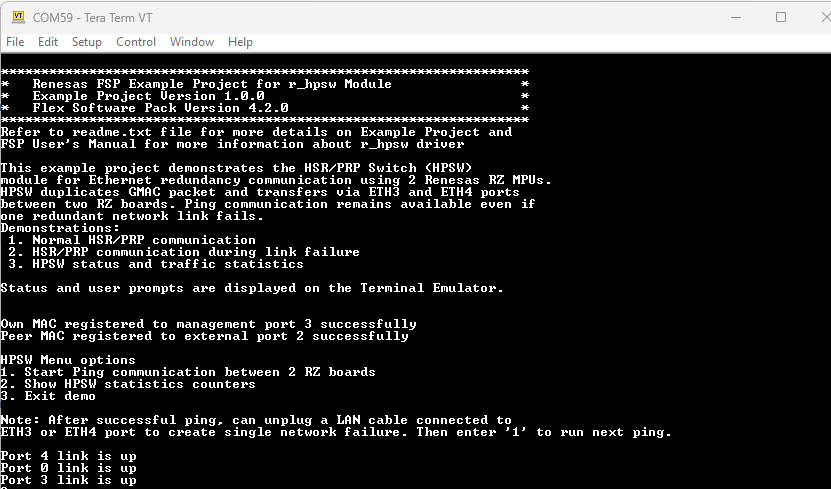
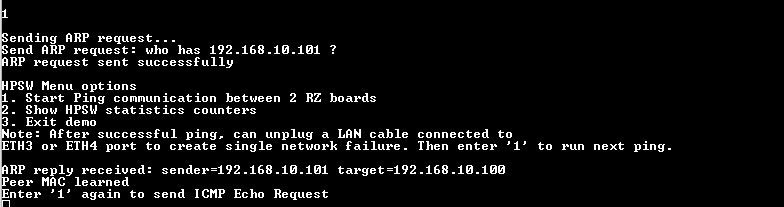
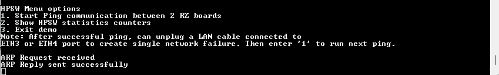
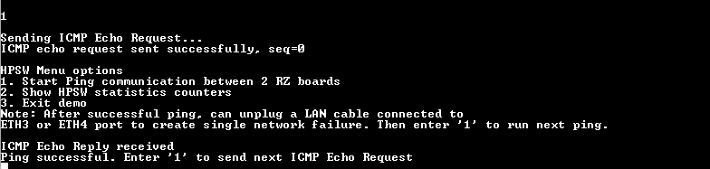
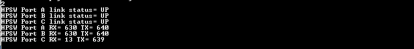
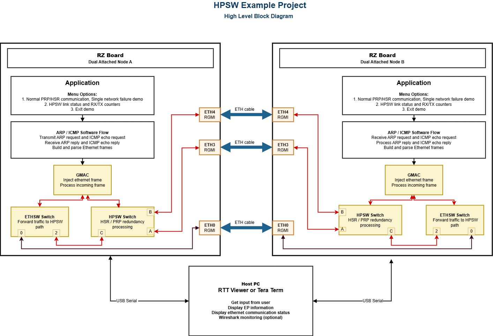
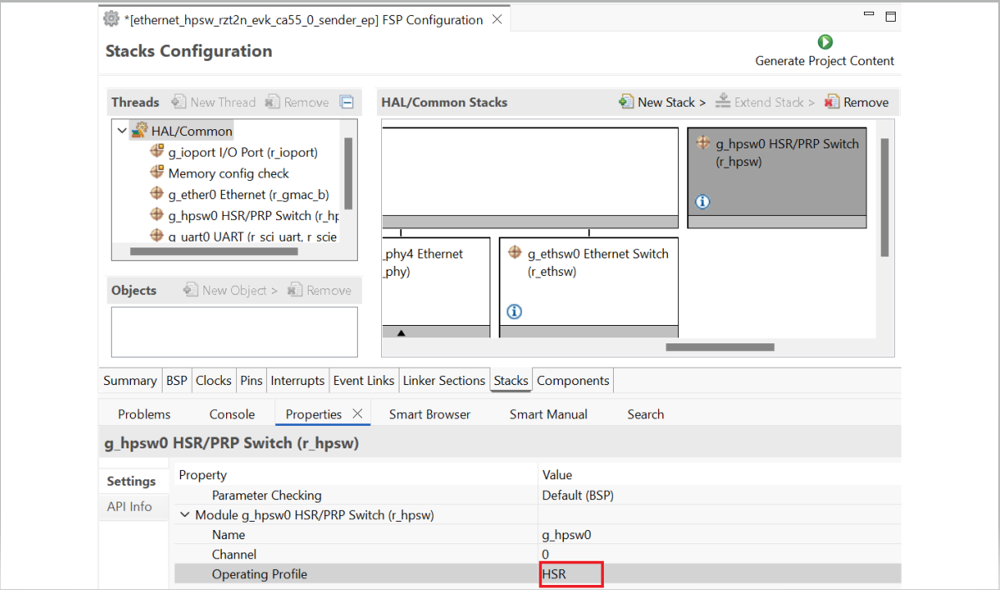
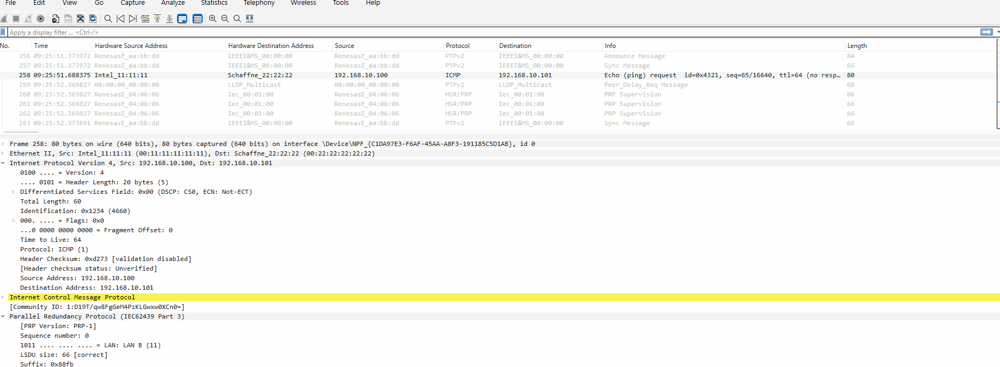
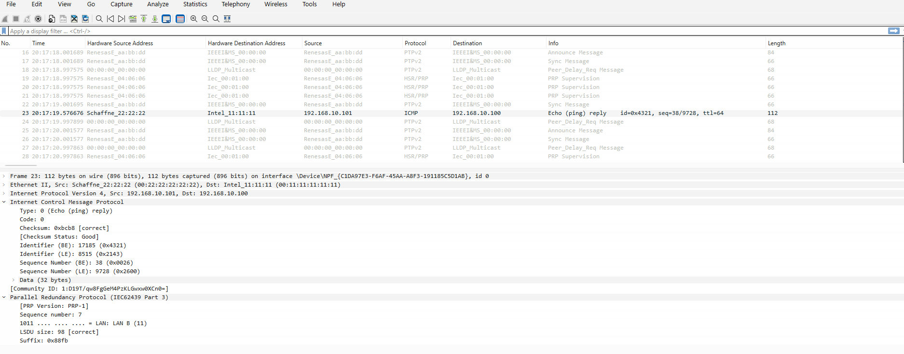

# Ethernet HPSW Example Project on RZ Boards

## Table of Contents

- [Ethernet HPSW Example Project on RZ Boards](#ethernet-hpsw-example-project-on-rz-boards)
  - [Table of Contents](#table-of-contents)
  - [Introduction](#introduction)
    - [Supported Boards](#supported-boards)
  - [Required Resources](#required-resources)
    - [Hardware Requirements](#hardware-requirements)
      - [Common Hardware](#common-hardware)
      - [Additional Hardware](#additional-hardware)
      - [Hardware Connections](#hardware-connections)
  - [Software Requirements](#software-requirements)
  - [Application Execution](#application-execution)
  - [Project Notes](#project-notes)
    - [System-Level Block Diagram](#system-level-block-diagram)
    - [FSP Modules Used](#fsp-modules-used)
    - [Module Configuration Notes](#module-configuration-notes)
      - [Ethernet Switch Configuration](#ethernet-switch-configuration)
      - [Ethernet Configuration](#ethernet-configuration)
    - [How to Change the HSR/PRP Mode](#how-to-change-the-hsrprp-mode)
      - [Steps](#steps)
    - [API Usage](#api-usage)
    - [Memory Usage](#memory-usage)
    - [Clock Configuration](#clock-configuration)
    - [Application Execution Flow](#application-execution-flow)
    - [PRP Verification](#prp-verification)
    - [HSR Verification](#hsr-verification)
    - [Link Failure Verification](#link-failure-verification)
  - [Wireshark Verification Guide](#wireshark-verification-guide)
    - [What is Wireshark?](#what-is-wireshark)
    - [Setting Up a Capture](#setting-up-a-capture)
      - [Step 1 - Identify the Ethernet Adapter](#step-1---identify-the-ethernet-adapter)
      - [Step 2 - Start a Capture](#step-2---start-a-capture)
      - [Step 3 - Apply a Display Filter](#step-3---apply-a-display-filter)
      - [Step 4 - Inspect Captured Packets](#step-4---inspect-captured-packets)
  - [Troubleshooting Tips](#troubleshooting-tips)
  - [Known Limitations](#known-limitations)
  - [Conclusion and Next Steps](#conclusion-and-next-steps)
  - [References](#references)
  - [Notice](#notice)
  - [Corporate Headquarters](#corporate-headquarters)
  - [Contact information](#contact-information)
  - [Trademarks](#trademarks)

## Introduction

The Ethernet HPSW example project demonstrates Ethernet redundancy communication using the HSR/PRP Switch (HPSW) module available on Renesas RZ devices and the Renesas Flexible Software Package (FSP).

The example project demonstrates how to build a fault-tolerant Ethernet network using either High-availability Seamless Redundancy (HSR) or Parallel Redundancy Protocol (PRP). Two RZ boards communicate through redundant Ethernet network paths. The transmitting board generates ARP and ICMP packets and forwards them through the HPSW redundancy path.

In PRP mode, packets are duplicated and transmitted through two independent networks simultaneously. In HSR mode, packets are transmitted through a redundant ring topology. If one Ethernet cable or redundant network path is disconnected, communication continues through the remaining active path.

The project demonstrates:

- Normal HSR/PRP communication using active redundant network connections.
- Communication continuity during a single redundant network link failure.
- HPSW link status monitoring.
- HPSW traffic counter monitoring.

Status messages, received packet information, link status, counter values, and user prompts are displayed on the terminal console.

Please refer to the [Example Project Usage Guide](https://github.com/renesas/rz-fsp-examples/blob/main/example_projects/Example%20Project%20Usage%20Guide.pdf) for general information on example projects.

### Supported Boards

<div style="margin-left:2em; max-height:200px; overflow-y:auto; border:1px solid #ccc; border-radius:4px;">

| #  | Board | MPU | J-Link OB VCOM | SEGGER_RTT Address | Board-Specific Guide |
|----|-------|-----|----------------|----------------|----------------------|
| 1  | RZT2N EVK | R9A07G076M48GBG | ☑ | N/A | [RZT2N EVK Guide](ethernet_hpsw_board_specific_notes.md#rzt2n-evk--board-specific-guide) |
...

</div><br>

**Note:**
* Boards marked with ☑ under **J-Link OB VCOM** support the J-Link On-Board Virtual COM Port.

## Required Resources

To build and run the Ethernet HPSW example project, the following resources are needed.

### Hardware Requirements

#### Common Hardware

* RZ supported boards: RZ/T2N-EVK.
* 2 x Renesas RZ boards.
* 2 x USB Type-C cables.
* 4 x USB Type-A to micro USB cables.
* 3 x LAN cables.

#### Additional Hardware
* Detailed **Additional Hardware** for each supported board is described in the [Board-Specific Guide](ethernet_hpsw_board_specific_notes.md#supported-boards).

#### Hardware Connections
* Detailed **Specific Connections** for each supported board are described in the [Board-Specific Guide](ethernet_hpsw_board_specific_notes.md#supported-boards).

## Software Requirements

- Renesas Flexible Software Package (FSP): Version 4.2.0
- e² studio: Version 2026-07
- FSP Smart Configurator: Version 2026-07
- IAR: Version 9.60.3
- GCC ARM Embedded Toolchain: Version 13.3.1.arm-13-24
- GCC ARM A-Profile (AArch64 bare-metal): Version 13.2 rel1
- J-Link: Version 9.44
- Terminal Console Application: Tera Term or a similar application
- Wireshark (optional): For observing ARP and ICMP Ethernet traffic. Download from https://www.wireshark.org/download.html - install with Npcap (included in installer). See [Wireshark Verification Guide](#wireshark-verification-guide) for setup details.

**Note:** Refer to the [FSP version requirements](https://github.com/renesas/rz-fsp-examples/blob/main/example_projects/version_info_table.md) table per IDE to correctly download the needed [FSP release](https://github.com/renesas/rz-fsp/releases).

## Application Execution

1. Import the ethernet HPSW example project into e² studio / IAR.
2. Open the FSP Configuration editor/ FSP Smart Configurator and generate the project content.
3. Configure the hardware according to `ethernet_hpsw_board_specific_notes.md`.
4. Power on both RZ boards according to 'Debug and Power Connections' section in `ethernet_hpsw_board_specific_notes.md`.
5. Confirm both boards are recognized by the host PC as two COM port pairs (e.g: COM5/COM6 and COM7/COM8). For each board, select the COM port with the higher number in the pair as the serial console port. If no output appears in the terminal while the program is running, reconnect using the other COM port in the pair.
6. Set the configuration of Terminal Emulator (Tera Term) as follows:
   Speed: 115200 bps
   Data: 8 bit  
   Parity: none
   Stop bits: 1 bit
   Flow control: none
   * Set the terminal software reception line feed code to [AUTO].
   * To echo back characters types in Tera Term, the user needs to enable it through
        [Setup]  -> [Terminal...] -> Check [Local echo]

7. Download the example project to both Renesas RZ boards.
   e² studio:
   * In [Project Explorer] view, right click the node of the project to be debugged and select [Debug As]->[Debug Configurations...] menu.
   * Select "ethernet_hpsw_rzt2n_evk_{cortex}_sender_ep Debug_Flat" in the Renesas GDB Hardware Debugging node
and select [Debugger]->[Connection Settings].
   * Select [...] next to J-Link Serial value. When window is displayed, select one
of found probe and press the "OK" button.
   * Press [Debug] button.
   * When "Proceed with launch" window is displayed, select [Yes].
   * When "Confirm Perspective Switch" window is displayed, select [Switch].
   * Press the "Resume" button. The program will break at "hal_entry();"in main.
   * Repeat above steps for the other RZ board with project "ethernet_hpsw_rzt2n_evk_{cortex}_receiver_ep Debug_Flat". 
   * If the message "A Renesas GDB debug session is already active" appears, select [No].

   IAR:
   * Select "ethernet_hpsw_rzt2n_evk_{cortex}_sender_ep" project and click on the [Download and debug] button in the "Project" toolbar.
   * A J-Link Probe Selection window is displayed, select one of found probe and press the "OK" button.
   * The program will break at the first code in "main".
   * Press the [Go] button again to execute the program.
   * Repeat above steps for the other RZ board with project "ethernet_hpsw_rzt2n_evk_{cortex}_receiver_ep". 
   * When a J-Link Proble Selection window is displayed, select a probe that is different from the one you have already selected previously.
8. Open the terminal console for each board on the Host PC.
9. Observe the startup banner and initialization messages, link-up events.
10. Run the communication demonstration from the terminal menu options `1`, `2`, or `3` .
11. Verify ARP Request/Reply and ICMP Echo Request/Reply communication.
12. After successful Ping. Please unplug one redundant Ethernet cable (ETH3 or ETH4) to simulate a link failure.
13. Verify that communication continues through the remaining active path.
14. Read HPSW link status and traffic counters from the terminal menu.

Example runtime menu:


+ EP Information Banner and Link-Up:

   

+ ARP Request Output:

   

+ ARP Reply Output:

   

+ ICMP Echo Request, Reply:

   

+ HPSW port link status and statistics counter:

   
## Project Notes

### System-Level Block Diagram



> **Note:** The exact redundant network topology depends on whether the example is configured for PRP or HSR. Refer to the Board-Specific Guide for cabling details.

### FSP Modules Used

List of important modules used in this example project. Refer to the FSP User Manual for further details on each module listed below.

| Module Name | Usage | Searchable Keyword |
|---|---|---|
| HSR/PRP Switch | Controls HPSW redundancy processing, link status, and traffic counters. | `r_hpsw` |
| Ethernet Switch | Provides the internal Ethernet switch path between the application Ethernet interface and the HPSW path. | `r_ethsw` |
| Ethernet | Provides GMAC transmit and receive operations for ARP and ICMP packets. | `r_gmac` / `r_gmac_b` |
| Ethernet PHY | Provides PHY setup, link detection, and physical Ethernet connectivity. | `r_ether_phy` |
| Ethernet Selector | Selects the Ethernet signal path used by the board configuration. | `r_ether_selector` |

### Module Configuration Notes

This section describes FSP Configurator properties which are important or different from those selected by default.

Configuration Properties for HSR/PRP Switch - `g_hpsw0` instance 

Path: `configuration.xml > Stacks > HSR/PRP Switch (r_hpsw) > Properties`

<div style="margin-left:2em; max-height:300px; overflow-y:auto; border:1px solid #ccc; border-radius:4px;">

| Module Property Path and Identifier | Default Value | Used Value | Reason |
| :----------------------------------: | :-----------: | :--------: | :----: |
| Module g_hpsw0 HSR/PRP Switch (r_hpsw) > Operating Profile | No profile | PRP | Configure redundant network topology PRP |
</div><br>

#### Ethernet Switch Configuration

Static forwarding configuration is used to direct application Ethernet traffic toward the HPSW path.

Configuration Properties for Ethernet SELECTOR (r_ether_selector) - `g_ethsw0`, `g_ethsw3`, `g_ethsw4` instance 

Path: `configuration.xml > Stacks > Ethernet SELECTOR (r_ether_selector) > Properties`

<div style="margin-left:2em; max-height:300px; overflow-y:auto; border:1px solid #ccc; border-radius:4px;">

| Module Property Path and Identifier | Default Value | Used Value | Reason |
| :----------------------------------: | :-----------: | :--------: | :----: |
| Module Ethernet SELECTOR (r_ether_selector) > Ethernet Mode | Ethernet Switch + Ethernet Switch + Ethernet Switch + Ethernet MAC1 + Ethernet MAC2 | Ethernet Switch + Ethernet Switch + Ethernet MAC2 + HSR PRP Switch + HSR PRP Switch | Configure redundant network HSR PRP Switch |
</div><br>

#### Ethernet Configuration

Each board must use a unique MAC address. The application uses Ethernet transmit and receive functions to exchange ARP and ICMP frames through the HPSW redundancy path.
The MAC addresses of 2 boards are set in example project 'ethernet_hpsw_example.c' source file.
   Sender board: 00:11:11:11:11:11
   Receiver board: 00:22:22:22:22:22

### How to Change the HSR/PRP Mode

This example project is configured to operate in **PRP (Parallel Redundancy Protocol)** mode by default.
To change the redundancy protocol mode, update the **HSR/PRP Switch (r_hpsw)** configuration in the FSP Stack.

#### Steps

1. Open the project in **e² studio** / **IAR**.
2. Open the FSP Configuration editor windown or FSP Smart Configurator tool.
3. Navigate to `Stacks > HSR/PRP Switch (r_hpsw) > Properties`. Change value of "Operating Profile" parameter.
   
4. Click on **Generate project content**.
4. Rebuild project.

### API Usage

The links below list the FSP-provided APIs used at the application layer.

- [HSR/PRP Switch Reference on GitHub](https://renesas.github.io/rz-fsp/group___r_z_t___h_p_s_w.html)
- [FSP Introduction and User Manual on GitHub](https://renesas.github.io/rz-fsp/)

### Memory Usage

Memory usage varies depending on the target board, compiler, linker script, and enabled components.

Reference notes:

- Non-cached memory may be required for Ethernet descriptors or frame buffers depending on driver configuration.
- Stack and heap size should be reviewed when enabling additional debug logs or counter display logic.

Accessing Memory Usage View in e² studio:

1. Navigate to `Renesas Views > C/C++ > Memory Usage`.
2. Select the target project in the Project Explorer.
3. Review ROM, RAM, and special memory section allocation.

### Clock Configuration

Default clock settings generated by FSP are used unless board-specific documentation states otherwise.

### Application Execution Flow

```text
              Application Execution Flow
                        |
                        v
              Initialize Ethernet Subsystem
                        |
                        v
              Configure MAC Table Entries
                        |
                        v
              Display User Menu
                        |
                        v
              Enter Main Runtime Loop
                        |
                        +--> Monitor Link Status
                        |
                        +--> Process User Commands
                        |      |
                        |      +--> Ping Demo
                        |      |      |
                        |      |      +--> ARP Discovery
                        |      |      +--> ICMP Echo Communication
                        |      |
                        |      +--> Display HPSW Status/Counters
                        |      |
                        |      +--> Exit
                        |
                        +--> Process Incoming Ethernet Frames
                              |
                              +--> ARP Processing
                              +--> ICMP Processing
                              +--> Statistics Update
                        |
                        +--> Repeat Until Exit Selected
                        |
                        v
              De-initialize Ethernet Subsystem
                        |
                        v
              End Program
```

### PRP Verification

Recommended checks:

| Checkpoint | Expected Result |
|---|---|
| Both redundant links connected | Communication succeeds |
| ARP Request/Reply | Successful |
| ICMP Echo Request/Reply | Successful |
| HPSW counters | Counters increment on active ports |

### HSR Verification

Recommended checks:

| Checkpoint | Expected Result |
|---|---|
| HSR redundant topology connected | Communication succeeds |
| ARP Request/Reply | Successful |
| ICMP Echo Request/Reply | Successful |
| HPSW counters | Counters increment on active ports |

### Link Failure Verification

1. Start the communication demo.
2. Confirm ARP and ICMP communication is successful.
3. Disconnect one redundant Ethernet cable.
4. Continue the communication demo.
5. Check terminal output and HPSW counters.

Expected result:

- Communication continues through the remaining active network path.
- ICMP Echo Request/Reply remains successful.
- HPSW status reflects the disconnected link.


## Wireshark Verification Guide

### What is Wireshark?

[Wireshark](https://www.wireshark.org/) is a free, open-source network packet analyzer. It captures frames arriving at a selected network adapter and allows the user to inspect Ethernet, ARP, IPv4, and ICMP fields.

In this EP, Wireshark can be used to observe ARP and ICMP packets and confirm that Ethernet communication remains available during normal operation and single redundant link failure conditions.

**Download and install:** https://www.wireshark.org/download.html  
During installation, accept the default option to install **Npcap** (the packet capture driver required on Windows). Without Npcap, Wireshark cannot capture from network adapters.


### Setting Up a Capture

#### Step 1 - Identify the Ethernet Adapter

Open the network adapter settings on the Host PC and identify the adapter connected to the Ethernet test network. In Wireshark, match the adapter by name or IP address.

#### Step 2 - Start a Capture

Open Wireshark and start a capture on the adapter connected to the Ethernet test network.

#### Step 3 - Apply a Display Filter

Useful filters for this EP:

+ ICMP Echo Request frame captured by Wirshark on ETH4 port:

   

+ ICMP Echo Reply frame captured by Wirshark on ETH4 port:

   
#### Step 4 - Inspect Captured Packets

Inspect the packet detail pane and verify the following traffic:
- ARP Request
- ARP Reply
- ICMP Echo Request
- ICMP Echo Reply

## Troubleshooting Tips

| Symptom | Likely Cause | Solution |
|---|---|---|
| No console output | Wrong serial port or terminal connection | Confirm the terminal cable and COM port. |
| Debugger cannot connect | Debug cable not connected or board not powered | Confirm J32 connection and board power. |
| ETH0, ETH3 or ETH4 link is down | LAN cable missing, wrong port, or board switch mismatch | Check board-specific wiring and switch settings. |
| ARP communication fails | Ethernet forwarding path not configured correctly | Check ETHSW and HPSW configuration. |
| HPSW counters remain zero | Traffic is not reaching HPSW | Check HPSW enable status and ETHSW forwarding path. |
| Redundancy behavior is not observed | Wrong PRP/HSR topology or wrong FSP HPSW mode | Check board-specific topology and HPSW mode configuration. |

## Known Limitations

- This EP is intended to demonstrate HPSW redundancy behavior using two RZ boards.
- Behavior depends on the selected HSR or PRP configuration and the physical network topology.
- The unsupported RZT2N Evaluation Board model must not be used for this EP.
- Wireshark verification depends on the available capture topology.

## Conclusion and Next Steps

* To further explore HPSW Switch implementation on Renesas RZT2N:
    * Refer to the FSP User Manual for the `HSR/PRP Switch` and `r_gmac` drivers for deeper technical insights.
    * Visit renesas.com for additional HSR/PRP Switch resources, application notes, and documentation related to RZT2N devices.

## References

The following documents provide general reference and background information.

* [HSR/PRP Switch Reference on GitHub](https://renesas.github.io/rz-fsp/group___r_z_t___h_p_s_w.html)
* [FSP User Manual on GitHub](https://renesas.github.io/rz-fsp)
* [Example Project Usage Guide](https://github.com/renesas/rz-fsp-examples/blob/main/example_projects/Example%20Project%20Usage%20Guide.pdf)

## Notice

1. Descriptions of circuits, software and other related
information in this document are provided only to illustrate the
operation of semiconductor products and application examples. You are
fully responsible for the incorporation or any other use of the
circuits, software, and information in the design of your product or
system. Renesas Electronics disclaims any and all liability for any
losses and damages incurred by you or third parties arising from the use
of these circuits, software, or information. 

2. Renesas Electronics
hereby expressly disclaims any warranties against and liability for
infringement or any other claims involving patents, copyrights, or other
intellectual property rights of third parties, by or arising from the
use of Renesas Electronics products or technical information described
in this document, including but not limited to, the product data,
drawings, charts, programs, algorithms, and application examples. 

3. No license, express, implied or otherwise, is granted hereby under any
patents, copyrights or other intellectual property rights of Renesas
Electronics or others. 

4. You shall be responsible for determining what
licenses are required from any third parties, and obtaining such
licenses for the lawful import, export, manufacture, sales, utilization,
distribution or other disposal of any products incorporating Renesas
Electronics products, if required. 

5. You shall not alter, modify, copy,
or reverse engineer any Renesas Electronics product, whether in whole or
in part. Renesas Electronics disclaims any and all liability for any
losses or damages incurred by you or third parties arising from such
alteration, modification, copying or reverse engineering. 

6. Renesas Electronics products are classified according to the following two
quality grades: "Standard" and "High Quality". The intended applications
for each Renesas Electronics product depends on the product's quality
grade, as indicated below. "Standard": Computers; office equipment;
communications equipment; test and measurement equipment; audio and
visual equipment; home electronic appliances; machine tools; personal
electronic equipment; industrial robots; etc. "High Quality":
Transportation equipment (automobiles, trains, ships, etc.); traffic
control (traffic lights); large-scale communication equipment; key
financial terminal systems; safety control equipment; etc. Unless
expressly designated as a high reliability product or a product for
harsh environments in a Renesas Electronics data sheet or other Renesas
Electronics document, Renesas Electronics products are not intended or
authorized for use in products or systems that may pose a direct threat
to human life or bodily injury (artificial life support devices or
systems; surgical implantations; etc.), or may cause serious property
damage (space system; undersea repeaters; nuclear power control systems;
aircraft control systems; key plant systems; military equipment; etc.).
Renesas Electronics disclaims any and all liability for any damages or
losses incurred by you or any third parties arising from the use of any
Renesas Electronics product that is inconsistent with any Renesas
Electronics data sheet, user's manual or other Renesas Electronics
document. 

7. No semiconductor product is absolutely secure. Notwithstanding any security measures or features that may be implemented in Renesas Electronics hardware or software products, Renesas Electronics shall have absolutely no liability arising out of
any vulnerability or security breach, including but not limited to any unauthorized access to or use of a Renesas Electronics product or a system that uses a Renesas Electronics product. RENESAS ELECTRONICS DOES NOT WARRANT OR GUARANTEE THAT RENESAS ELECTRONICS PRODUCTS, OR ANY
SYSTEMS CREATED USING RENESAS ELECTRONICS PRODUCTS WILL BE INVULNERABLE OR FREE FROM CORRUPTION, ATTACK, VIRUSES, INTERFERENCE, HACKING, DATA LOSS OR THEFT, OR OTHER SECURITY INTRUSION ("Vulnerability Issues"). RENESAS ELECTRONICS DISCLAIMS ANY AND ALL RESPONSIBILITY OR LIABILITY
ARISING FROM OR RELATED TO ANY VULNERABILITY ISSUES. FURTHERMORE, TO THE EXTENT PERMITTED BY APPLICABLE LAW, RENESAS ELECTRONICS DISCLAIMS ANY AND ALL WARRANTIES, EXPRESS OR IMPLIED, WITH RESPECT TO THIS DOCUMENT
AND ANY RELATED OR ACCOMPANYING SOFTWARE OR HARDWARE, INCLUDING BUT NOT LIMITED TO THE IMPLIED WARRANTIES OF MERCHANTABILITY, OR FITNESS FOR A PARTICULAR PURPOSE. 

8. When using Renesas Electronics products, refer to the latest product information (data sheets, user's manuals, application notes, "General Notes for Handling and Using Semiconductor Devices" in
the reliability handbook, etc.), and ensure that usage conditions are within the ranges specified by Renesas Electronics with respect to
maximum ratings, operating power supply voltage range, heat dissipation characteristics, installation, etc. Renesas Electronics disclaims any
and all liability for any malfunctions, failure or accident arising out of the use of Renesas Electronics products outside of such specified
ranges. 

9. Although Renesas Electronics endeavors to improve the quality and reliability of Renesas Electronics products, semiconductor products
have specific characteristics, such as the occurrence of failure at a certain rate and malfunctions under certain use conditions. Unless
designated as a high reliability product or a product for harsh environments in a Renesas Electronics data sheet or other Renesas
Electronics document, Renesas Electronics products are not subject to radiation resistance design. You are responsible for implementing safety
measures to guard against the possibility of bodily injury, injury or damage caused by fire, and/or danger to the public in the event of a
failure or malfunction of Renesas Electronics products, such as safety design for hardware and software, including but not limited to
redundancy, fire control and malfunction prevention, appropriate treatment for aging degradation or any other appropriate measures.
Because the evaluation of microcomputer software alone is very difficult and impractical, you are responsible for evaluating the safety of the
final products or systems manufactured by you. 

10. Please contact a
Renesas Electronics sales office for details as to environmental matters such as the environmental compatibility of each Renesas Electronics
product. You are responsible for carefully and sufficiently investigating applicable laws and regulations that regulate the
inclusion or use of controlled substances, including without limitation, the EU RoHS Directive, and using Renesas Electronics products in
compliance with all these applicable laws and regulations. Renesas Electronics disclaims any and all liability for damages or losses
occurring as a result of your noncompliance with applicable laws and regulations. 

11. Renesas Electronics products and technologies shall not be used for or incorporated into any products or systems whose
manufacture, use, or sale is prohibited under any applicable domestic or foreign laws or regulations. You shall comply with any applicable export
control laws and regulations promulgated and administered by the governments of any countries asserting jurisdiction over the parties or
transactions. 

12. It is the responsibility of the buyer or distributor of Renesas Electronics products, or any other party who distributes,
disposes of, or otherwise sells or transfers the product to a third party, to notify such third party in advance of the contents and
conditions set forth in this document. 

13. This document shall not be
reprinted, reproduced or duplicated in any form, in whole or in part, without prior written consent of Renesas Electronics. 

14. Please contact a Renesas Electronics sales office if you have any questions regarding the information contained in this document or Renesas Electronics
products. (Note1) "Renesas Electronics" as used in this document means Renesas Electronics Corporation and also includes its directly or
indirectly controlled subsidiaries. (Note2) "Renesas Electronics product(s)" means any product developed or manufactured by or for
Renesas Electronics.

                                                                                   (Rev.5.0-1 October 2020)
## Corporate Headquarters 

Contact information TOYOSU FORESIA, 3-2-24

Toyosu, Koto-ku, Tokyo 135-0061, Japan 

www.renesas.com 

## Contact information 

For further information on a product, technology, the most up-to-date version of a
document, or your nearest sales office, please visit:
www.renesas.com/contact/. 

## Trademarks 
Renesas and the Renesas logo are trademarks of Renesas Electronics Corporation. All trademarks and
registered trademarks are the property of their respective owners.

							© 2026 Renesas Electronics Corporation. All rights reserved
