# Ethernet L3 Forwarding Example Project on RZ Boards

## Table of Contents
1. [Introduction](#introduction)
    1. [Supported Boards](#supported-boards)
2. [Required Resources](#required-resources)
    1. [Hardware Requirements](#hardware-requirements)
        1. [Common Hardware](#common-hardware)
        2. [Additional Hardware](#additional-hardware)
        3. [Hardware Connections](#hardware-connections)
    2. [Software Requirements](#software-requirements)
3. [Application Execution](#application-execution)
4. [Project Notes](#project-notes)
    1. [System-Level Block Diagram](#system-level-block-diagram)
    2. [FSP Modules Used](#fsp-modules-used)
    3. [Module Configuration Notes](#module-configuration-notes)
    4. [API Usage](#api-usage)
    5. [Memory Usage](#memory-usage)
    6. [Clock Configuration](#clock-configuration)
    7. [Application Execution Flow](#application-execution-flow)
    8. [Wireshark Verification Guide](#wireshark-verification-guide)
    9. [Troubleshooting Tips](#troubleshooting-tips)
    10. [Known Limitations](#known-limitations)
5. [Special Topics](#special-topics)
6. [Conclusion and Next Steps](#conclusion-and-next-steps)
7. [References](#references)
8. [Notice](#notice)

## Introduction

The ESWM L3 Forwarding project demonstrates hardware-accelerated Ethernet packet forwarding on the Renesas RZ/T2N EVK using the ESWM (Ethernet Switch Module) and Renesas FSP.

The EP injects test Ethernet frames from the CPU through the internal CPU_INJECT/GWCA path. The injected frames are then processed by ESWM hardware and forwarded or dropped according to the selected runtime forwarding mode.

This EP supports three runtime forwarding modes:

- **Mode `[1]` MAC forwarding**

  Demonstrates Layer 2 forwarding by destination MAC address lookup.

  The EP injects Ethernet frames whose destination MAC addresses match the configured PC NIC MAC addresses. ESWM searches the MAC forwarding table and forwards each frame to the configured destination port:

  - `NIC2_MAC -> ETH1 / NIC2 side`
  - `NIC1_MAC -> ETH0 / NIC1 side`

  This mode demonstrates MAC table entry setup, CPU_INJECT ingress, destination port mapping, and ESWM hardware forwarding to ETH0 or ETH1.

- **Mode `[2]` VLAN forwarding**

  Demonstrates 802.1Q C-TAG forwarding by VLAN ID.

  The EP injects C-TAG Ethernet frames with configured VLAN IDs. ESWM parses the C-TAG, searches the VLAN forwarding table, and forwards each frame to the configured destination port:

  - `VID=10 -> ETH0 / NIC1 side`
  - `VID=20 -> ETH1 / NIC2 side`

  This mode demonstrates VLAN table entry setup, C-TAG parsing, VLAN ID based forwarding, and unicast destination MAC usage for the VLAN test frames.

- **Mode `[3]` L3 forwarding**

  Demonstrates hardware IPv4 forwarding between two configured subnets.

  The EP injects C-TAG IPv4/UDP test frames that emulate traffic between the two PC-side networks:

  - `192.168.10.100 -> 192.168.20.100`, expected egress to `ETH1 / NIC2 side`
  - `192.168.20.100 -> 192.168.10.100`, expected egress to `ETH0 / NIC1 side`

  ESWM performs full-key L3 stream lookup using MAC, C-TAG, IP, protocol, and UDP port fields. When a route entry matches, ESWM updates the packet in hardware by rewriting the destination MAC address to the target NIC MAC and decrementing IPv4 TTL from `64` to `63`.

In addition to the main forwarding path, the EP includes mode-specific verification scenarios to help confirm forwarding and drop behavior:

- **REJECT / Drop verification**
  - Used in MAC, VLAN, and L3 modes.
  - Installs an explicit drop entry with `dst_ports=0`.
  - Confirms that a matching injected frame is accepted by the CPU_INJECT path but is not forwarded to any physical Ethernet port.

- **DUAL-PORT forwarding verification**
  - Used in MAC mode.
  - Installs one MAC entry whose destination ports include both ETH0 and ETH1.
  - Confirms that one injected frame can be forwarded to both physical Ethernet ports.

- **VLAN-UNICAST confirmation**
  - Used in VLAN mode.
  - Confirms that VLAN test frames use unicast destination MAC addresses instead of broadcast destination MAC addresses.

- **FWD-VS-DROP summary**
  - Printed as a mode-specific summary.
  - Explains the expected behavior for forwarded frames, no-entry frames, and explicit REJECT/drop entries.

ARP handling is used only in L3 mode. The CPU handles ARP request and reply processing through RMAC read/write APIs, while ESWM hardware handles IPv4 forwarding.

Please refer to the [Example Project Usage Guide](https://github.com/renesas/rz-fsp-examples/blob/main/example_projects/Example%20Project%20Usage%20Guide.pdf) for general information on example projects.

### Supported Boards

<div style="margin-left:2em; max-height:200px; overflow-y:auto; border:1px solid #ccc; border-radius:4px;">

| #  | Board | MPU | J-Link OB VCOM | SEGGER_RTT Address | Board-Specific Guide |
|----|-------|-----|----------------|----------------|----------------------|
| 1  | RZT2N EVK | R9A07G076M48GBG | ☑ | 0x10193de0 (Cortex-R52) | [RZT2N EVK Guide](ethernet_L3_forwarding_board_specific_notes.md#rzt2n-evk--board-specific-guide) |
...

</div><br>

**Note:**
* Boards marked with ☑ under **J-Link OB VCOM** support the J-Link On-Board Virtual COM Port.

## Required Resources
To build and run the ESWM L3 Forwarding example project, the following resources are needed.

### Hardware Requirements

#### Common Hardware
* RZ supported boards: RZ/T2N-EVK.
* 1 x Renesas RZ board.
* 1 x USB Type-C cable.
* 1 x USB Type-A to micro USB cable.
* 2 × Ethernet cables.
* 1 × PC with 2 separate Ethernet NICs (physical or USB adapter), connected to J8A (ETH0) and J8B (ETH1).

#### Additional Hardware
* Detailed **Additional Hardware** for each supported board is described in the [Board-Specific Guide](ethernet_L3_forwarding_board_specific_notes.md#rzt2n-evk--board-specific-guide).

#### Hardware Connections
* Detailed **Specific Connections** for each supported board are described in the [Board-Specific Guide](ethernet_L3_forwarding_board_specific_notes.md#rzt2n-evk--board-specific-guide).
* Common Connections:
    * Connect the POWER(15V/3A) port on evaluation board to a power source using a USB Type-C cable for board power supply.
    * Slide SW1 "POWER_SW" from OFF to ON side to turn on the power supply for evaluation board.
    * Connect the J32 port on evaluation board to the PC using USB Micro-B cable for debugging.
    * Connect J8A (ETH0) on the RZT2N EVK to NIC1 on the PC.
    * Connect J8B (ETH1) on the RZT2N EVK to NIC2 on the PC.

### Software Requirements
* Renesas Flexible Software Package (FSP): Version 4.2.0
* e2 studio: Version 2026-07
* FSP Smart Configurator: Version 2026-07
* IAR: Version 9.60.3
* GCC ARM Embedded Toolchain: Version 13.3.1.arm-13-24 for cortexR-52
* GCC ARM A-Profile (AArch64 bare-metal): Version 13.2 rel1 for cortexA-55
* Terminal Console Application: Tera Term or a similar application (for CA55 output)
* SEGGER J-Link RTT Viewer: Version 9.44 (For CR52 output)
* Wireshark (optional, recommended): For verifying forwarded frames on PC NICs. Download from https://www.wireshark.org/download.html - install with Npcap (included in installer). See [Wireshark Verification Guide](#wireshark-verification-guide) for setup details.

**Note:** Refer to the [FSP version requirements](https://github.com/renesas/rz-fsp-examples/blob/main/example_projects/version_info_table.md) table per IDE to correctly download the needed [FSP release](https://github.com/renesas/rz-fsp/releases).

## Application Execution
1. Import the example project into e² studio / IAR.
   Before running, make sure hardware connections are done.
2. Open the FSP Configuration editor / FSP Smart Configurator and generate the project content.
3. Configure the PC NICs and update the PC NIC MAC addresses in the source code, as described in the
   [MAC Address Configuration](ethernet_L3_forwarding_board_specific_notes.md#mac-address-configuration).
4. Download Ethernet L3 forwarding EP to one Renesas RZ MPU Evaluation kit and run the project.
   * e² studio: Start a debug session with the project's "Debug_Flat" launch configuration, then press the "Resume" button.
   * IAR: Click the [Download and debug] button, then press the [Go] button.
5. Open appropriate console on the host PC to see the console output.
   * Cortex-R52: J-Link RTT Viewer.
   * Cortex-A55: Tera Term at 115200 bps, 8 bit, no parity, 1 stop bit, no flow control. Keep [Local echo]
     disabled (default): the EP prints the entered option itself, so enabling it can show characters twice.
6. Power-cycle the RZ board.
7. Observe the startup banner and link-up events, then enter `1`, `2`, or `3` (then press Enter on Tera Term)
   to select a forwarding mode.
8. *(Optional but recommended)* Open Wireshark on NIC1 and/or NIC2 **before** entering a forwarding mode to capture and
   verify forwarded frames. See [Wireshark Verification Guide](#wireshark-verification-guide) for setup and filter instructions.
9. Press any key in console (then Enter on Tera Term) to return to the mode selection menu.

### Execution Output

**Note:** Execution results may vary depending on connected NIC MAC addresses. The console prints exact Wireshark filters with real addresses during each inject.

   The following example shows the execution output on the RZT2N-EVK board, using CR52 (SEGGER RTT Viewer console); the CA55 build prints the same text on Tera Term:

+ Startup Banner and Link-Up:

   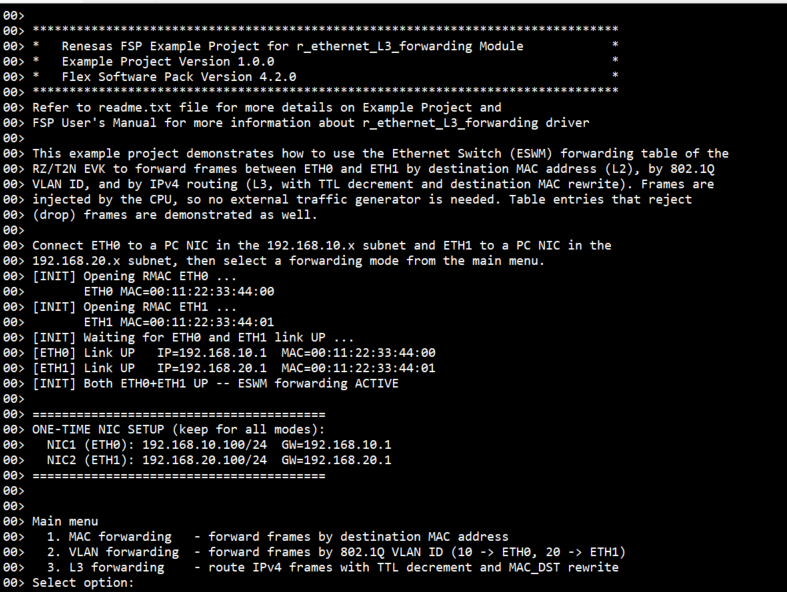

+ Console: MAC Mode Forwarding Output:

   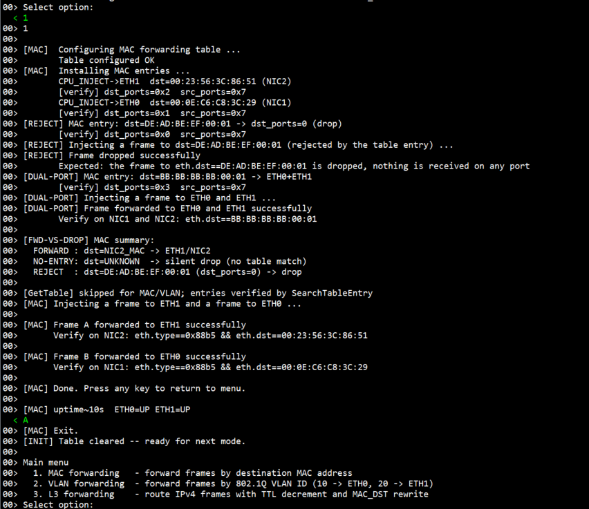

+ Console: VLAN Mode Forwarding Output:

   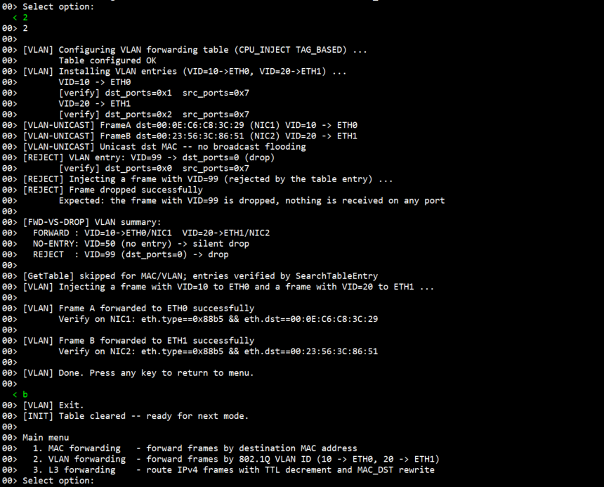

+ Console: L3 Mode Forwarding Output:

   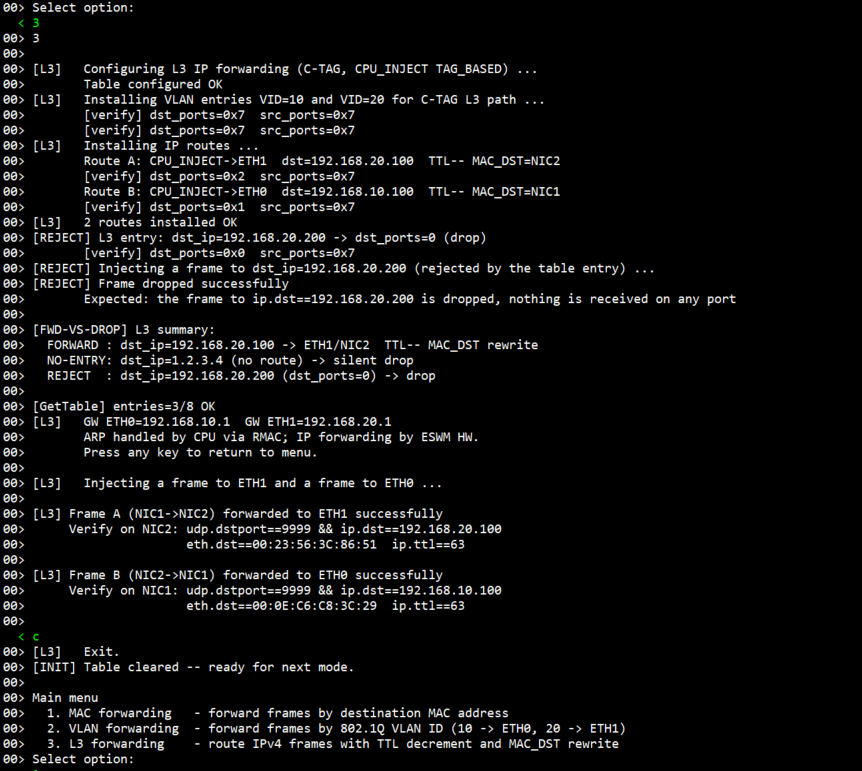

## Project Notes

### System-Level Block Diagram

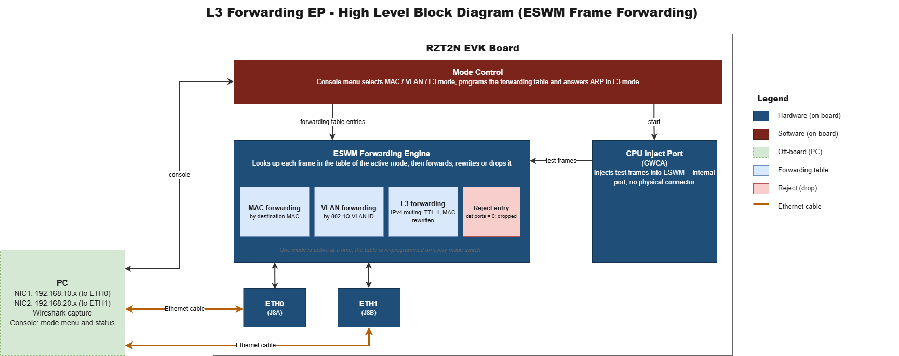

### FSP Modules Used

List of important modules used in this example project. Refer to the FSP User Manual for further details on each module listed below.

<div style="margin-left:2em; max-height:200px; overflow-y:auto; border:1px solid #ccc; border-radius:4px;">

| Module Name | Usage | Searchable Keyword |
|-------------|-------|-------------------|
| Layer3 Switch | Controls ESWM forwarding table (MAC/VLAN/L3 modes), CPU_INJECT GWCA TX, and table entry management | r_layer3_switch |
| RMAC | Opens Ethernet MAC ports (ETH0/ETH1), processes PHY link state, sends/receives ARP frames | r_rmac |
| Ethernet physical layer | Provides PHY setup, auto-negotiation/link detection, and physical Ethernet connectivity for the board connectors. | r_ether_phy |

</div><br>

### Module Configuration Notes

This section describes FSP Configurator properties which are important or different from those selected by default.

Configuration Properties for Layer3 Switch - `g_layer3_switch0` instance 

Path: `configuration.xml > Stacks > g_layer3_switch0 Layer3 Ethernet Switch > Properties`

<div style="margin-left:2em; max-height:300px; overflow-y:auto; border:1px solid #ccc; border-radius:4px;">

| Module Property Path and Identifier | Default Value | Used Value | Reason |
| :----------------------------------: | :-----------: | :--------: | :----: |
| Module g_layer3_switch0 Layer3 Switch > Common > Available Queue Number | 4 | 24 | Each GWCA one-shot inject call occupies one queue slot. The EP injects multiple frames per mode (forward + REJECT + DUAL-PORT verify), requiring at least 24 queue slots to avoid `FSP_ERR_OUT_OF_MEMORY` from `CreateDescriptorQueue` |

</div><br>

Configuration Properties for RMAC - `g_rmac0` instance J8A (ETH0)

Path: `configuration.xml > Stacks > g_rmac0 Ethernet MAC > Properties`

<div style="margin-left:2em; max-height:300px; overflow-y:auto; border:1px solid #ccc; border-radius:4px;">

| Module Property Path and Identifier | Default Value | Used Value | Reason |
| :----------------------------------: | :-----------: | :--------: | :----: |
| Module g_rmac0 RMAC > General > Promiscuous Mode | Disable | Enable | Required for the EP to receive ARP request frames directed to the board gateway IP. Without promiscuous mode, the RMAC hardware filter drops frames whose destination MAC does not match the port MAC address, preventing ARP replies from being generated |
| Module g_rmac0 RMAC > General > MAC Address | 00:11:22:33:44:55 | 00:11:22:33:44:00 | Board MAC address for ETH0 port, used as the L3 route lookup key for incoming frames from NIC1 |
| Module g_rmac0 RMAC > General > Number of Buffer Nodes | 24 | 32 | Increased buffer node pool for the ARP polling loop in L3 mode, where both ETH0 and ETH1 receive concurrent ARP traffic |
| Module g_rmac0 RMAC > General > Number of TX/RX Descriptors | 3 | 4 | Increased queue depth to handle burst ARP traffic without descriptor exhaustion |

</div><br>

Configuration Properties for RMAC - `g_rmac1` instance J8B (ETH1)

Path: `configuration.xml > Stacks > g_rmac1 Ethernet MAC > Properties`

<div style="margin-left:2em; max-height:300px; overflow-y:auto; border:1px solid #ccc; border-radius:4px;">

| Module Property Path and Identifier | Default Value | Used Value | Reason |
| :----------------------------------: | :-----------: | :--------: | :----: |
| Module g_rmac1 RMAC > General > Channel | 0 | **1** | J8B (ETH1) is physically connected to RMAC channel 1. |
| Module g_rmac1 RMAC > General > Promiscuous Mode | Disable | Enable | Same reason as `g_rmac0` - required to receive ARP requests for the board gateway IP on ETH1 |
| Module g_rmac1 RMAC > General > MAC Address | 00:11:22:33:44:55 | 00:11:22:33:44:01 | Board MAC address for ETH1 port, used as the L3 route lookup key for incoming frames from NIC2 |
| Module g_rmac1 RMAC > General > Number of Buffer Nodes | 24 | 32 |Increased buffer node pool for the ARP polling loop in L3 mode, where both ETH0 and ETH1 receive concurrent ARP traffic |
| Module g_rmac1 RMAC > General > Number of TX/RX Descriptors | 3 | 4 | Increased queue depth to handle burst ARP traffic without descriptor exhaustion |

</div><br>

### API Usage
The links below list the FSP-provided APIs used at the application layer.

* [Layer3 Switch Module APIs on FSP User Manual on GitHub](https://renesas.github.io/rz-fsp/group___r_z_t___l_a_y_e_r3___s_w_i_t_c_h.html)
* [RMAC Module APIs on FSP User Manual on GitHub](https://renesas.github.io/rz-fsp/group___r_z_t___r_m_a_c.html)

### Memory Usage
Memory usage varies depending on the target board, compiler, linker script, and enabled components.

**Reference Measurements:**

Measured using **Memory Usage view in e² studio** with the following conditions:
- Target: RZT2N EVK (R9A07G076)
- Core: Cortex-R52 (CR52_0)
- Compiler: GCC ARM
- Build: Debug

<div style="margin-left:2em; max-height:200px; overflow-y:auto; border:1px solid #ccc; border-radius:4px;">

| Item | Approximate Size |
|------|-----------------|
| Program / ROM Usage | ~100 KB |
| RAM Usage (total allocated) | ~50 KB |
| Non-cached SRAM (.noncache_buffer.eth) | ~4 KB (RX buffers + TX descriptors) |

</div><br>

**Notes:**
* RX buffers (`g_rx_buf0`, `g_rx_buf1`, 1536 bytes each) and TX descriptors + TX frame buffer are placed in the `.noncache_buffer.eth` section (non-cached SRAM) required for GWCA DMA operation.
* The exact RAM figure depends on linker script configuration and the non-cached SRAM region allocation.

**Accessing Memory Usage View in e² studio:**
* Navigate to:

        Renesas Views -> C/C++ -> Memory Usage

* Then select the target project in the Project Explorer to display memory details.

### Clock Configuration

If the clock configuration deviates from the default or requires special handling for specific EPs, those details will be documented here to support EP demonstration. However, for the Ethernet L3 forwarding EP, no special clock adjustments are necessary.

### Application Execution Flow
This section describes the sequence of events and API calls during the execution flow of the application. The diagram shows the Ethernet L3 Forwarding operation flow:

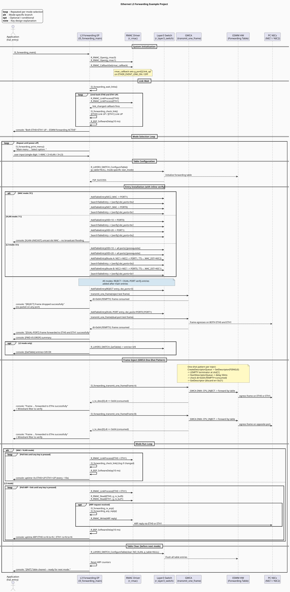

Refer to [`ethernet_L3_forwarding_sequence_diagram.puml`](ethernet_L3_forwarding_sequence_diagram.puml) for the PlantUML source.

### Wireshark Verification Guide

#### What is Wireshark?

[Wireshark](https://www.wireshark.org/) is a free, open-source network packet analyzer. It captures all frames arriving at a selected network adapter and lets you inspect every field - Ethernet header, IP header, UDP payload - in detail. In this EP, Wireshark is used to confirm that the ESWM hardware correctly forwarded frames injected by the CPU to the expected physical port (NIC1 or NIC2).

**Download and install:** https://www.wireshark.org/download.html  
During installation, accept the default option to install **Npcap** (the packet capture driver required on Windows). Without Npcap, Wireshark cannot capture from network adapters.

---

#### Setting Up a Capture

**Step 1 - Identify your NIC1 and NIC2 adapter names in Wireshark**

When Wireshark opens, it shows a list of available network interfaces. The names shown here may differ from Windows "Local Area Connection" names. To identify the correct adapters:

1. Open **Windows Settings -> Network & Internet -> Advanced network settings**.
2. Note the adapter names for NIC1 (192.168.10.100) and NIC2 (192.168.20.100).
3. In Wireshark, hover over each interface - a tooltip shows the IP address, which lets you match it to NIC1 or NIC2.

**Step 2 - Start a capture**

1. Open Wireshark.
2. Double-click each adapter to open a separate capture window per NIC.

**Step 3 - Apply a display filter**

The filter bar is at the top of the Wireshark window (light green when empty, green when valid, red when invalid).

* Type a filter expression and press **Enter** to apply.
* Filters do not drop captured packets - they only hide/show them. You can change the filter at any time without losing the capture.

**Basic filter syntax used in this EP:**

| Syntax | Meaning |
|--------|---------|
| `eth.dst == aa:bb:cc:dd:ee:ff` | Destination MAC address equals |
| `eth.type == 0x88b5` | EtherType field equals 0x88B5 |
| `vlan.id == 10` | 802.1Q VLAN ID equals 10 |
| `ip.dst == 192.168.20.100` | IPv4 destination address |
| `ip.ttl == 63` | IP Time-To-Live field equals 63 |
| `udp.dstport == 9999` | UDP destination port equals 9999 |
| `arp` | Show only ARP frames |
| `A && B` | Both condition A and B must be true |

**Step 4 - Inspect a captured packet**

Double-click any row in the packet list to open the packet detail pane (or use the bottom panel). Expand the protocol layers by clicking the ▶ arrow:

```
▼ Frame 1: 64 bytes on wire
▼ Ethernet II
      Destination: 00:23:56:3c:86:51  ← verify this is NIC2 MAC in L3 mode
      Source: 00:11:22:33:44:01
      Type: 0x88b5 (or 0x8100 for VLAN-tagged)
▼ 802.1Q Virtual LAN  ← only visible if NIC driver does NOT strip the tag
      ID: 10
▼ Internet Protocol Version 4
      Time to Live: 63  ← must be 63 for L3 mode (ESWM decremented from 64)
      Source: 192.168.10.100
      Destination: 192.168.20.100
▼ User Datagram Protocol
      Destination Port: 9999
```

The example below shows a captured L3 mode frame with filter applied and the packet detail expanded:

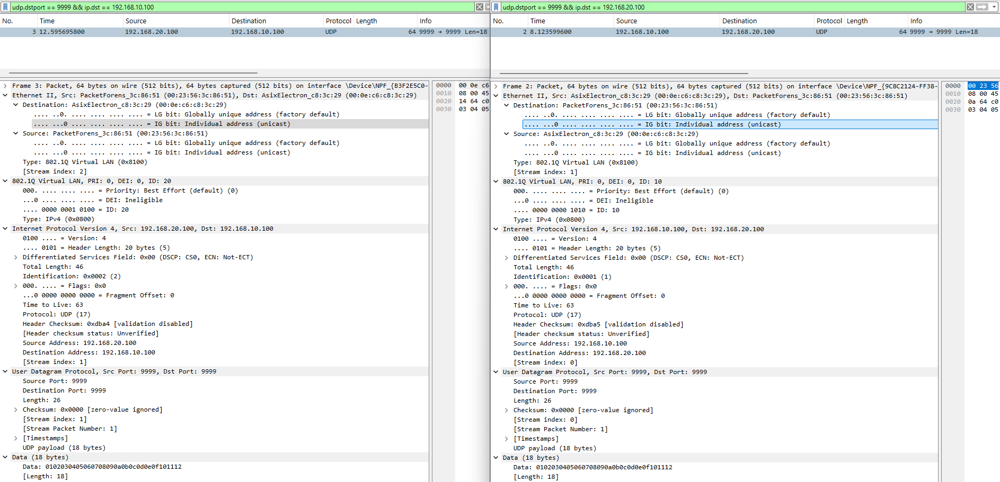

*Side-by-side capture: Route B on NIC1 (left) and Route A on NIC2 (right), both showing `eth.dst` rewritten to the target NIC MAC and `ip.ttl == 63`; the 802.1Q tag (`ID: 10` / `ID: 20`) is also visible on this NIC driver*

**Step 5 - Verify "no packet" cases (REJECT / DROP)**

For REJECT and no-entry (silent drop) tests:
1. Apply the filter for the expected frame (e.g. `eth.dst == de:ad:be:ef:00:01`).
2. Wait 5–10 seconds after the console prints the inject result.
3. The packet count in the status bar should remain **0** - no frames matching the filter were received.
4. Meanwhile, the console shows `[REJECT] Frame dropped successfully` - confirming the GWCA did transmit the frame into the ESWM, but the ESWM dropped it in silicon without forwarding to any physical port.

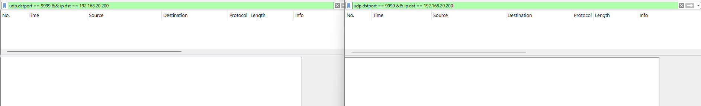

*L3 mode REJECT example: filter `udp.dstport == 9999 && ip.dst == 192.168.20.200` applied on both NIC1 and NIC2 - 0 packets on both, while the console printed `[REJECT] Frame dropped successfully`. The same pattern (0 packets on both NICs, console confirms the drop) applies to the MAC and VLAN REJECT entries.*

---

#### MAC Mode Verification

**Recommended Wireshark setup:** Open two capture windows, one on NIC1 and one on NIC2.

| Test case | Filter to apply | Capture window | Expected |
|-----------|----------------|----------------|----------|
| Frame forwarded to NIC2 | `eth.dst == 00:23:56:3c:86:51 && eth.type == 0x88b5` | NIC2 | **1 packet** appears |
| Same frame NOT seen on NIC1 | `eth.dst == 00:23:56:3c:86:51 && eth.type == 0x88b5` | NIC1 | **0 packets** - ESWM only egresses to the matching port |
| Frame forwarded to NIC1 | `eth.dst == 00:0e:c6:c8:3c:29 && eth.type == 0x88b5` | NIC1 | **1 packet** appears |
| REJECT (dst=DE:AD:BE:EF:00:01) | `eth.dst == de:ad:be:ef:00:01` | NIC1 + NIC2 | **0 packets** on both - silicon drop |
| DUAL-PORT (dst=BB:BB:BB:BB:00:01) | `eth.dst == bb:bb:bb:bb:00:01` | NIC1 + NIC2 | **1 packet each** - same frame on both ports simultaneously |
| Unknown MAC (no table entry) | `eth.type == 0x88b5` (watch for unexpected frames) | NIC1 + NIC2 | **0 packets** - silent drop, no matching table entry |

**Packet detail to check (expand Ethernet II layer):**
- `Destination` = the NIC MAC
- `Type` = `0x88b5` - confirming this is the EP's test frame, not background traffic

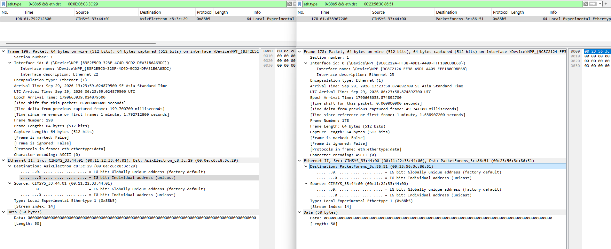

*Side-by-side capture: NIC1 (left, filter for Frame B) and NIC2 (right, filter for Frame A) each show 1 packet received*

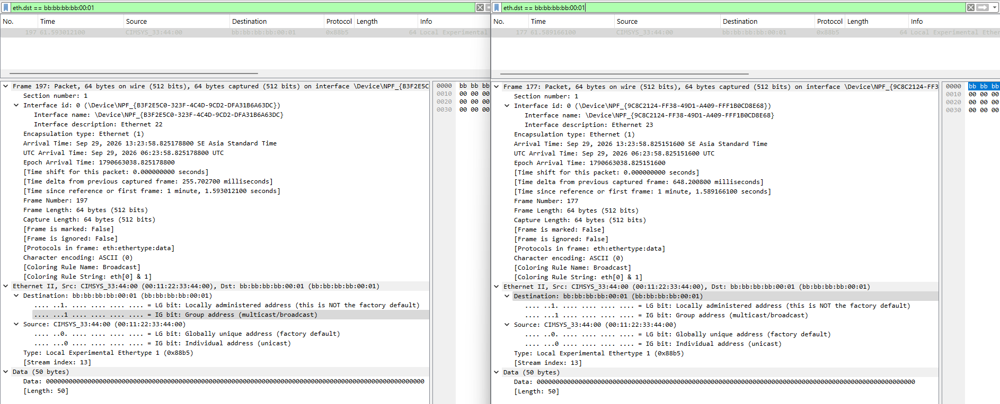

*DUAL-PORT check: filter `eth.dst == bb:bb:bb:bb:00:01` applied on both NIC1 and NIC2 - 1 packet on each, from a single injected frame*

---

#### VLAN Mode Verification

**Recommended Wireshark setup:** Capture on NIC1 and NIC2 simultaneously.

| Test case | Filter to apply | Capture window | Expected |
|-----------|----------------|----------------|----------|
| VID=10 frame -> NIC1 only | `eth.dst == 00:0e:c6:c8:3c:29` | NIC1 | **1 packet** |
| VID=10 frame NOT on NIC2 | `eth.dst == 00:0e:c6:c8:3c:29` | NIC2 | **0 packets** - confirms no broadcast flooding |
| VID=20 frame -> NIC2 only | `eth.dst == 00:23:56:3c:86:51` | NIC2 | **1 packet** |
| REJECT VID=99 | `vlan.id == 99` | NIC1 + NIC2 | **0 packets** |

**Note on 802.1Q tag visibility in Wireshark:**

The injected frames carry a C-TAG (TPID=`0x8100`, VID=10 or 20). Whether Wireshark sees this tag depends on the Windows NIC driver:

- **Tag stripped by driver (most common on Windows):** Wireshark shows an untagged `Ethernet II` frame. The `802.1Q Virtual LAN` layer is absent. The filter `vlan.id == 10` returns no results. In this case, verify by `eth.dst` only - the console confirms unicast forwarding is working correctly.
- **Tag passed through to Wireshark:** A `802.1Q Virtual LAN` sub-layer is visible inside `Ethernet II`. You can confirm `ID: 10` or `ID: 20` in the packet detail.

To check whether your NIC strips tags: capture a VLAN frame and look at the Ethernet II type field - if it shows `0x8100`, the tag is present. If it shows `0x88b5` directly (no VLAN layer), the tag was stripped.

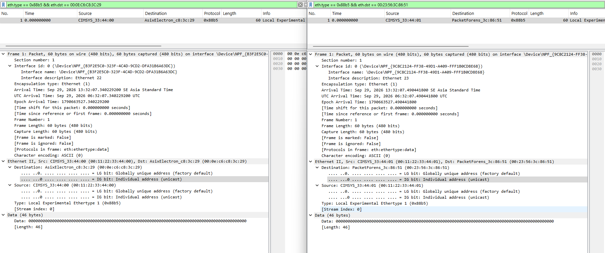

*Side-by-side capture: NIC1 (left, Frame A) and NIC2 (right, Frame B) each show 1 packet; on this NIC driver the 802.1Q tag was not stripped, so `802.1Q Virtual LAN` (`ID: 10` / `ID: 20`) is visible in the packet detail*

**Broadcast flooding check (important VLAN property):**

The VLAN table maps each VID to a specific unicast egress port. To confirm the ESWM is not flooding:
1. Set a capture on **NIC2**.
2. On the console, enter VLAN mode and let the EP inject the VID=10 frame (-> ETH0/NIC1).
3. Apply filter `eth.dst == 00:0e:c6:c8:3c:29` on the NIC2 capture.
4. Result: **0 packets on NIC2** - the VID=10 frame went only to ETH0, not broadcast to ETH1.

---

#### L3 Mode Verification

**Recommended Wireshark setup:** Capture on NIC1 and NIC2.

| Test case | Filter to apply | Capture window | Expected |
|-----------|----------------|----------------|----------|
| Route A (NIC1->NIC2) arrives at NIC2 | `udp.dstport == 9999 && ip.dst == 192.168.20.100` | NIC2 | **1 packet** |
| Route B (NIC2->NIC1) arrives at NIC1 | `udp.dstport == 9999 && ip.dst == 192.168.10.100` | NIC1 | **1 packet** |
| TTL decremented to 63 | `udp.dstport == 9999 && ip.ttl == 63` | NIC1 + NIC2 | Both forwarded packets show TTL=63 |
| MAC_DST rewritten (Route A) | `eth.dst == 00:23:56:3c:86:51` | NIC2 | eth.dst = NIC2 MAC (not board MAC `00:11:22:33:44:01`) |
| MAC_DST rewritten (Route B) | `eth.dst == 00:0e:c6:c8:3c:29` | NIC1 | eth.dst = NIC1 MAC (not board MAC `00:11:22:33:44:00`) |
| REJECT (dst_ip=192.168.20.200) | `udp.dstport == 9999 && ip.dst == 192.168.20.200` | NIC1 + NIC2 | **0 packets** |
| ARP (board replies during run loop) | `arp` | NIC1 or NIC2 | ARP request from NIC, ARP reply from board (src = board MAC) visible |

**Packet detail walkthrough for L3 frame (expand all layers):**

```
▼ Ethernet II
      Destination: 00:23:56:3c:86:51  ← NIC2 MAC  [rewritten by ESWM from board ETH1 MAC]
      Source:      00:11:22:33:44:01  ← board ETH1 MAC
      Type: 0x8100 (802.1Q)           ← C-TAG present (may be stripped by driver)
▼ 802.1Q Virtual LAN  (if not stripped)
      ID: 10
      Type: 0x0800 (IPv4)
▼ Internet Protocol Version 4
      Source:      192.168.10.100
      Destination: 192.168.20.100
      Time to Live: 63               ← injected as 64; ESWM decremented
      Protocol: UDP (17)
      Header checksum: valid         ← ESWM recomputed after TTL change
▼ User Datagram Protocol
      Source Port: 9999
      Destination Port: 9999
▼ Data (18 bytes)
      Payload: 01 02 03 04 05 ... 12 ← sequential pattern from EP
```

**Key things to confirm:**
1. `eth.dst` = NIC MAC address (not the board gateway MAC) - this proves ESWM rewrote the destination MAC.
2. `ip.ttl` = **63** - proves ESWM performed the TTL decrement (hardware routing, not CPU).
3. The packet arrives on the **correct NIC** - Route A on NIC2, Route B on NIC1.
4. For REJECT: the console shows `[REJECT] Frame dropped successfully` but Wireshark shows **0 packets** - proves silicon-level drop without any physical egress.

### Troubleshooting Tips

| Symptom | Likely Cause | Fix |
|---------|-------------|-----|
| `FSP_ERR_WRITE_FAILED` from `ConfigureTable` | `p_table` is non-NULL | Ensure `tbl_cfg.p_table = NULL` always |
| Console prints `Frame ... was NOT injected: the TX descriptor was not consumed by hardware` | `AVAILABLE_QUEUE_NUM` too low | Set to ≥ 24 in Layer3 Switch FSP config |
| ETH1 link never comes up | `g_rmac1` channel set to 0 instead of 1 | Change `g_rmac1` channel to 1 in FSP Configurator |
| L3 frames not forwarded | VLAN entries not installed before L3 routes | `l3_forwarding_install_entries()` always installs VID=10/20 first |
| GetDescriptor returns err 0x21 | Normal for one-shot GWCA pattern | This is expected; result is intentionally discarded |
| No packets on Wireshark | NIC1/NIC2 MAC not set in `g_l3_forwarding_pc1_mac[]` / `g_l3_forwarding_pc2_mac[]` | Edit `L3forwarding.c` lines 17–18 with correct MAC addresses from `ipconfig /all` |

### Known Limitations

* This EP uses a software inject (CPU_INJECT via GWCA) to generate test frames. Real-world traffic from external hosts is not required for basic demonstration.
* The GWCA one-shot pattern creates a fresh descriptor queue per inject call. Long-running inject sequences must account for queue index monotonic growth.
* L3 mode stream filter uses all 8 fields (full-key match). Partial-key matching is not demonstrated in this EP.

## Special Topics

### Customizing the forwarding scenarios

The demo scenarios are defined by constants in the source code. Change them, rebuild and rerun to see how the ESWM forwarding table behaves with different entries:

| What to change | Where | Effect |
|----------------|-------|--------|
| `destination_ports` of a MAC or VLAN entry (`LAYER3_SWITCH_PORT_BITMASK_PORT0` / `PORT1`) | `l3_forwarding_install_entries()` in `L3forwarding.c` | The frame egresses on the other physical port. Capture on the matching NIC. |
| VLAN IDs `L3_FORWARDING_VLAN_ID_ETH0` / `L3_FORWARDING_VLAN_ID_ETH1` | `L3forwarding.h` | The VLAN entries and the injected C-TAG frames use the new VIDs. Update the `vlan.id` Wireshark filter accordingly. |
| Reject targets `s_reject_mac`, `L3_FORWARDING_REJECT_VID`, `s_reject_ip` | `L3forwarding.c` | Selects which frames are dropped by the `dst_ports=0` entry. |
| Destination ports of the dual-port entry (`s_dual_port_mac`) | `l3_forwarding_install_dual_port_entry()` in `L3forwarding.c` | Removing one port bit makes the frame egress on a single port only. |

### Changing the board MAC addresses in the FSP Configurator

The board MAC address of each physical Ethernet port is set in the RMAC properties: `g_rmac0` for **ETH0 (J8A)**, `g_rmac1` for **ETH1 (J8B)** (both under `General > MAC Address`) — this board has other Ethernet-capable peripherals, so the RMAC instance name alone does not say which physical connector it drives. In L3 mode, the EP uses the board MAC address as the destination MAC key of the L3 route entries, defined by `L3_FORWARDING_ETH0_MAC` and `L3_FORWARDING_ETH1_MAC` in `L3forwarding.c`. If the MAC address is changed in the FSP Configurator, update these two constants to the same value. Otherwise, traffic sent from a real PC to the gateway address would not match the L3 route entries.

### Verify Features

Four verification scenarios run automatically at the end of each mode:

| Feature | Mechanism | Expected Result |
|---------|-----------|----------------|
| **REJECT** | Install `dst_ports=0` entry; inject matching frame | Console prints `Frame dropped successfully`; NO packet on any Wireshark capture |
| **DUAL-PORT** | Install `dst_ports=PORT0\|PORT1`; inject matching frame | Console prints `Frame forwarded to ETH0 and ETH1 successfully`; same frame visible on **both** NIC1 and NIC2 Wireshark |
| **VLAN-UNICAST** | Console log only: unicast MAC dst in VLAN mode | Confirms no broadcast flooding - frame goes to specific NIC only |
| **FWD-VS-DROP** | Summary log: FORWARD / NO-ENTRY / REJECT comparison | Console prints behavior comparison for the current mode |

## Conclusion and Next Steps
* To further explore ESWM L3 forwarding implementation:
    * Refer to the FSP User Manual for the `r_layer3_switch` and `r_rmac` drivers for deeper technical insights.
    * Visit renesas.com for additional ESWM resources, application notes, and documentation related to RZT2N devices.

## References
The following documents provide general reference and background information.

* [FSP User Manual on GitHub](https://renesas.github.io/rz-fsp)
* [Example Project Usage Guide](https://github.com/renesas/rz-fsp-examples/blob/main/example_projects/Example%20Project%20Usage%20Guide.pdf)

## Notice

1. Descriptions of circuits, software and other related
information in this document are provided only to illustrate the
operation of semiconductor products and application examples. You are
fully responsible for the incorporation or any other use of the
circuits, software, and information in the design of your product or
system. Renesas Electronics disclaims any and all liability for any
losses and damages incurred by you or third parties arising from the use
of these circuits, software, or information. 

2. Renesas Electronics
hereby expressly disclaims any warranties against and liability for
infringement or any other claims involving patents, copyrights, or other
intellectual property rights of third parties, by or arising from the
use of Renesas Electronics products or technical information described
in this document, including but not limited to, the product data,
drawings, charts, programs, algorithms, and application examples. 

3. No license, express, implied or otherwise, is granted hereby under any
patents, copyrights or other intellectual property rights of Renesas
Electronics or others. 

4. You shall be responsible for determining what
licenses are required from any third parties, and obtaining such
licenses for the lawful import, export, manufacture, sales, utilization,
distribution or other disposal of any products incorporating Renesas
Electronics products, if required. 

5. You shall not alter, modify, copy,
or reverse engineer any Renesas Electronics product, whether in whole or
in part. Renesas Electronics disclaims any and all liability for any
losses or damages incurred by you or third parties arising from such
alteration, modification, copying or reverse engineering. 

6. Renesas Electronics products are classified according to the following two
quality grades: "Standard" and "High Quality". The intended applications
for each Renesas Electronics product depends on the product's quality
grade, as indicated below. "Standard": Computers; office equipment;
communications equipment; test and measurement equipment; audio and
visual equipment; home electronic appliances; machine tools; personal
electronic equipment; industrial robots; etc. "High Quality":
Transportation equipment (automobiles, trains, ships, etc.); traffic
control (traffic lights); large-scale communication equipment; key
financial terminal systems; safety control equipment; etc. Unless
expressly designated as a high reliability product or a product for
harsh environments in a Renesas Electronics data sheet or other Renesas
Electronics document, Renesas Electronics products are not intended or
authorized for use in products or systems that may pose a direct threat
to human life or bodily injury (artificial life support devices or
systems; surgical implantations; etc.), or may cause serious property
damage (space system; undersea repeaters; nuclear power control systems;
aircraft control systems; key plant systems; military equipment; etc.).
Renesas Electronics disclaims any and all liability for any damages or
losses incurred by you or any third parties arising from the use of any
Renesas Electronics product that is inconsistent with any Renesas
Electronics data sheet, user's manual or other Renesas Electronics
document. 

7. No semiconductor product is absolutely secure. Notwithstanding any security measures or features that may be implemented in Renesas Electronics hardware or software products, Renesas Electronics shall have absolutely no liability arising out of
any vulnerability or security breach, including but not limited to any unauthorized access to or use of a Renesas Electronics product or a system that uses a Renesas Electronics product. RENESAS ELECTRONICS DOES NOT WARRANT OR GUARANTEE THAT RENESAS ELECTRONICS PRODUCTS, OR ANY
SYSTEMS CREATED USING RENESAS ELECTRONICS PRODUCTS WILL BE INVULNERABLE OR FREE FROM CORRUPTION, ATTACK, VIRUSES, INTERFERENCE, HACKING, DATA LOSS OR THEFT, OR OTHER SECURITY INTRUSION ("Vulnerability Issues"). RENESAS ELECTRONICS DISCLAIMS ANY AND ALL RESPONSIBILITY OR LIABILITY
ARISING FROM OR RELATED TO ANY VULNERABILITY ISSUES. FURTHERMORE, TO THE EXTENT PERMITTED BY APPLICABLE LAW, RENESAS ELECTRONICS DISCLAIMS ANY AND ALL WARRANTIES, EXPRESS OR IMPLIED, WITH RESPECT TO THIS DOCUMENT
AND ANY RELATED OR ACCOMPANYING SOFTWARE OR HARDWARE, INCLUDING BUT NOT LIMITED TO THE IMPLIED WARRANTIES OF MERCHANTABILITY, OR FITNESS FOR A PARTICULAR PURPOSE. 

8. When using Renesas Electronics products, refer to the latest product information (data sheets, user's manuals, application notes, "General Notes for Handling and Using Semiconductor Devices" in
the reliability handbook, etc.), and ensure that usage conditions are within the ranges specified by Renesas Electronics with respect to
maximum ratings, operating power supply voltage range, heat dissipation characteristics, installation, etc. Renesas Electronics disclaims any
and all liability for any malfunctions, failure or accident arising out of the use of Renesas Electronics products outside of such specified
ranges. 

9. Although Renesas Electronics endeavors to improve the quality and reliability of Renesas Electronics products, semiconductor products
have specific characteristics, such as the occurrence of failure at a certain rate and malfunctions under certain use conditions. Unless
designated as a high reliability product or a product for harsh environments in a Renesas Electronics data sheet or other Renesas
Electronics document, Renesas Electronics products are not subject to radiation resistance design. You are responsible for implementing safety
measures to guard against the possibility of bodily injury, injury or damage caused by fire, and/or danger to the public in the event of a
failure or malfunction of Renesas Electronics products, such as safety design for hardware and software, including but not limited to
redundancy, fire control and malfunction prevention, appropriate treatment for aging degradation or any other appropriate measures.
Because the evaluation of microcomputer software alone is very difficult and impractical, you are responsible for evaluating the safety of the
final products or systems manufactured by you. 

10. Please contact a
Renesas Electronics sales office for details as to environmental matters such as the environmental compatibility of each Renesas Electronics
product. You are responsible for carefully and sufficiently investigating applicable laws and regulations that regulate the
inclusion or use of controlled substances, including without limitation, the EU RoHS Directive, and using Renesas Electronics products in
compliance with all these applicable laws and regulations. Renesas Electronics disclaims any and all liability for damages or losses
occurring as a result of your noncompliance with applicable laws and regulations. 

11. Renesas Electronics products and technologies shall not be used for or incorporated into any products or systems whose
manufacture, use, or sale is prohibited under any applicable domestic or foreign laws or regulations. You shall comply with any applicable export
control laws and regulations promulgated and administered by the governments of any countries asserting jurisdiction over the parties or
transactions. 

12. It is the responsibility of the buyer or distributor of Renesas Electronics products, or any other party who distributes,
disposes of, or otherwise sells or transfers the product to a third party, to notify such third party in advance of the contents and
conditions set forth in this document. 

13. This document shall not be
reprinted, reproduced or duplicated in any form, in whole or in part, without prior written consent of Renesas Electronics. 

14. Please contact a Renesas Electronics sales office if you have any questions regarding the information contained in this document or Renesas Electronics
products. (Note1) "Renesas Electronics" as used in this document means Renesas Electronics Corporation and also includes its directly or
indirectly controlled subsidiaries. (Note2) "Renesas Electronics product(s)" means any product developed or manufactured by or for
Renesas Electronics.

                                                                                   (Rev.5.0-1 October 2020)
## Corporate Headquarters 

Contact information TOYOSU FORESIA, 3-2-24

Toyosu, Koto-ku, Tokyo 135-0061, Japan 

www.renesas.com 

## Contact information 

For further information on a product, technology, the most up-to-date version of a
document, or your nearest sales office, please visit:
www.renesas.com/contact/. 

## Trademarks 
Renesas and the Renesas logo are trademarks of Renesas Electronics Corporation. All trademarks and
registered trademarks are the property of their respective owners.

							© 2026 Renesas Electronics Corporation. All rights reserved
