# Ethernet CBS Example Project on RZ Boards

## Table of Contents
1. [Introduction](#introduction)
    1. [Supported Boards](#supported-boards)
2. [Required Resources](#required-resources)
    1. [Hardware Requirements](#hardware-requirements)
    2. [Software Requirements](#software-requirements)
    3. [Traffic Generator Requirements](#traffic-generator-requirements)
3. [Application Execution](#application-execution)
4. [Project Notes](#project-notes)
    1. [System-Level Block Diagram](#system-level-block-diagram)
    2. [FSP Modules Used](#fsp-modules-used)
    3. [Module Configuration Notes](#module-configuration-notes)
    4. [API Usage](#api-usage)
    5. [Memory Usage](#memory-usage)
    6. [Clock Configuration](#clock-configuration)
    7. [Application Execution Flow](#application-execution-flow)
    8. [Wireshark Verification Guide](#wireshark-verification-guide)
    9. [Troubleshooting Tips](#troubleshooting-tips)
    10. [Known Limitations](#known-limitations)
5. [Special Topics](#special-topics)
6. [Conclusion and Next Steps](#conclusion-and-next-steps)
7. [References](#references)
8. [Notice](#notice)

## Introduction

The CBS (IEEE 802.1Qav Credit-Based Shaper) example project demonstrates hardware bandwidth
capping on the Renesas RZ/T2N EVK using the ESWM (Ethernet Switch Module) via the
`r_layer3_switch` FSP driver. Once a queue's MAC-table entry and bandwidth percentage are
programmed, the credit accounting that enforces the cap runs entirely in silicon - the CPU has
no role in any per-frame shaping decision.

A queue's cap is a percentage of the port's **physical link speed**, not of whatever traffic
happens to be offered. The shaped egress port (ETH0) always links at 1000 Mbps (RGMII, fixed by
the board wiring), so the two shaped queues are capped at:

| Queue | Destination MAC | Bandwidth setting | Cap on a 1000 Mbps link |
|---|---|---|---|
| Q0 | `44:44:44:00:00:0A` | 10 % | **100 Mbps** |
| Q1 | `44:44:44:00:00:0B` | 30 % | **300 Mbps** |

Frames are steered to a queue purely by destination MAC and are always shaped on egress out
Port 0 (ETH0/J8A).

This EP supports **six runtime-selectable modes**, chosen from a console menu. There are two
traffic sources, and each has the same three options (CBS disabled as a baseline, then each queue enabled and tested on its own):

| Mode | Traffic source | CBS | What it proves | Needs a PC-side generator? |
|---|---|---|---|---|
| `[1]` | Port-to-port (external, into ETH1/J8B) | Disabled | Baseline: traffic passes unshaped | Yes |
| `[2]` | Port-to-port | Enabled, **Q0 only** | Q0 is limited to ~100 Mbps | Yes (`--queue 0`) |
| `[3]` | Port-to-port | Enabled, **Q1 only** | Q1 is limited to ~300 Mbps | Yes (`--queue 1`) |
| `[4]` | CPU-generated (board injects the frames itself via GWCA) | Disabled | Baseline: the CPU-inject path offers well over 300 Mbps | No |
| `[5]` | CPU-generated | Enabled, **Q0 only** | Q0 is limited to ~100 Mbps | No |
| `[6]` | CPU-generated | Enabled, **Q1 only** | Q1 is limited to ~300 Mbps | No |

Each enabled mode is deliberately **single-queue** ("isolated"): the other queue's MAC is left
out of the MAC table, so only one queue is classified and shaped at a time. See
[Known Limitations](#known-limitations) for why running both queues together is not offered.

Please refer to the [Example Project Usage Guide](https://github.com/renesas/rz-fsp-examples/blob/main/example_projects/Example%20Project%20Usage%20Guide.pdf)
for general information on example projects.

### Supported Boards

| # | Board | MPU | J-Link OB VCOM | SEGGER_RTT Address | Board-Specific Guide |
|---|---|---|---|---|---|
| 1 | RZT2N EVK | R9A07G076M48GBG | ☑ | 0x10181f30 | [RZT2N EVK Guide](ethernet_cbs_board_specific_notes.md#rzt2n-evk--board-specific-guide) |

**Note:** Boards marked with ☑ under **J-Link OB VCOM** support the J-Link On-Board Virtual COM
Port. Console output and menu input use **SEGGER RTT** on the Cortex-R52 core (the RTT control
block is at the address listed in the table above, the same for the e² studio and IAR builds) and a
**Tera Term** serial console (SCI0, 115200 bps) on the Cortex-A55 core.

## Required Resources

### Hardware Requirements

#### Common Hardware
* RZ supported boards: RZ/T2N-EVK.
* 1 x Renesas RZ board.
* 1 x USB Type-C cable.
* 1 x USB Type-A to micro USB cable (2 x for Cortex-A55: one for debugging, one for the serial console).
* 2 x Ethernet cables.
* 1 x PC with an Ethernet NIC connected to J8A (ETH0) for Wireshark capture.
* *(Modes `[1]`-`[3]` only)* 1 x host (Linux PC or Raspberry Pi) with a Gigabit Ethernet NIC
  connected to J8B (ETH1), to run the traffic generator script - see
  [Traffic Generator Requirements](#traffic-generator-requirements).

#### Additional Hardware
* Detailed **Additional Hardware** for each supported board is described in the
  [Board-Specific Guide](ethernet_cbs_board_specific_notes.md#rzt2n-evk--board-specific-guide).

#### Hardware Connections
* Detailed **Specific Connections** for each supported board are described in the
  [Board-Specific Guide](ethernet_cbs_board_specific_notes.md#rzt2n-evk--board-specific-guide).
* Common Connections:
    * Connect the POWER(15V/3A) port on the evaluation board to a power source using a USB Type-C
      cable for board power supply.
    * Slide SW1 "POWER_SW" from OFF to ON to turn on the power supply for the evaluation board.
    * Connect the J32 port on the evaluation board to the PC using a USB Micro-B cable for
      debugging (and the RTT console on Cortex-R52).
    * *(Cortex-A55 only)* Connect the J33 port on the evaluation board to the PC using a USB
      Micro-B cable for the serial console.
    * Connect J8A (ETH0) on the RZT2N EVK to the capture PC's NIC (Wireshark).
    * Connect J8B (ETH1) on the RZT2N EVK **directly** to the NIC of the traffic host (modes
      `[1]`-`[3]` only) - no switch or router in between.

### Software Requirements
* Renesas Flexible Software Package (FSP): Version 4.2.0
* e2 studio: Version 2026-07
* FSP Smart Configurator: Version 2026-07
* IAR: Version 9.60.3
* GCC ARM Embedded Toolchain: Version 13.3.1.arm-13-24 for cortexR-52
* GCC ARM A-Profile (AArch64 bare-metal): Version 13.2 rel1 for cortexA-55
* J-Link: Version 9.44
* SEGGER J-Link RTT Viewer: Version 9.44 (console output and mode-menu input, for cortexR-52)
* Terminal Console Application: Tera Term or a similar application (for cortexA-55)
* Wireshark with Npcap: verifies the shaped bandwidth on ETH0. Download from
  https://www.wireshark.org/download.html - install with Npcap (included in installer). See
  [Wireshark Verification Guide](#wireshark-verification-guide) for setup details.
* Traffic generator script (modes `[1]`-`[3]` only), one of:
    * `cbs_send_test_frames_linux.py` - Linux host, Python 3 standard library only, run
      with `sudo` (**recommended** - this is the one that can offer enough load).
    * `cbs_send_test_frames.py` - Windows, `pip install scapy` plus Npcap, run as Administrator.

**Note:** Refer to the [FSP version requirements](https://github.com/renesas/rz-fsp-examples/blob/main/example_projects/version_info_table.md)
table per IDE to correctly download the needed [FSP release](https://github.com/renesas/rz-fsp/releases).

### Traffic Generator Requirements

The port-to-port modes only prove a cap if the traffic source delivers **well above** that cap.
Use a source that steadily delivers **more than 400-500 Mbps** to ETH1 - a source that cannot
exceed 300 Mbps says nothing about Q1's 300 Mbps limit, whether CBS works or not. Both scripts
print their own **offered-load statistics** at the end of a flood run, with an `OK` / `WARNING`
verdict against each queue's cap; read that line first, and treat a `WARNING` run as
inconclusive. That figure is measured at the sender, before the wire, so it is an upper bound:
the rate actually delivered to the board can be lower (see the note under
[Mode `[1]` verification](#mode-1-port-to-port-cbs-disabled-verification)).

| Script | Typical offered load | Enough for |
|---|---|---|
| `cbs_send_test_frames.py` (Windows, Scapy + Npcap) | ~200-270 Mbps | Q0's 100 Mbps cap only |
| `cbs_send_test_frames_linux.py` (Linux, raw `AF_PACKET` socket) on a Gigabit NIC | up to ~860 Mbps offered | Both caps, with a wide margin |

Practical points, all learned the hard way on this EP:

* Connect the traffic source **directly** to ETH1. The test frames use synthetic destination MACs
  that no real switch has ever learned; a managed switch's unknown-unicast blocking silently
  drops every frame, while the source still reports full speed.
* If a USB Ethernet adapter is used (a Raspberry Pi with a USB3 Gigabit adapter was used for
  validation), plug it into a **USB 3.0** port. A USB 2.0 port caps the offered load at ~290 Mbps
  regardless of the adapter's Gigabit link, which is almost exactly Q1's cap and easy to mistake
  for CBS shaping.
* Confirm the script's `--iface` is really the NIC cabled to ETH1 before trusting a result
  (`--list` on Windows, `ip link show` on Linux - the interface showing `state UP` once the
  cable is plugged in).
* Flood **one queue at a time** (`--queue 0` or `--queue 1`). `--queue both` splits the sender's
  throughput between the two MACs, so each MAC's offered load drops to about half, and its result
  depends on what ran just before it.

#### Checking the traffic source before testing

Do these three checks once, before using a source for modes `[1]`-`[3]`. Checks 1 and 2 are run in
a terminal on the traffic host (the Linux host cabled to ETH1; replace `eth1` with its interface
name). Check 3 is made in Wireshark on the capture PC cabled to ETH0.

1. On the traffic host, the NIC link to ETH1 is Gigabit (must read `Speed: 1000Mb/s`; on a USB adapter also
   check it sits on a USB 3.0 port):

   ```bash
   ethtool eth1 | grep -i speed
   ```

2. On the traffic host, the host really hands the frames to the NIC. Read the NIC's TX counters, run
   one flood, read them again - `tx_packets` must grow by the script's `Packets sent`, and `tx_dropped` / `tx_errors`
   must not grow:

   ```bash
   for i in /sys/class/net/*; do echo "$(basename $i) $(cat $i/operstate) tx_packets=$(cat $i/statistics/tx_packets) tx_dropped=$(cat $i/statistics/tx_dropped) tx_errors=$(cat $i/statistics/tx_errors)"; done
   ```

3. On the capture PC, the rate that actually arrives is high enough - this is the check that
   matters. With the board in mode `[1]` (CBS disabled), flood one queue from the traffic host and
   read ETH0 in the Wireshark I/O Graph: it must sit
   **above ~400-500 Mbps**, otherwise the source is not suitable for proving the 300 Mbps cap.

## Application Execution

1. Import the Ethernet CBS example project into e² studio / IAR.
2. Open the FSP Configuration editor / FSP Smart Configurator and generate the project content.
3. Configure the hardware according to `ethernet_cbs_board_specific_notes.md`, and make sure the
   hardware connections are done.
4. Setup the terminal console to display.
   1. If using RTT Viewer (Cortex-R52): open **SEGGER J-Link RTT Viewer** on the host PC for the
      active J-Link connection (target `R9A07G076`). Under [RTT Control Block] select **Address**
      and enter the SEGGER_RTT address from the [Supported Boards](#supported-boards) table
      (`0x10181f30`).
   2. If using Tera Term (Cortex-A55): confirm the Renesas RZ board is recognized by the host PC as
      a COM port pair (e.g: COM5/COM6). Select the COM port with the higher number in the pair as
      the serial console port. If no output appears in the terminal while the program is running,
      reconnect using the other COM port in the pair.
      1. Set the configuration of Terminal Emulator (Tera Term) as follows:
          Speed: 115200 bps
          Data: 8 bit
          Parity: none
          Stop bits: 1 bit
          Flow control: none
          * Set the terminal software reception line feed code to [AUTO].
          * Keep [Local echo] disabled (default): the EP prints the entered option itself, so
            enabling it can show characters twice.
5. Download the Ethernet CBS EP to the Renesas RZ MPU evaluation kit.
   e² studio:
   * In [Project Explorer] view, right click the node of the project to be debugged and select
     [Debug As]->[Debug Configurations...] menu.
   * Select "ethernet_cbs_rzt2n_evk_{cortex}_ep Debug_Flat" in the Renesas GDB Hardware Debugging
     node and select [Debugger]->[Connection Settings].
   * Press [Debug] button.
   * When "Proceed with launch" window is displayed, select [Yes].
   * When "Confirm Perspective Switch" window is displayed, select [Switch].
   * Press the "Resume" button. The program will break at "hal_entry();" in main.

   IAR:
   * Click on the [Download and debug] button in the "Project" toolbar.
     The program will break at the first code in "main".
   * Press the [Go] button again to execute the program.
6. Start a Wireshark capture on the NIC connected to **ETH0 (J8A)** - this is where shaped
   traffic egresses in every mode.
7. Reset the board. The banner and a link-up line (`ETH0 link: UP   ETH1 link: UP`) are printed,
   followed by the mode menu.
8. Type `1`-`6` and press Enter to select the first mode - this is the only blocking prompt; from
   then on, type a different mode number at any time to switch, no stop step needed.
9. Run the mode's test, as listed below.

| Mode | Generator command (Linux host shown) | Wireshark display filter | Expected result |
|---|---|---|---|
| `[1]` | `sudo python3 cbs_send_test_frames_linux.py --iface eth0 --mode once`, then `--mode flood --queue 0` and `--mode flood --queue 1` (separate runs) | `eth.dst == 44:44:44:00:00:0a` / `eth.dst == 44:44:44:00:00:0b` | Unshaped: throughput follows the offered load |
| `[2]` | `sudo python3 cbs_send_test_frames_linux.py --iface eth0 --mode flood --queue 0` | `eth.dst == 44:44:44:00:00:0a` | Stays at **~100 Mbps** |
| `[3]` | `sudo python3 cbs_send_test_frames_linux.py --iface eth0 --mode flood --queue 1` | `eth.dst == 44:44:44:00:00:0b` | Stays at **~300 Mbps** |
| `[4]` | none - the board generates the traffic | `eth.dst == 44:44:44:00:00:0b` | Unshaped, **~750-1000 Mbps**, well above 300 |
| `[5]` | none | `eth.dst == 44:44:44:00:00:0a` | Stays at **~100 Mbps** |
| `[6]` | none | `eth.dst == 44:44:44:00:00:0b` | Stays at **~300 Mbps** |

Mode `[4]` transmits to Q1's MAC only (one MAC is enough to show headroom above both caps), which is why its filter is Q1's.

Modes `[1]`-`[3]`: run `--mode once` first (one frame per MAC) and confirm at least one packet
per MAC reaches ETH0 in Wireshark before flooding. `--iface eth0` is the Linux host's
interface cabled to ETH1 - substitute the real name. On Windows use
`python cbs_send_test_frames.py --iface "<ETH1 NIC name>" ...` with the same `--mode` / `--queue`
options.

Suggested order: `1 → 2 → 3` then `4 → 5 → 6` - each source's baseline first, so the shaped
result can be compared against the unshaped one in the same session. Modes can be run in any
order and any number of times without a reset.

### Execution Output

**Note:** Execution results may vary slightly run to run (exact link-up timing, exact Mbps
readings at any given second). The examples below show the execution output on the RZT2N EVK
board, Cortex-R52 core. The Cortex-A55 build prints the same lines on the Tera Term console. Every
mode is shown as a pair: the console block printed when the mode starts, and the Wireshark I/O
Graph (Y axis = Bits, interval 1 sec) captured on ETH0.

+ Startup Banner, Link-Up, and Menu:

  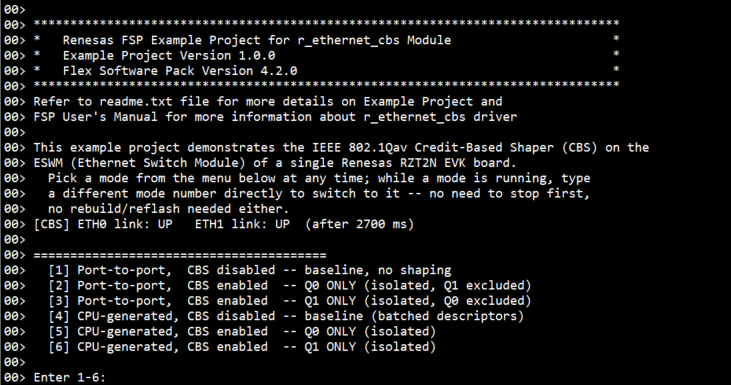

+ Mode `[1]` Port-to-port, CBS disabled (generator: `--mode flood --queue 0` / `--queue 1` / `--queue both`):

  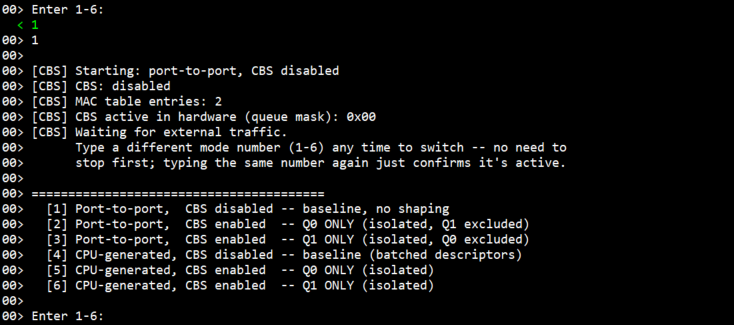
  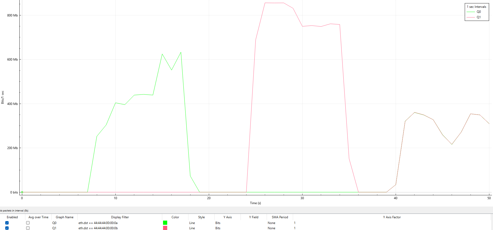

  Both single-queue floods run well above 300 Mbps; flooding both together right after lands
  lower per MAC, with a caveat on its repeatability, under
  [Mode `[1]` verification](#mode-1-port-to-port-cbs-disabled-verification).

+ Traffic-source terminal (SSH session on the Linux host running `cbs_send_test_frames_linux.py`):

  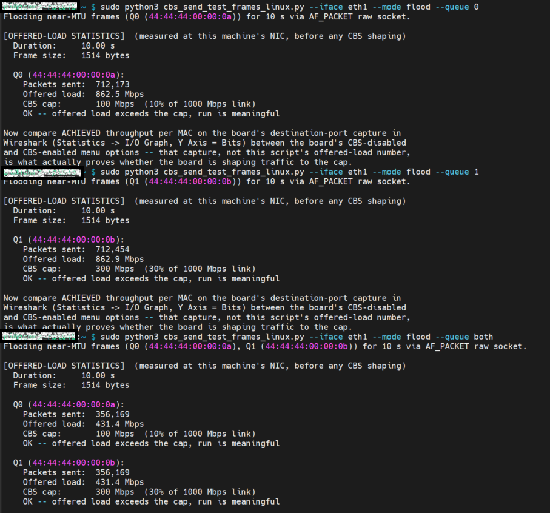

  Each run prints `[OFFERED-LOAD STATISTICS]`: the duration, frame size, **packets sent**, the
  **offered load** in Mbps, the **CBS cap** of that queue and an `OK` / `WARNING` verdict. Here
  `--queue 0` and `--queue 1` each offer ~862 Mbps (`OK` against the 100 / 300 Mbps caps), while
  `--queue both` splits it to ~432 Mbps per MAC. The offered load is measured at the sender; the
  rate actually delivered is read on ETH0 in Wireshark.

+ Mode `[2]` Port-to-port, CBS enabled, Q0 only (generator: `--queue 0`) - limited to ~100 Mbps:

  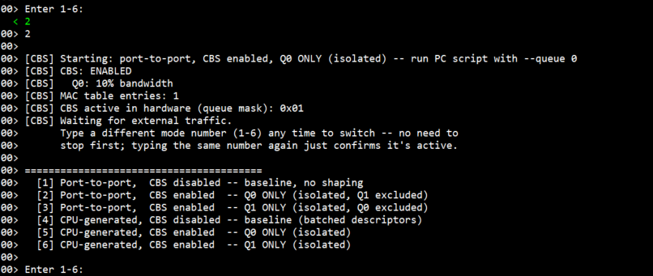
  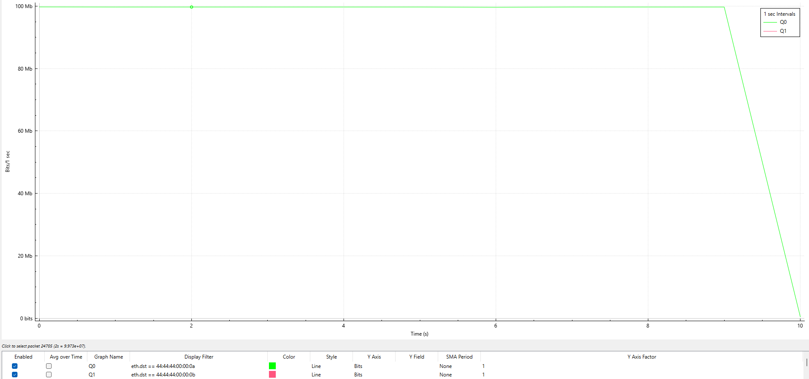

+ Mode `[3]` Port-to-port, CBS enabled, Q1 only (generator: `--queue 1`) - limited to ~300 Mbps:

  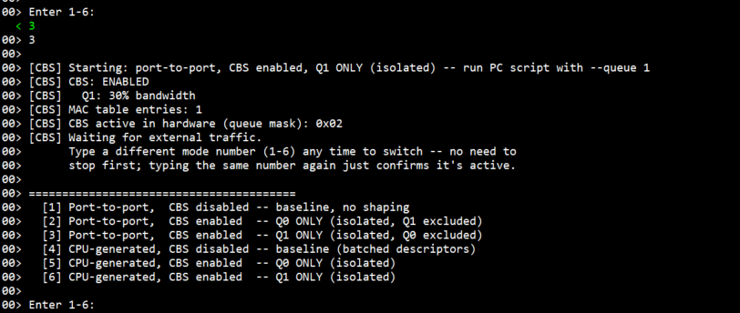
  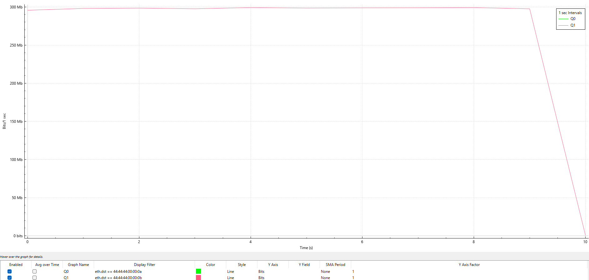

+ Mode `[4]` CPU-generated, CBS disabled - unshaped, ~750-1000 Mbps:

  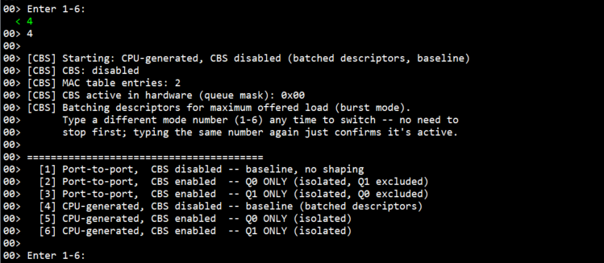
  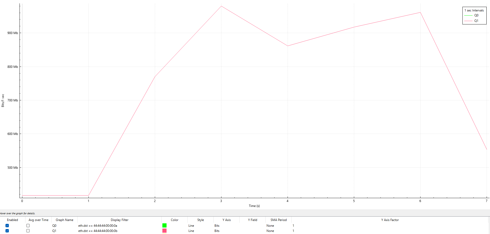

+ Mode `[5]` CPU-generated, CBS enabled, Q0 only - limited to ~100 Mbps:

  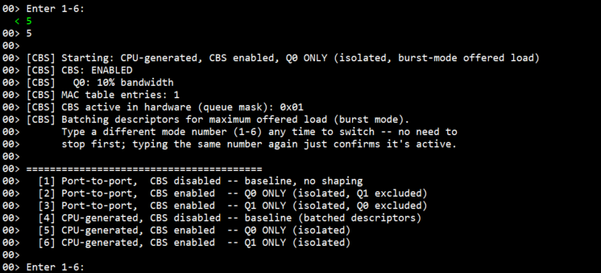
  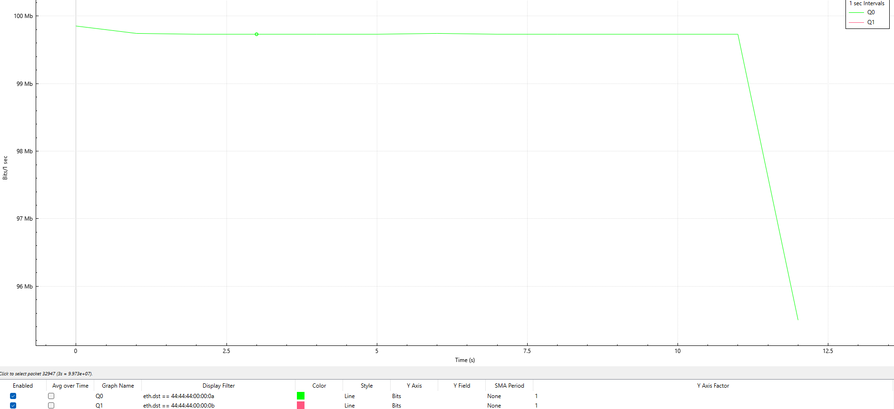

+ Mode `[6]` CPU-generated, CBS enabled, Q1 only - limited to ~300 Mbps:

  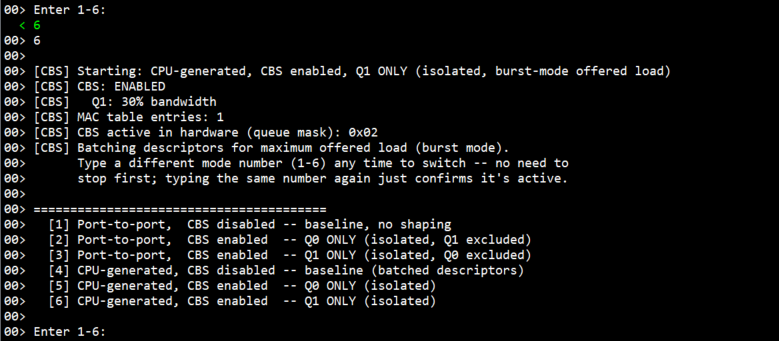
  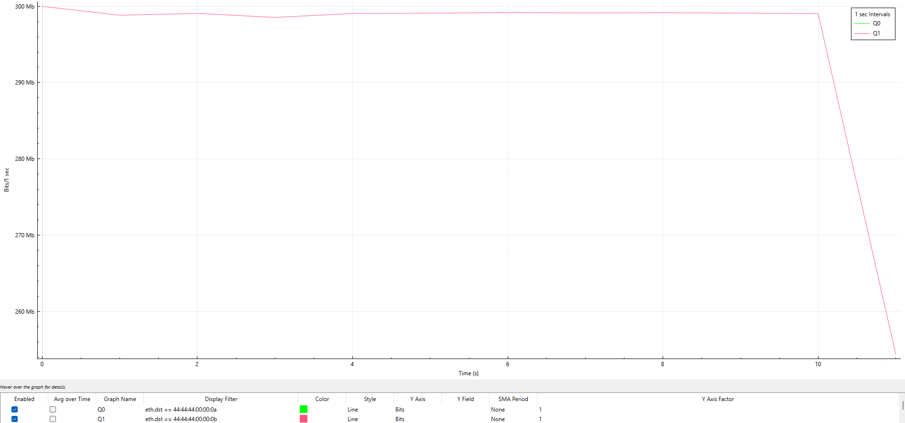

## Project Notes

### System-Level Block Diagram

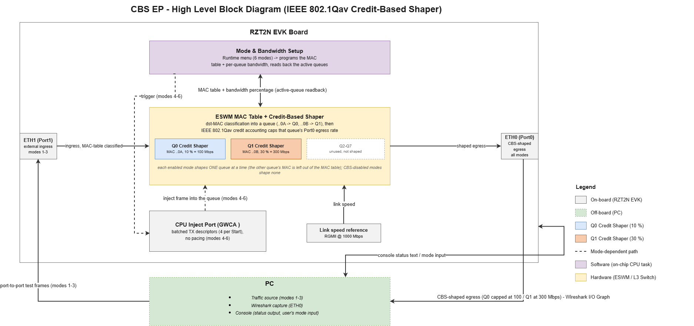

### FSP Modules Used

| Module Name | Usage | Searchable Keyword |
|---|---|---|
| Layer3 Switch | Controls the ESWM MAC table, per-queue CBS bandwidth configuration, and CPU_INJECT GWCA TX (CPU-generated modes) | `r_layer3_switch` |
| Ethernet PHY | PHY setup, auto-negotiation/link detection for ETH0/ETH1 | `r_ether_phy` |
| Ethernet Selector | RGMII port mux configuration | `r_ether_selector` |

### Module Configuration Notes

This section describes FSP Configurator properties which are important or different from those
selected by default.

Configuration Properties for Layer3 Switch - `g_layer3_switch0` instance

Path: `configuration.xml > Stacks > g_layer3_switch0 Layer3 Ethernet Switch > Properties`

<div style="margin-left:2em; max-height:300px; overflow-y:auto; border:1px solid #ccc; border-radius:4px;">

| Module Property Path and Identifier | Default Value | Used Value | Reason |
| :----------------------------------: | :-----------: | :--------: | :----: |
| Module g_layer3_switch0 Layer3 Switch > Common > Time Aware Shaper | Disabled | Disabled | Must stay disabled - CBS does not use TAS gating. |
| Module g_layer3_switch0 Layer3 Switch > Common > gPTP | Disabled (no gPTP stack added) | Disabled | Must stay disabled - CBS needs **no gPTP timer instance** - its credit accounting runs from the port's link speed, not a cycle-time clock. |
| Module g_layer3_switch0 Layer3 Switch > per-queue bandwidth / burst frame (Port 0 and Port 1, Queue 0-7) | 0 | 0 (left at default) | The bandwidth percentages are applied at run time by the application (`cbs_configure_bandwidth()`), so each mode can enable or disable shaping without a rebuild. |
</div><br>

Path: `configuration.xml > Stacks > g_layer3_switch0 Layer3 Ethernet Switch > r_ether_phy0 ethernet (r_ether_phy) > Properties`

<div style="margin-left:2em; max-height:300px; overflow-y:auto; border:1px solid #ccc; border-radius:4px;">

| Module Property Path and Identifier | Default Value | Used Value | Reason |
| :----------------------------------: | :-----------: | :--------: | :----: |
| Module g_ether_phy0/1 Ethernet PHY > Common > MDIO type | GMAC | RMAC0 in ESWM | Required for this board's standalone Layer3-Switch topology. |
| Module g_ether_phy0/1 Ethernet PHY > Common > PHY-LSI Address | 0 (both) | 0 (phy0) / 1 (phy1) | Left at the generic default, both PHYs answer at the same address and only one ever links up. |
| Module g_ether_phy0/1 Ethernet PHY > Common > PHY Reset Port | P04_7 | P07_0 | This board's actual PHY reset pin - left wrong, one or both PHY links never come up. |
</div><br>

Path: `configuration.xml > Stacks > g_layer3_switch0 Layer3 Ethernet Switch > r_ether_phy0 ethernet (r_ether_phy) > g_ether_selector0 Ethernet SELECTOR (r_ether_selector) > Properties`

<div style="margin-left:2em; max-height:300px; overflow-y:auto; border:1px solid #ccc; border-radius:4px;">

| Module Property Path and Identifier | Default Value | Used Value | Reason |
| :----------------------------------: | :-----------: | :--------: | :----: |
| Module g_ether_selector0/1 Ethernet SELECTOR > Common > Interface type / Speed | RGMII / 1000 Mbps | RGMII / 1000 Mbps, full duplex | This board's PCB wiring is RGMII only, and the link only comes up at Gigabit - see [Known Limitations](#known-limitations). |
</div><br>

### API Usage
The link below lists the FSP-provided APIs used at the application layer.

* [Layer3 Switch Module APIs on FSP User Manual on GitHub](https://renesas.github.io/rz-fsp/group___r_z_t___l_a_y_e_r3___s_w_i_t_c_h.html)

| No. | API Name | Usage |
|---|---|---|
| 1 | `R_LAYER3_SWITCH_Open` | Opens the switch and starts PHY auto-negotiation |
| 2 | `R_LAYER3_SWITCH_ConfigureTable` | Configures the MAC table |
| 3 | `R_LAYER3_SWITCH_AddTableEntry` | Adds a MAC table entry (destination MAC -> queue steering) |
| 4 | `R_LAYER3_SWITCH_ConfigurePort` | Applies the per-queue CBS bandwidth (the core CBS call) |
| 5 | `R_LAYER3_SWITCH_CreateDescriptorQueue` | Creates the GWCA TX descriptor queue (CPU-generated modes) |
| 6 | `R_LAYER3_SWITCH_SetDescriptor` | Fills a TX descriptor with a frame (CPU-generated modes) |
| 7 | `R_LAYER3_SWITCH_StartDescriptorQueue` | Starts transmission of the queued descriptors (CPU-generated modes) |

### Memory Usage

Memory usage varies depending on target board, compiler, linker script, and enabled components.

**Reference Measurements:**

Measured using **Memory Usage view in e² studio** with the following conditions:
- Target: RZT2N EVK (R9A07G076)
- Core: Cortex-R52 (CR52_0)
- Compiler: GCC ARM
- Build: Debug

| Item | Approximate Size |
|---|---|
| Program / ROM image (Program + Constant + Initialized Data) | ~32.6 KB (33,392 bytes) |
| RAM (Initialized Data + Uninitialized Data + Data + Stack + Others) | ~79.4 KB (81,304 bytes) |
| Total on-chip RAM occupied (all Internal Ram regions, "Device Memory Usage" tab) | ~102.6 KB (105,068 bytes) |

Section sizes from the "Size" panel:

| Section | Bytes |
|---|---|
| Program (`.text`, code) | 17,652 |
| Constant (`.rodata`) | 6,112 |
| Initialized Data (`.data`) | 9,628 |
| Uninitialized Data (`.bss`) | 35,704 |
| Others (non-cached ETH buffers, FSP control blocks, TCM / vector sections) | 35,972 |
| Data / Stack | 0 / 0 (sized by the linker script, not a named section) |

Per-region occupancy from the "Device Memory Usage" tab:

| Internal Ram region | Used / Size | % |
|---|---|---|
| 0x00000000 - 0x0007FFFF | 60,880 / 524,288 | 11.61 % |
| 0x00100000 - 0x0010FFFF | 33,944 / 65,536 | 51.79 % |
| 0x10000000 - 0x101FFFFF | 10,244 / 2,097,152 | 0.49 % |
| ExternalRom (0x40000000+) | 0 | 0.00 % |

**Notes:**
* This Debug build links entirely into on-chip RAM (three `Internal Ram` windows); the External
  ROM region is unused. "Program / ROM image" is the loadable image size, not a separate flash
  figure.
* "Program / ROM image" and "RAM" overlap by the Initialized Data figure (9,628 bytes) - it is
  counted once as the load image and once as the live writable copy:
  `33,392 + 81,304 - 9,628 = 105,068`, the total on-chip RAM occupied (and the sum of the three
  region rows above).
* The DMA-visible TX buffers (`.noncache_buffer.eth`: `s_tx_desc[CBS_TX_DESC_NUM + 1]` and
  `s_tx_frame_buf[CBS_TX_DESC_NUM][1514]` from `cbs_ep.o`, plus the FSP switch control block
  `g_layer3_switch0_ctrl` from `common_data.o`) are part of the `Others` figure. With the shipped
  `CBS_TX_DESC_NUM = 4` the frame buffers are 4 x 1514 = 6,056 bytes; this scales with
  `CBS_TX_DESC_NUM`, not with the traffic rate or the selected mode. For the exact section
  total, search `.noncache_buffer.eth` in `Debug/<project>.map`.
* Figures depend on linker-script configuration and the non-cached SRAM region layout.

**Accessing Memory Usage View in e² studio:**

```
Renesas Views -> C/C++ -> Memory Usage
```

Then select the target project in the Project Explorer to display memory details. For the
non-cached SRAM figure specifically, search `.noncache_buffer.eth` in the generated
`Debug/<project>.map` file.

### Clock Configuration

No special clock adjustments are necessary for this EP. CBS needs **no gPTP timer instance**
(`LAYER3_SWITCH_CFG_GPTP_ENABLE=0`) - the credit-shaper's rate accounting runs off the port's
own link-speed reference rather than a cycle-time clock.

### Application Execution Flow

This section describes the sequence of events and API calls during the execution flow of the
application. The diagram shows: open the switch once (plus the RMAC promiscuous-mode fix), wait
for both PHY links, read the first mode, then loop forever - clear and reprogram the MAC table,
apply the mode's CBS bandwidth, run it (idle-wait for external traffic in modes `[1]`-`[3]`, or
inject batched descriptors in modes `[4]`-`[6]`), and poll (non-blocking) for a different mode
number, with no separate stop step.

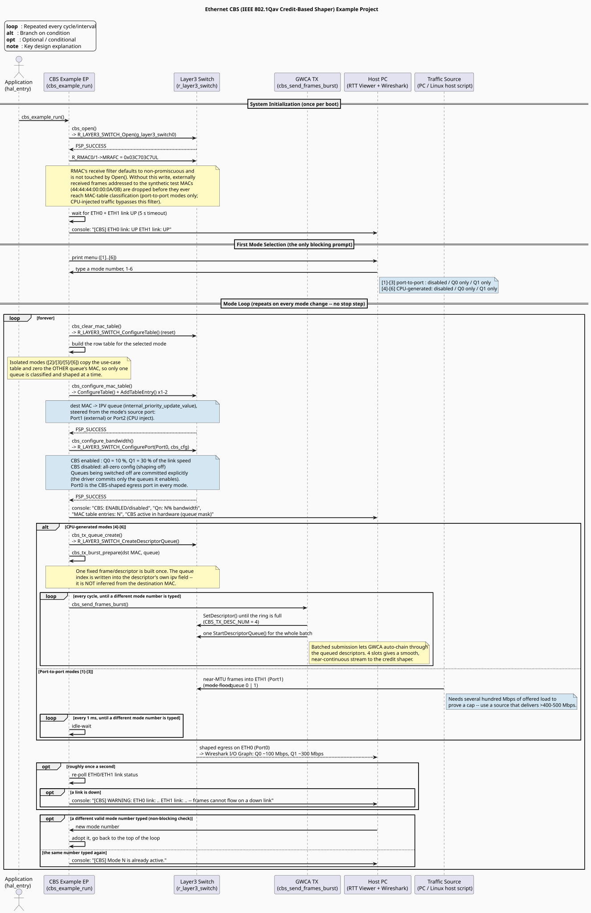

Refer to [`ethernet_cbs_sequence_diagram.puml`](ethernet_cbs_sequence_diagram.puml) for the
PlantUML source.

### Wireshark Verification Guide

#### What is Wireshark?

[Wireshark](https://www.wireshark.org/) is a free, open-source network packet analyzer. In this
EP it is the source of truth for CBS: the console only reports what was *programmed*, while the
capture on ETH0 shows the bandwidth that actually *got through*.

**Download and install:** https://www.wireshark.org/download.html - accept the default option
to install **Npcap**.

---

#### Basic filter syntax used in this EP

| Syntax | Meaning |
|---|---|
| `eth.dst == 44:44:44:00:00:0a` | Destination MAC equals Q0's MAC |
| `eth.dst == 44:44:44:00:00:0b` | Destination MAC equals Q1's MAC |
| `eth.dst == 44:44:44:00:00:0a or eth.dst == 44:44:44:00:00:0b` | Either queue |
| `eth.type == 0x88b5` | This EP's test-frame EtherType (IEEE local experimental) |

Packet detail (expand **Ethernet II**): `Destination` = the target MAC, `Type` = `0x88b5`.

---

#### I/O Graph setup (the actual bandwidth verification)

1. With the capture running on the NIC connected to ETH0, open the **Statistics** menu and select
   **I/O Graphs**.
2. In the I/O Graphs window, click the **+** button below the graph list once per queue. For each new
   line, double-click the **Display Filter** cell and enter `eth.dst == 44:44:44:00:00:0a` (name it
   `Q0`) or `eth.dst == 44:44:44:00:00:0b` (name it `Q1`), and set the **Y Axis** cell to **Bits**.
3. In the **Interval** drop-down below the graph, select **1 sec**, so the axis reads directly in Mbps.

> **Interval matters for how the numbers read.** The Y axis shows *bits per interval*, not a
> rate. At a 500 ms interval a steady 300 Mbps shows as ~150 Mb; at 1 sec it shows as ~300 Mb.
> Both are the same traffic - always read against the interval printed on the axis label.

Ignore the first 1-2 seconds of any capture (ramp-up) when reading the steady rate.

---

#### Mode `[1]` Port-to-port, CBS disabled Verification

**Recommended Wireshark setup:** capture on the NIC connected to ETH0, I/O Graph with both queue lines.
This mode is also the check that qualifies the traffic source (see
[Checking the traffic source before testing](#checking-the-traffic-source-before-testing)).

| Test case | Filter to apply | Expected |
|---|---|---|
| Source floods Q0 alone (`--queue 0`) | `eth.dst == 44:44:44:00:00:0a` | Unshaped, follows the offered load; typically **~400-700 Mbps**, varying from second to second - no ceiling near 100 Mbps |
| Source floods Q1 alone (`--queue 1`) | `eth.dst == 44:44:44:00:00:0b` | Unshaped, typically **~400-700 Mbps** - no ceiling near 300 Mbps |
| Source floods both, started from idle (`--queue both`) | both filters | About half of the sender's rate each: **~415-430 Mbps per MAC**, the two lines on top of each other |


*One continuous capture: Q0 flooded alone (green), then Q1 flooded alone (pink), then both
flooded together immediately after (overlapping trace). The first two segments run well above
300 Mbps; the back-to-back "both" segment lands lower, around ~220-360 Mbps per MAC.*

**Note - `--queue both` depends on what ran just before it.** Started from idle, both MACs read
close to half the sender's offered load each (~415-430 Mbps, matching the "both, started from
idle" row above). Started immediately after the two single-queue floods, as in the capture
above, the achieved rate drops well below that even though the script still reports the same
offered load. The script's offered-load figure is measured at the sender, before the wire, so it
cannot show this; the cause was not isolated. Treat `--queue both` as a qualitative check only:
run it from idle and leave a pause after a previous flood (the pause length was not
characterized). It is not used for any cap verification - modes `[2]`/`[3]`/`[5]`/`[6]` always
exercise one queue at a time.

#### Mode `[2]` Port-to-port, Q0 only Verification

| Test case | Filter to apply | Expected |
|---|---|---|
| Generator floods Q0 (`--queue 0`), offered load reads `OK` | `eth.dst == 44:44:44:00:00:0a` | Stays at **~100 Mbps**, although the offered load is far higher |

#### Mode `[3]` Port-to-port, Q1 only Verification

| Test case | Filter to apply | Expected |
|---|---|---|
| Generator floods Q1 (`--queue 1`), offered load reads `OK` (must exceed 300 Mbps) | `eth.dst == 44:44:44:00:00:0b` | Stays at **~300 Mbps** |

#### Mode `[4]` CPU-generated, CBS disabled Verification

| Test case | Filter to apply | Expected |
|---|---|---|
| Board injects frames to Q1's MAC, no generator | `eth.dst == 44:44:44:00:00:0b` | Runs freely at **~750-1000 Mbps**, comfortably above 300 Mbps |

#### Mode `[5]` CPU-generated, Q0 only Verification

| Test case | Filter to apply | Expected |
|---|---|---|
| Board injects frames to Q0's MAC | `eth.dst == 44:44:44:00:00:0a` | Stays at **~100 Mbps** |

#### Mode `[6]` CPU-generated, Q1 only Verification

| Test case | Filter to apply | Expected |
|---|---|---|
| Board injects frames to Q1's MAC | `eth.dst == 44:44:44:00:00:0b` | Stays at **~300 Mbps**, versus the free-running mode `[4]` baseline |

A pass is **the enabled mode's rate matching the cap while the disabled baseline of the same
source runs clearly above it**. The baseline is what proves the rate is shaping rather than
a coincidental ceiling of the traffic source.

### Troubleshooting Tips

| Symptom | Likely Cause | Fix |
|---|---|---|
| `Returned Error Code: 0x...` printed right after reset, then the board stops | FSP Configurator stack error | `gptp_enable` / `tas_enable` should both be disabled; recheck `configuration.xml`, regenerate, rebuild. |
| No RTT output at all (Cortex-R52) | RTT Viewer attached late, or the RTT control block address is wrong | Attach RTT Viewer (target `R9A07G076`, [RTT Control Block] **Address** = the SEGGER_RTT address in [Supported Boards](#supported-boards)) and reset the board. |
| No output in Tera Term (Cortex-A55) | Wrong COM port of the J33 pair, or the terminal is not set to 115200 8N1 | Select the other COM port of the pair; check the Tera Term settings in [Application Execution](#application-execution). |
| The selected number appears twice or text overwrites the line (Cortex-A55) | Tera Term [Local echo] is enabled | Disable [Local echo]: the EP prints the entered option itself. |
| `ETH0 link: DOWN` / `ETH1 link: DOWN` right after reset | PHY auto-negotiation takes ~1-3 s | This line prints once, right after the link-wait loop; check cabling/LEDs if still DOWN after that. |
| Modes `[1]`-`[3]`: Wireshark sees 0 packets on ETH0, but the generator reports full speed | A switch or router between the generator and ETH1 dropped the frames (unknown unicast), or the wrong `--iface` | Cable the generator directly to ETH1; re-check `--iface`; send `--mode once` first and confirm 1 packet per MAC arrives. |
| Modes `[2]`/`[3]`: no capping at all | Offered load never exceeded the cap (script printed `WARNING`), the traffic source delivers less than it reports, or a USB 2.0 port limits the adapter | Run the [source checks](#checking-the-traffic-source-before-testing); use a source that delivers >400-500 Mbps in mode `[1]`, on a USB 3.0 port if it is a USB adapter. |
| Modes `[1]`-`[3]`: the rate on ETH0 is well below the script's offered load, or a `--queue both` run reads lower than it did earlier | The script's figure is measured at the sender; the delivered rate can be lower, and `--queue both` right after other floods was observed to drop to ~200-330 Mbps per MAC | Read the rate on ETH0, not the script; flood one queue at a time; leave a pause between runs. |
| Wireshark shows Q0 traffic missing in mode `[1]` | Only one queue is being flooded, or a previous `--queue 1` run is still going | Stop old generator processes; run `--queue 0` and `--queue 1` as separate floods. |
| Graph reads half (or double) the expected Mbps | I/O Graph interval is not 1 sec | Y axis is bits per interval - see [I/O Graph setup](#io-graph-setup-the-actual-bandwidth-verification). |

### Known Limitations

* **Running both queues at the same time is not offered.** Two combined modes (both queues
  enabled together, one per traffic source) existed during development and were removed after
  hardware testing:
    * *CPU-generated:* the combined offered load through the shared CPU-inject path never
      stressed Q1 hard enough to show its cap, so the result could not prove either queue.
    * *Port-to-port:* with the generator offering well above both caps on both MACs
      (~430 Mbps each), Q0 dropped to near zero while Q1 held its full 300 Mbps cap -
      reproduced identically across independent runs. This is far more severe than a shared-link
      split, since the combined caps (400 Mbps) sit well under the 1000 Mbps link.
  A corrected credit-upper-limit register value (see the next point) was tried as a fix and
  made no difference. The remaining suspect is strict-priority arbitration between the
  descriptor queues (higher queue index favoured), independent of CBS credit state; this could
  not be confirmed without lower-level bus tracing. Each queue's cap is verified reliably in
  isolation, which is what modes `[2]`, `[3]`, `[5]` and `[6]` do.
* **`max_burst_num` has no observable effect.** In FSP v4.2.0 the driver's credit-upper-limit
  register write (`EACAULCq`) is multiplied by zero, so the register is always 0 whatever
  `max_burst_num` is set to. The field is still filled in correctly in `cbs_config.c` in case a
  later FSP release honours it. Only `band_width_pct` shapes traffic.
* **The disabled baselines depend on an explicit commit.** Disabling a queue needs an
  admin-to-oper commit (`EACC.CC[q]`, manual 34.4.2.8), but `R_LAYER3_SWITCH_ConfigurePort()`
  commits only the queues it enables, so a queue switched off would otherwise keep its previous
  shaping (a CBS-disabled mode read a flat 300 Mbps after Q1's mode during development).
  `cbs_configure_bandwidth()` therefore commits the queues being switched off, and the console
  prints the hardware-active queue mask after every mode change. Do **not** add a blanket commit of
  all queues after `ConfigurePort()` - that was measured to make an enabled queue's bandwidth erratic.
* **The ETH0 and ETH1 links run at RGMII @ 1000 Mbps only.** Both the interface type and the speed are fixed by
  the board's wiring; selecting MII, or lowering the speed to 100 Mbps, results in no packets at
  all because the link never comes up. The caps are therefore 100 / 300 Mbps, which is why a
  Windows/Npcap generator (~200-270 Mbps) cannot conclusively prove Q1's cap.
* **The CPU-inject path offers roughly 750-1000 Mbps, not full line rate.** The physical link
  itself does reach near line rate in bursts, so this is not a PHY or board limit. It is
  comfortably above both caps, which is all the CBS demonstration needs. The batch size
  (`CBS_TX_DESC_NUM`) matters for the enabled read: 4 gives a smooth rate on mode `[6]`, while
  20 gave an uneven rate below the cap.
* **The caps are fixed percentages of link speed**, not of offered traffic - a queue offered
  less than its cap simply passes unshaped.
* The queue bandwidth table is fixed at build time (`cbs_config.c`); only the mode (traffic
  source and CBS on/off, per queue) is selectable at runtime, not the percentages themselves.

## Special Topics

No special configuration steps are required for this EP beyond the properties listed in
[Module Configuration Notes](#module-configuration-notes).

## Conclusion and Next Steps
* To further explore CBS implementation on Renesas RZT2N:
  * Refer to the FSP User Manual for the `r_layer3_switch` driver for deeper technical detail.
  * Visit renesas.com for additional ESWM/CBS resources and application notes for RZT2N devices.
  * The behaviour of two simultaneously saturated CBS queues (see
    [Known Limitations](#known-limitations)) is an open item worth revisiting with lower-level
    tracing or vendor support.

## References
* [FSP User Manual on GitHub](https://renesas.github.io/rz-fsp)
* [Layer3 Switch Module APIs on FSP User Manual on GitHub](https://renesas.github.io/rz-fsp/group___r_z_t___l_a_y_e_r3___s_w_i_t_c_h.html)
* [Example Project Usage Guide](https://github.com/renesas/rz-fsp-examples/blob/main/example_projects/Example%20Project%20Usage%20Guide.pdf)

## Notice

1. Descriptions of circuits, software and other related
information in this document are provided only to illustrate the
operation of semiconductor products and application examples. You are
fully responsible for the incorporation or any other use of the
circuits, software, and information in the design of your product or
system. Renesas Electronics disclaims any and all liability for any
losses and damages incurred by you or third parties arising from the use
of these circuits, software, or information. 

2. Renesas Electronics
hereby expressly disclaims any warranties against and liability for
infringement or any other claims involving patents, copyrights, or other
intellectual property rights of third parties, by or arising from the
use of Renesas Electronics products or technical information described
in this document, including but not limited to, the product data,
drawings, charts, programs, algorithms, and application examples. 

3. No license, express, implied or otherwise, is granted hereby under any
patents, copyrights or other intellectual property rights of Renesas
Electronics or others. 

4. You shall be responsible for determining what
licenses are required from any third parties, and obtaining such
licenses for the lawful import, export, manufacture, sales, utilization,
distribution or other disposal of any products incorporating Renesas
Electronics products, if required. 

5. You shall not alter, modify, copy,
or reverse engineer any Renesas Electronics product, whether in whole or
in part. Renesas Electronics disclaims any and all liability for any
losses or damages incurred by you or third parties arising from such
alteration, modification, copying or reverse engineering. 

6. Renesas Electronics products are classified according to the following two
quality grades: "Standard" and "High Quality". The intended applications
for each Renesas Electronics product depends on the product's quality
grade, as indicated below. "Standard": Computers; office equipment;
communications equipment; test and measurement equipment; audio and
visual equipment; home electronic appliances; machine tools; personal
electronic equipment; industrial robots; etc. "High Quality":
Transportation equipment (automobiles, trains, ships, etc.); traffic
control (traffic lights); large-scale communication equipment; key
financial terminal systems; safety control equipment; etc. Unless
expressly designated as a high reliability product or a product for
harsh environments in a Renesas Electronics data sheet or other Renesas
Electronics document, Renesas Electronics products are not intended or
authorized for use in products or systems that may pose a direct threat
to human life or bodily injury (artificial life support devices or
systems; surgical implantations; etc.), or may cause serious property
damage (space system; undersea repeaters; nuclear power control systems;
aircraft control systems; key plant systems; military equipment; etc.).
Renesas Electronics disclaims any and all liability for any damages or
losses incurred by you or any third parties arising from the use of any
Renesas Electronics product that is inconsistent with any Renesas
Electronics data sheet, user's manual or other Renesas Electronics
document. 

7. No semiconductor product is absolutely secure. Notwithstanding any security measures or features that may be implemented in Renesas Electronics hardware or software products, Renesas Electronics shall have absolutely no liability arising out of
any vulnerability or security breach, including but not limited to any unauthorized access to or use of a Renesas Electronics product or a system that uses a Renesas Electronics product. RENESAS ELECTRONICS DOES NOT WARRANT OR GUARANTEE THAT RENESAS ELECTRONICS PRODUCTS, OR ANY
SYSTEMS CREATED USING RENESAS ELECTRONICS PRODUCTS WILL BE INVULNERABLE OR FREE FROM CORRUPTION, ATTACK, VIRUSES, INTERFERENCE, HACKING, DATA LOSS OR THEFT, OR OTHER SECURITY INTRUSION ("Vulnerability Issues"). RENESAS ELECTRONICS DISCLAIMS ANY AND ALL RESPONSIBILITY OR LIABILITY
ARISING FROM OR RELATED TO ANY VULNERABILITY ISSUES. FURTHERMORE, TO THE EXTENT PERMITTED BY APPLICABLE LAW, RENESAS ELECTRONICS DISCLAIMS ANY AND ALL WARRANTIES, EXPRESS OR IMPLIED, WITH RESPECT TO THIS DOCUMENT
AND ANY RELATED OR ACCOMPANYING SOFTWARE OR HARDWARE, INCLUDING BUT NOT LIMITED TO THE IMPLIED WARRANTIES OF MERCHANTABILITY, OR FITNESS FOR A PARTICULAR PURPOSE. 

8. When using Renesas Electronics products, refer to the latest product information (data sheets, user's manuals, application notes, "General Notes for Handling and Using Semiconductor Devices" in
the reliability handbook, etc.), and ensure that usage conditions are within the ranges specified by Renesas Electronics with respect to
maximum ratings, operating power supply voltage range, heat dissipation characteristics, installation, etc. Renesas Electronics disclaims any
and all liability for any malfunctions, failure or accident arising out of the use of Renesas Electronics products outside of such specified
ranges. 

9. Although Renesas Electronics endeavors to improve the quality and reliability of Renesas Electronics products, semiconductor products
have specific characteristics, such as the occurrence of failure at a certain rate and malfunctions under certain use conditions. Unless
designated as a high reliability product or a product for harsh environments in a Renesas Electronics data sheet or other Renesas
Electronics document, Renesas Electronics products are not subject to radiation resistance design. You are responsible for implementing safety
measures to guard against the possibility of bodily injury, injury or damage caused by fire, and/or danger to the public in the event of a
failure or malfunction of Renesas Electronics products, such as safety design for hardware and software, including but not limited to
redundancy, fire control and malfunction prevention, appropriate treatment for aging degradation or any other appropriate measures.
Because the evaluation of microcomputer software alone is very difficult and impractical, you are responsible for evaluating the safety of the
final products or systems manufactured by you. 

10. Please contact a
Renesas Electronics sales office for details as to environmental matters such as the environmental compatibility of each Renesas Electronics
product. You are responsible for carefully and sufficiently investigating applicable laws and regulations that regulate the
inclusion or use of controlled substances, including without limitation, the EU RoHS Directive, and using Renesas Electronics products in
compliance with all these applicable laws and regulations. Renesas Electronics disclaims any and all liability for damages or losses
occurring as a result of your noncompliance with applicable laws and regulations. 

11. Renesas Electronics products and technologies shall not be used for or incorporated into any products or systems whose
manufacture, use, or sale is prohibited under any applicable domestic or foreign laws or regulations. You shall comply with any applicable export
control laws and regulations promulgated and administered by the governments of any countries asserting jurisdiction over the parties or
transactions. 

12. It is the responsibility of the buyer or distributor of Renesas Electronics products, or any other party who distributes,
disposes of, or otherwise sells or transfers the product to a third party, to notify such third party in advance of the contents and
conditions set forth in this document. 

13. This document shall not be
reprinted, reproduced or duplicated in any form, in whole or in part, without prior written consent of Renesas Electronics. 

14. Please contact a Renesas Electronics sales office if you have any questions regarding the information contained in this document or Renesas Electronics
products. (Note1) "Renesas Electronics" as used in this document means Renesas Electronics Corporation and also includes its directly or
indirectly controlled subsidiaries. (Note2) "Renesas Electronics product(s)" means any product developed or manufactured by or for
Renesas Electronics.

                                                                                   (Rev.5.0-1 October 2020)
## Corporate Headquarters 

Contact information TOYOSU FORESIA, 3-2-24

Toyosu, Koto-ku, Tokyo 135-0061, Japan 

www.renesas.com 

## Contact information 

For further information on a product, technology, the most up-to-date version of a
document, or your nearest sales office, please visit:
www.renesas.com/contact/. 

## Trademarks 
Renesas and the Renesas logo are trademarks of Renesas Electronics Corporation. All trademarks and
registered trademarks are the property of their respective owners.

							© 2026 Renesas Electronics Corporation. All rights reserved
