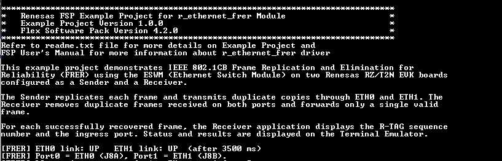
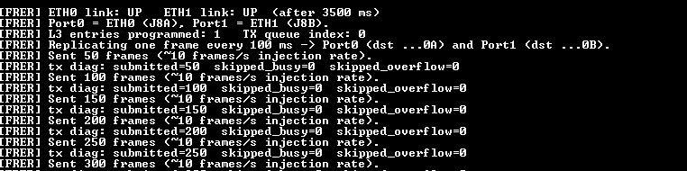
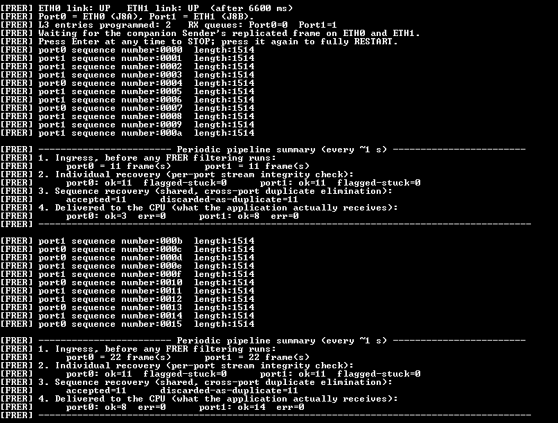
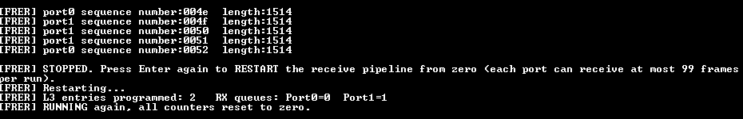
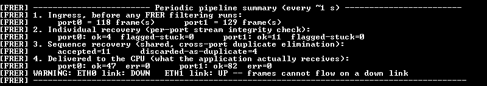
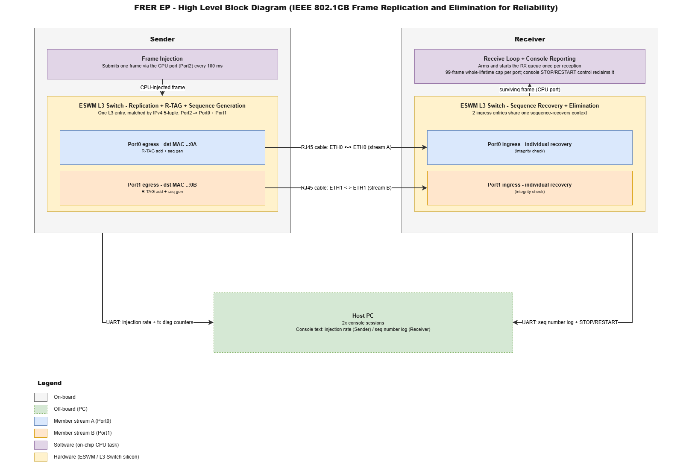
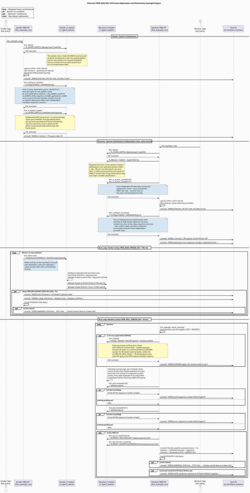

**Navigation:** [🏠 ethernet_frer_notes](ethernet_frer_notes.md)

# Ethernet FRER Example Project on RZ Boards

## Table of Contents
1. [Introduction](#introduction)
    1. [Supported Boards](#supported-boards)
2. [Required Resources](#required-resources)
    1. [Hardware Requirements](#hardware-requirements)
    2. [Software Requirements](#software-requirements)
3. [Application Execution](#application-execution)
4. [Project Notes](#project-notes)
    1. [System-Level Block Diagram](#system-level-block-diagram)
    2. [FSP Modules Used](#fsp-modules-used)
    3. [Module Configuration Notes](#module-configuration-notes)
    4. [API Usage](#api-usage)
    5. [Memory Usage](#memory-usage)
    6. [Clock Configuration](#clock-configuration)
    7. [Application Execution Flow](#application-execution-flow)
    8. [Console Verification Guide](#console-verification-guide)
    9. [Troubleshooting Tips](#troubleshooting-tips)
    10. [Known Limitations](#known-limitations)
5. [Special Topics](#special-topics)
6. [Conclusion and Next Steps](#conclusion-and-next-steps)
7. [References](#references)
8. [Notice](#notice)

## Introduction

The FRER (IEEE 802.1CB Frame Replication and Elimination for Reliability) example project
demonstrates hardware-based stream replication and duplicate elimination on the Renesas RZ/T2N
EVK using the ESWM (Ethernet Switch Module) via the `r_layer3_switch` FSP driver. Once the L3
table entries are programmed, replication, R-TAG insertion, sequence-number generation, and
duplicate elimination are all performed autonomously in silicon - the CPU has no role in any
per-frame decision.

In this example, two RZ/T2N EVK boards are used and connected via two physical links to verify
FRER operation.

- **Sender node**

  The board's own CPU injects one frame via GWCA into the switch's CPU port. A single L3
  forwarding entry (`destination_ports = Port0 | Port1`) makes the switch hardware replicate
  that frame onto both external ports, inserting an R-TAG (EtherType `0xF1C1`) and a
  hardware-generated, monotonically increasing sequence number into each member stream. Runs
  forever from boot with no console interaction.

- **Receiver node**

  Two L3 entries (one per ingress port) share a single sequence-recovery context, eliminating
  duplicate frames in hardware so communication still succeeds even if one of the two LAN
  cables is disconnected. Offers one console control: press Enter to STOP the receive loop,
  press Enter again to fully RESTART it (reclaims the RX queue's finite lifetime capacity - see
  [Known Limitations](#known-limitations)).

Please refer to the [Example Project Usage Guide](https://github.com/renesas/rz-fsp-examples/blob/main/example_projects/Example%20Project%20Usage%20Guide.pdf)
for general information on example projects.

### Supported Boards

| # | Board | MPU | J-Link OB VCOM | Board-Specific Guide |
|---|---|---|---|---|
| 1 | RZT2N EVK | R9A07G076M48GBG | ☑ | [RZT2N EVK Guide](ethernet_frer_board_specific_notes.md#rzt2n-evk--board-specific-guide) |

**Note:** Boards marked with ☑ under **J-Link OB VCOM** support the J-Link On-Board Virtual COM
Port. This project uses the board's separate **UART-to-USB** console bridge instead (see
[Software Requirements](#software-requirements)), not the J-Link VCOM.

## Required Resources

### Hardware Requirements

#### Common Hardware
* RZ supported boards: RZ/T2N-EVK.
* 2 x Renesas RZ boards - one Sender, one Receiver nodes.
* 2 x USB Type-C cables (board power, one per board).
* 4 x USB Type-A to micro USB cables (two per board: one for J-Link debug, one for the serial
  console).
* 2 x Ethernet cables (ETH0<->ETH0, ETH1<->ETH1 directly between the two boards).

#### Additional Hardware
* Detailed **Additional Hardware** for each supported board is described in the
  [Board-Specific Guide](ethernet_frer_board_specific_notes.md#rzt2n-evk--board-specific-guide).

#### Hardware Connections
* Detailed **Specific Connections** for each supported board are described in the
  [Board-Specific Guide](ethernet_frer_board_specific_notes.md#rzt2n-evk--board-specific-guide).
* Common Connections (both boards):
    * Connect the POWER(15V/3A) port on each evaluation board to a power source using a USB
      Type-C cable for board power supply.
    * Slide each board's SW1 "POWER_SW" from OFF to ON to turn it on.
    * Connect the **J32** port on each evaluation board to the PC using a USB Micro-B cable for
      debugging/flashing.
    * Connect the **J33** port on each evaluation board to the PC using a USB Micro-B cable for
      the serial console (see [Software Requirements](#software-requirements) below).
    * Connect J8A (ETH0) on the Sender board to J8A (ETH0) on the Receiver board.
    * Connect J8B (ETH1) on the Sender board to J8B (ETH1) on the Receiver board.

### Software Requirements
* Renesas Flexible Software Package (FSP): Version 4.2.0
* e2 studio: Version 2026-07
* FSP Smart Configurator: Version 2026-07
* IAR: Version 9.60.3
* J-Link: Version 9.44
* GCC ARM Embedded Toolchain: Version 13.3.1.arm-13-24 for cortexR-52
* GCC ARM A-Profile (AArch64 bare-metal): Version 13.2 rel1 for cortexA-55
* Terminal Console Application: TeraTerm or a similar application - one session per board, via
  the on-board UART-to-USB bridge (J33), **not** SEGGER RTT Viewer (see
  [Board-Specific Guide](ethernet_frer_board_specific_notes.md#rzt2n-evk--board-specific-guide)).

**Note:** Refer to the [FSP version requirements](https://github.com/renesas/rz-fsp-examples/blob/main/example_projects/version_info_table.md)
table per IDE to correctly download the needed [FSP release](https://github.com/renesas/rz-fsp/releases).

## Application Execution

1. Import **both** example projects (Sender and Receiver) into e² studio / IAR, open the FSP
   Configuration editor / FSP Smart Configurator, generate the project content, and build them.
2. Configure the hardware according to `ethernet_frer_board_specific_notes.md`.
3. Power on both RZ boards according to the **Debug and Console Connections** section in
   `ethernet_frer_board_specific_notes.md`.
4. Confirm both boards are recognized by the host PC as two COM port pairs (e.g. COM5/COM6 and
   COM7/COM8). For each board, select the COM port with the higher number in the pair as the
   serial console port. If no output appears in the terminal while the program is running,
   reconnect using the other COM port in the pair.
5. Set the configuration of Terminal Emulator (TeraTerm) as follows:
   * Speed: 115200 bps
   * Data: 8 bit
   * Parity: none
   * Stop bits: 1 bit
   * Flow control: none
   * Set the terminal software reception line feed code to [AUTO].
6. Download the example project to both Renesas RZ boards.
   e² studio:
   * In [Project Explorer] view, right click the node of the project to be debugged and select
     [Debug As]->[Debug Configurations...] menu.
   * Select "ethernet_frer_rzt2n_evk_{cortex}_sender_ep Debug_Flat" in the Renesas GDB Hardware
     Debugging node and select [Debugger]->[Connection Settings].
   * Select [...] next to J-Link Serial value. With both boards connected, a J-Link Probe Selection
     window is displayed with two probes: select the probe of the board to be programmed and press
     the "OK" button.
   * Press [Debug] button.
   * When "Proceed with launch" window is displayed, select [Yes].
   * When "Confirm Perspective Switch" window is displayed, select [Switch].

   IAR:
   * With both boards connected, select the probe of the board to be programmed: in
     [Project]->[Options...]->[Debugger]->[J-Link/J-Trace]->[Connection], enter the serial number
     of that board's J-Link probe in [Serial no].
   * Click on the [Download and debug] button in the "Project" toolbar.
     The program will break at the first code in "main".
7. Press the "Resume" button (e² studio) or the [Go] button (IAR). In e² studio the program will
   break at `hal_entry();` in `hal_entry.c`.
8. Repeat step (6) to (7) for the other RZ board with project
   "ethernet_frer_rzt2n_evk_{cortex}_receiver_ep Debug_Flat".
   * In step (6), select a probe that is different from the one you have already selected
     previously.
   * If the message "A Renesas GDB debug session is already active" appears, select [No].
9. Open the terminal console for each board on the Host PC.
10. Observe the startup banner and initialization messages, link-up events.
11. Neither project has a menu to interact with. The Sender runs immediately; the Receiver starts
    RUNNING immediately and prints a per-frame sequence number line plus a periodic pipeline
    summary. Press Enter in the Receiver's TeraTerm session at any time to STOP it; press Enter
    again to fully RESTART it (see [Known Limitations](#known-limitations) for why this exists).

### Execution Output

**Note:** Execution results may vary slightly run to run (exact link-up timing, exact sequence
numbers at any given moment). The example below shows the execution output on two RZT2N EVK
boards, Cortex-R52 core. The Cortex-A55 builds print the same lines.

+ Sender: Startup Banner and Link-Up:

  

+ Sender: Steady-State Console Output:

  

  Injection rate holds steady at ~10 frames/s; `tx diag: submitted=..` climbs at the same rate
  with `skipped_busy=0 skipped_overflow=0` throughout a healthy run.

+ Receiver: Startup Banner and Link-Up:

  

+ Receiver: Steady-State Console Output (periodic pipeline summary):

  

  Per-frame `port0 sequence number:` / `port1 sequence number:` lines interleave from both
  ingress paths; the periodic summary's 4 steps (ingress -> individual recovery -> sequence
  recovery -> delivered to CPU) show the accepted count matching the discarded-duplicate count
  every interval, with zero receive errors.

+ Receiver: STOP / RESTART Console Control:

  

  Pressing Enter once STOPs the receive loop (prints the per-port lifetime-cap reminder);
  pressing it again fully RESTARTs the pipeline and resumes with every counter at zero.

+ Single-Path Failure Ride-Through (ETH1 unplugged, then replugged):

  

  Communication continues successfully through the remaining active path: with ETH1 physically
  unplugged mid-run, `port0` keeps delivering every sequence number unbroken while the Receiver's
  link-status warning fires every summary interval as a reminder that `port1` is down. Replugging
  the cable clears the warning and `port1` resumes on its own, with no restart needed (the RX
  queue itself was never touched by the link drop, unlike the whole-lifetime cap - see
  [Known Limitations](#known-limitations)).

## Project Notes

### System-Level Block Diagram



### FSP Modules Used

| Module Name | Usage | Searchable Keyword |
|---|---|---|
| Layer3 Switch | Sender: replicates the injected frame, inserts the R-TAG and sequence number, and transmits via the CPU-injection GWCA path. Receiver: recovers/eliminates duplicate sequence numbers, receives on two GWCA RX queues, and exposes the FRER hardware counters. | `r_layer3_switch` |
| Ethernet PHY | PHY setup and auto-negotiation/link detection for ETH0/ETH1 (both projects) | `r_ether_phy` |
| Ethernet Selector | RGMII port mux configuration (both projects) | `r_ether_selector` |
| SCI UART | Console backend for both projects (TeraTerm), used in place of SEGGER RTT | `r_sci_uart` |

### Module Configuration Notes

This section describes FSP Configurator properties which are important or different from those
selected by default. Identical on both the Sender and Receiver projects unless noted.

Configuration Properties for Layer3 Switch - `g_layer3_switch0` instance

Path: `configuration.xml > Stacks > g_layer3_switch0 Layer3 Ethernet Switch > r_ether_phy0 ethernet (r_ether_phy) > Properties`

<div style="margin-left:2em; max-height:300px; overflow-y:auto; border:1px solid #ccc; border-radius:4px;">

| Module Property Path and Identifier | Default Value | Used Value | Reason |
| :----------------------------------: | :-----------: | :--------: | :----: |
| Module g_ether_phy0/1 Ethernet PHY > Common > MDIO type | GMAC | RMAC0 in ESWM | Required for this board's standalone Layer3-Switch topology. |
| Module g_ether_phy0/1 Ethernet PHY > Common > PHY-LSI Address | 0 (both) | 0 (phy0) / 1 (phy1) | Left at the generic default, both PHYs answer at the same address and only one ever links up. |
| Module g_ether_phy0/1 Ethernet PHY > Common > PHY Reset Port | P04_7 | P07_0 | This board's actual PHY reset pin - left wrong, one or both PHY links never come up. |
</div><br>

Path: `configuration.xml > Stacks > g_layer3_switch0 Layer3 Ethernet Switch > Properties`

<div style="margin-left:2em; max-height:300px; overflow-y:auto; border:1px solid #ccc; border-radius:4px;">

| Module Property Path and Identifier | Default Value | Used Value | Reason |
| :----------------------------------: | :-----------: | :--------: | :----: |
| Module g_layer3_switch0 Layer3 Switch > Common > Number of Layer 3 routing entries | (default) | 10 | Sender uses 1 entry, Receiver uses 2 - sized with margin. |
</div><br>

### API Usage
The link below lists the FSP-provided APIs used at the application layer.

* [Layer3 Switch Module APIs on FSP User Manual on GitHub](https://renesas.github.io/rz-fsp/group___r_z_t___l_a_y_e_r3___s_w_i_t_c_h.html)

### Memory Usage

Memory usage varies depending on target board, compiler, linker script, and enabled components.

**Reference Measurements:**

Measured using **Memory Usage view in e² studio** with the following conditions:
- Target: RZT2N EVK (R9A07G076)
- Core: Cortex-R52 (CR52_0)
- Compiler: GCC ARM
- Build: Debug

| Item | Sender | Receiver |
|---|---|---|
| Program / ROM image (Program + Constant + Initialized Data) | ~38.5 KB (39,432 bytes) | ~41.6 KB (42,608 bytes) |
| RAM (Initialized Data + Uninitialized Data + Data + Stack + Others) | ~76.7 KB (78,528 bytes) | ~371.3 KB (380,184 bytes) |
| Total on-chip RAM occupied (all Internal Ram regions, "Device Memory Usage" tab) | ~106.4 KB (108,912 bytes) | ~402.5 KB (412,144 bytes) |

Section sizes from the "Size" panel:

| Section | Sender (bytes) | Receiver (bytes) |
|---|---|---|
| Program (`.text`, code) | 24,200 | 25,776 |
| Constant (`.rodata`) | 6,184 | 6,184 |
| Initialized Data (`.data`) | 9,048 | 10,648 |
| Uninitialized Data (`.bss`) | 35,064 | 35,184 |
| Others (non-cached ETH buffers, FSP control blocks, TCM / vector sections) | 34,416 | 334,352 |
| Data / Stack | 0 / 0 (sized by the linker script, not a named section) | 0 / 0 (sized by the linker script, not a named section) |

Per-region occupancy from the "Device Memory Usage" tab (both builds use the same linker script -
no External ROM/RAM is used by either):

| Internal Ram region | Sender: Used / Size (%) | Receiver: Used / Size (%) |
|---|---|---|
| 0x00000000 - 0x0007FFFF | 68,440 / 524,288 (13.05 %) | 71,736 / 524,288 (13.68 %) |
| 0x00100000 - 0x0010FFFF | 34,024 / 65,536 (51.92 %) | 34,024 / 65,536 (51.92 %) |
| 0x10000000 - 0x101FFFFF | 6,448 / 2,097,152 (0.31 %) | 306,384 / 2,097,152 (14.61 %) |

**Notes:**
* Both projects link entirely into on-chip RAM (three `InternalRam` windows); the External ROM
  and External RAM regions are unused. "Program / ROM image" is the loadable image size, not a
  separate flash figure.
* The Receiver's `Others`/RAM footprint is far larger than the Sender's because its non-cached
  `.noncache_buffer.eth` section holds **two** RX descriptor queues (`FRER_RX_DESC_NUM = 100`
  slots each, one per ingress port) plus their frame buffers, versus the Sender's single, much
  smaller TX queue - this scales with `FRER_RX_DESC_NUM`, not with the injection rate or any
  other runtime setting.

Accessing Memory Usage View in e² studio:

1. Navigate to `Renesas Views > C/C++ > Memory Usage`.
2. Select the target project in the Project Explorer.
3. Review ROM, RAM, and special memory section allocation.

### Clock Configuration

No special clock adjustments are necessary for this EP. FRER needs **no gPTP timer instance**
(`LAYER3_SWITCH_CFG_GPTP_ENABLE=0`) - replication, tagging, and sequence recovery are all
event-driven (per-frame), not time-scheduled, so no cycle-time reference is required.

### Application Execution Flow

This section describes the sequence of events and API calls during the execution flow of both
projects. The diagram shows: Sender - open the switch, wait for both PHY links, program the one
replication entry, then loop forever injecting one frame per period. Receiver - open the switch
(+ RMAC fix), create both RX queues, wait for both PHY links, program the two recovery entries,
then loop forever polling both ports for a delivered frame while also handling the non-blocking
STOP/RESTART console toggle.



Refer to [`ethernet_frer_sequence_diagram.puml`](ethernet_frer_sequence_diagram.puml) for the
PlantUML source.

### Console Verification Guide

The Receiver prints a periodic pipeline summary (every ~1 s) covering four stages, backed
entirely by the switch's own hardware counters - nothing here is inferred or estimated in
software:

```
1. Ingress, before any FRER filtering runs:
   port0 = N frame(s)      port1 = N frame(s)
2. Individual recovery (per-port stream integrity check):
   port0: ok=.. flagged-stuck=..    port1: ok=.. flagged-stuck=..
3. Sequence recovery (shared, cross-port duplicate elimination):
   accepted=N    discarded-as-duplicate=N
4. Delivered to the CPU (what the application actually receives):
   port0: ok=.. err=..    port1: ok=.. err=..
```

Step 1 is what actually proves replication reached both ports: the Sender's console only confirms
the intent (`Replicating one frame every 100 ms -> Port0 (dst ...0A) and Port1 (dst ...0B)`), but
both ports' counts climbing together on the Receiver, from one Sender frame every 100 ms, is the
hardware's own proof that a copy genuinely arrived on each physical port - a non-zero count on
each side means that copy reached L3 classification, independent of whatever FRER does with it
next.

Step 2 is a narrower, single-path check: it only catches the same sequence number arriving twice
in a row on one port by itself, not cross-port elimination. The actual duplicate-elimination proof
is step 3 - `discarded-as-duplicate` is the switch's own hardware confirmation that a repeat of an
already-seen sequence number was thrown away before reaching the CPU.

Step 4 is what the application layer actually received; comparing it against step 1 tells
"eliminated by FRER" apart from "never arrived at all."

For the single-path failure case - communication continuing when one cable is unplugged - see the
[Single-Path Failure Ride-Through](#execution-output) capture above: the healthy port's step 1
count keeps climbing unbroken while the Receiver prints a link-status warning for the down port
only, never an error.

The Sender's console prints a parallel ground-truth figure every ~5 s:
`tx diag: submitted=.. skipped_busy=.. skipped_overflow=..` - `submitted` is the only figure that
proves a frame actually left the hardware; `Sent N frames` alone (which also counts silent
skips) cannot.

### Troubleshooting Tips

| Symptom | Likely Cause | Fix |
|---|---|---|
| No console output | Wrong COM port of the J33 pair, or the terminal is not set to 115200 8N1 | Select the other COM port of the pair; check the Tera Term settings in [Application Execution](#application-execution). |
| `[FRER] ERROR: switch open ...` | FSP Configurator stack error | Recheck `configuration.xml`, regenerate, rebuild. |
| `ETH0 link: DOWN` / `ETH1 link: DOWN` right after reset | PHY auto-negotiation takes ~1-3 s, or the OTHER board hasn't started negotiating yet | This line prints once, right after the link-wait loop (30 s timeout); check cabling/LEDs, and make sure both boards have been reset/resumed. |
| Receiver shows `port1 ok=0` forever | Ambiguous by itself | Check step 1 (`Ingress`) for that port first: `0` means no traffic arrived at all (cabling/link issue, not elimination); `>0` with step 4 `ok=0` means elimination is working as designed. |
| Receiver's counts stop climbing on one port, no errors printed | That port reached its 99-frame whole-lifetime reception cap | Expected - see [Known Limitations](#known-limitations). Press Enter twice (STOP then RESTART) to reclaim it. |
| Sender's `submitted` stops climbing while `skipped_busy`/`skipped_overflow` climb instead | Link down, or the Receiver board is not consuming fast enough | Check the Sender's own link-status warning line first. |

### Known Limitations

* **The Receiver's RX descriptor queue has a fixed, non-recyclable whole-lifetime reception cap
  of `FRER_RX_DESC_NUM - 1` = 99 frames per port.** Confirmed by reading the FSP driver source:
  an RX queue's internal `tail` index is never reset by anything except
  `R_LAYER3_SWITCH_Close()`, unlike the TX path's own `Start()`, which resets `head = tail = 0`
  on every call. The console STOP/RESTART toggle (`frer_restart()`) is the only workaround - it
  does not provide true unbounded-duration reception without a brief pipeline reset (both RX
  queues and both recovery entries are fully reprogrammed from scratch).
* **No runtime mode-selection menu** - an intentional consequence of FRER being a fixed two-role
  feature (replicate, or recover), not a missing feature. Each project performs exactly one role
  continuously from boot.

## Special Topics

### Why the RX queue needs a STOP/RESTART control

`R_LAYER3_SWITCH_StartDescriptorQueue()`'s RX path accepts exactly one frame per call - it
requires an internal `rx_available` flag set only by the *immediately preceding*
`SetDescriptor()` call, and consumes it on use. This means a queue must be armed and started one
slot at a time, per reception, and its internal `tail` index only ever moves forward -
`R_LAYER3_SWITCH_Close()` is the only operation confirmed to reset it. `frer_restart()` is this
project's console-driven workaround: close and reopen the switch, then redo both RX queues and
both recovery entries from scratch, including a manual clear of
`g_layer3_switch0_ctrl.frer_sequence_recovery_status[]` (not reset by `Close()`/`Open()` alone -
confirmed by reading the driver source, no `memset` of that array exists in it - a stale "already
learned" flag there would otherwise make the next `frer_configure_recovery()` call skip
re-writing the shared recovery context even though the hardware FRER table was just wiped).

### Why the Sender's TX queue is never pre-primed

Filling every descriptor slot in advance, before any real frame exists, makes the ring appear
permanently full to the driver: every later send is then silently rejected, while a plain "frames
sent" counter that only checks for a success return code keeps climbing anyway, hiding the
problem. This project instead leaves the TX descriptor array in its zero-initialised state and
lets real frames fill it one at a time as they are sent. The dedicated tx-diagnostics counters
(submitted / skipped-busy / skipped-overflow) exist specifically to make a silently-skipped send
visible, which a plain "frames sent" counter cannot do.

## Conclusion and Next Steps
* To further explore FRER implementation on Renesas RZT2N:
  * Refer to the FSP User Manual for the `r_layer3_switch` driver for deeper technical detail.
  * Visit renesas.com for additional ESWM/FRER resources and application notes for RZT2N devices.
  * A packet-capture-based cross-check (Wireshark) was not added for this EP; could be a future
    addition if a spare port/tap becomes available on either board.

## References
* [FSP User Manual on GitHub](https://renesas.github.io/rz-fsp)
* [Layer3 Switch Module APIs on FSP User Manual on GitHub](https://renesas.github.io/rz-fsp/group___r_z_t___l_a_y_e_r3___s_w_i_t_c_h.html)
* [Example Project Usage Guide](https://github.com/renesas/rz-fsp-examples/blob/main/example_projects/Example%20Project%20Usage%20Guide.pdf)

## Notice

1. Descriptions of circuits, software and other related
information in this document are provided only to illustrate the
operation of semiconductor products and application examples. You are
fully responsible for the incorporation or any other use of the
circuits, software, and information in the design of your product or
system. Renesas Electronics disclaims any and all liability for any
losses and damages incurred by you or third parties arising from the use
of these circuits, software, or information. 

2. Renesas Electronics
hereby expressly disclaims any warranties against and liability for
infringement or any other claims involving patents, copyrights, or other
intellectual property rights of third parties, by or arising from the
use of Renesas Electronics products or technical information described
in this document, including but not limited to, the product data,
drawings, charts, programs, algorithms, and application examples. 

3. No license, express, implied or otherwise, is granted hereby under any
patents, copyrights or other intellectual property rights of Renesas
Electronics or others. 

4. You shall be responsible for determining what
licenses are required from any third parties, and obtaining such
licenses for the lawful import, export, manufacture, sales, utilization,
distribution or other disposal of any products incorporating Renesas
Electronics products, if required. 

5. You shall not alter, modify, copy,
or reverse engineer any Renesas Electronics product, whether in whole or
in part. Renesas Electronics disclaims any and all liability for any
losses or damages incurred by you or third parties arising from such
alteration, modification, copying or reverse engineering. 

6. Renesas Electronics products are classified according to the following two
quality grades: "Standard" and "High Quality". The intended applications
for each Renesas Electronics product depends on the product's quality
grade, as indicated below. "Standard": Computers; office equipment;
communications equipment; test and measurement equipment; audio and
visual equipment; home electronic appliances; machine tools; personal
electronic equipment; industrial robots; etc. "High Quality":
Transportation equipment (automobiles, trains, ships, etc.); traffic
control (traffic lights); large-scale communication equipment; key
financial terminal systems; safety control equipment; etc. Unless
expressly designated as a high reliability product or a product for
harsh environments in a Renesas Electronics data sheet or other Renesas
Electronics document, Renesas Electronics products are not intended or
authorized for use in products or systems that may pose a direct threat
to human life or bodily injury (artificial life support devices or
systems; surgical implantations; etc.), or may cause serious property
damage (space system; undersea repeaters; nuclear power control systems;
aircraft control systems; key plant systems; military equipment; etc.).
Renesas Electronics disclaims any and all liability for any damages or
losses incurred by you or any third parties arising from the use of any
Renesas Electronics product that is inconsistent with any Renesas
Electronics data sheet, user's manual or other Renesas Electronics
document. 

7. No semiconductor product is absolutely secure. Notwithstanding any security measures or features that may be implemented in Renesas Electronics hardware or software products, Renesas Electronics shall have absolutely no liability arising out of
any vulnerability or security breach, including but not limited to any unauthorized access to or use of a Renesas Electronics product or a system that uses a Renesas Electronics product. RENESAS ELECTRONICS DOES NOT WARRANT OR GUARANTEE THAT RENESAS ELECTRONICS PRODUCTS, OR ANY
SYSTEMS CREATED USING RENESAS ELECTRONICS PRODUCTS WILL BE INVULNERABLE OR FREE FROM CORRUPTION, ATTACK, VIRUSES, INTERFERENCE, HACKING, DATA LOSS OR THEFT, OR OTHER SECURITY INTRUSION ("Vulnerability Issues"). RENESAS ELECTRONICS DISCLAIMS ANY AND ALL RESPONSIBILITY OR LIABILITY
ARISING FROM OR RELATED TO ANY VULNERABILITY ISSUES. FURTHERMORE, TO THE EXTENT PERMITTED BY APPLICABLE LAW, RENESAS ELECTRONICS DISCLAIMS ANY AND ALL WARRANTIES, EXPRESS OR IMPLIED, WITH RESPECT TO THIS DOCUMENT
AND ANY RELATED OR ACCOMPANYING SOFTWARE OR HARDWARE, INCLUDING BUT NOT LIMITED TO THE IMPLIED WARRANTIES OF MERCHANTABILITY, OR FITNESS FOR A PARTICULAR PURPOSE. 

8. When using Renesas Electronics products, refer to the latest product information (data sheets, user's manuals, application notes, "General Notes for Handling and Using Semiconductor Devices" in
the reliability handbook, etc.), and ensure that usage conditions are within the ranges specified by Renesas Electronics with respect to
maximum ratings, operating power supply voltage range, heat dissipation characteristics, installation, etc. Renesas Electronics disclaims any
and all liability for any malfunctions, failure or accident arising out of the use of Renesas Electronics products outside of such specified
ranges. 

9. Although Renesas Electronics endeavors to improve the quality and reliability of Renesas Electronics products, semiconductor products
have specific characteristics, such as the occurrence of failure at a certain rate and malfunctions under certain use conditions. Unless
designated as a high reliability product or a product for harsh environments in a Renesas Electronics data sheet or other Renesas
Electronics document, Renesas Electronics products are not subject to radiation resistance design. You are responsible for implementing safety
measures to guard against the possibility of bodily injury, injury or damage caused by fire, and/or danger to the public in the event of a
failure or malfunction of Renesas Electronics products, such as safety design for hardware and software, including but not limited to
redundancy, fire control and malfunction prevention, appropriate treatment for aging degradation or any other appropriate measures.
Because the evaluation of microcomputer software alone is very difficult and impractical, you are responsible for evaluating the safety of the
final products or systems manufactured by you. 

10. Please contact a
Renesas Electronics sales office for details as to environmental matters such as the environmental compatibility of each Renesas Electronics
product. You are responsible for carefully and sufficiently investigating applicable laws and regulations that regulate the
inclusion or use of controlled substances, including without limitation, the EU RoHS Directive, and using Renesas Electronics products in
compliance with all these applicable laws and regulations. Renesas Electronics disclaims any and all liability for damages or losses
occurring as a result of your noncompliance with applicable laws and regulations. 

11. Renesas Electronics products and technologies shall not be used for or incorporated into any products or systems whose
manufacture, use, or sale is prohibited under any applicable domestic or foreign laws or regulations. You shall comply with any applicable export
control laws and regulations promulgated and administered by the governments of any countries asserting jurisdiction over the parties or
transactions. 

12. It is the responsibility of the buyer or distributor of Renesas Electronics products, or any other party who distributes,
disposes of, or otherwise sells or transfers the product to a third party, to notify such third party in advance of the contents and
conditions set forth in this document. 

13. This document shall not be
reprinted, reproduced or duplicated in any form, in whole or in part, without prior written consent of Renesas Electronics. 

14. Please contact a Renesas Electronics sales office if you have any questions regarding the information contained in this document or Renesas Electronics
products. (Note1) "Renesas Electronics" as used in this document means Renesas Electronics Corporation and also includes its directly or
indirectly controlled subsidiaries. (Note2) "Renesas Electronics product(s)" means any product developed or manufactured by or for
Renesas Electronics.

                                                                                   (Rev.5.0-1 October 2020)
## Corporate Headquarters 

Contact information TOYOSU FORESIA, 3-2-24

Toyosu, Koto-ku, Tokyo 135-0061, Japan 

www.renesas.com 

## Contact information 

For further information on a product, technology, the most up-to-date version of a
document, or your nearest sales office, please visit:
www.renesas.com/contact/. 

## Trademarks 
Renesas and the Renesas logo are trademarks of Renesas Electronics Corporation. All trademarks and
registered trademarks are the property of their respective owners.

							© 2026 Renesas Electronics Corporation. All rights reserved
