# Ethernet TAS Example Project on RZ Boards

## Table of Contents
1. [Introduction](#introduction)
    1. [Supported Boards](#supported-boards)
2. [Required Resources](#required-resources)
    1. [Hardware Requirements](#hardware-requirements)
    2. [Software Requirements](#software-requirements)
3. [Application Execution](#application-execution)
4. [Project Notes](#project-notes)
    1. [System-Level Block Diagram](#system-level-block-diagram)
    2. [FSP Modules Used](#fsp-modules-used)
    3. [Module Configuration Notes](#module-configuration-notes)
    4. [API Usage](#api-usage)
    5. [Memory Usage](#memory-usage)
    6. [Clock Configuration](#clock-configuration)
    7. [Application Execution Flow](#application-execution-flow)
    8. [Wireshark Verification Guide](#wireshark-verification-guide)
    9. [Troubleshooting Tips](#troubleshooting-tips)
    10. [Known Limitations](#known-limitations)
5. [Special Topics](#special-topics)
6. [Conclusion and Next Steps](#conclusion-and-next-steps)
7. [References](#references)
8. [Notice](#notice)

## Introduction

The TAS (IEEE 802.1Qbv Time-Aware Shaper) example project demonstrates hardware gate-control-list
scheduling on the Renesas RZ/T2N EVK using the ESWM (Ethernet Switch Module) via the
`r_layer3_switch` FSP driver. A queue's gate only allows egress during its programmed open
window(s) within a repeating cycle - entirely silicon-driven once programmed, with no CPU
involvement in the shaping decision itself.

This EP supports three runtime-selectable modes, chosen from a console menu:

- **Mode `[1]` Port-to-port**

  External traffic entering Port 1 (ETH1/J8B) is shaped on egress out Port 0 (ETH0/J8A). Needs a
  PC-side test-frame generator (`tas_send_test_frames.py`) on ETH1.

- **Mode `[2]` CPU-generated**

  The MPU itself injects one frame per open queue every cycle via GWCA (internal `CPU_INJECT`
  port, no physical connector). Fully self-contained - no PC script needed.

- **Mode `[3]` Combined**

  Both traffic origins (external Port 1 **and** CPU-generated) are accepted into the same MAC
  table entries / same queues at the same time - demonstrates that TAS gates purely by queue,
  independent of ingress source.

All three modes share the same schedule: a **25 ms cycle**, with queues Q0-Q3 each open for one
**5 ms** slot back-to-back (`[0,5)`, `[5,10)`, `[10,15)`, `[15,20)` ms), Q4-Q7 permanently closed.
Frames are steered to a queue purely by destination MAC address (`44:44:44:00:00:0A`->Q0,
`..0B`->Q1, `..0C`->Q2, `..0D`->Q3), via a MAC-table entry with `internal_priority_update_value`
set to the target queue.

Please refer to the [Example Project Usage Guide](https://github.com/renesas/rz-fsp-examples/blob/main/example_projects/Example%20Project%20Usage%20Guide.pdf)
for general information on example projects.

### Supported Boards

| # | Board | MPU | J-Link OB VCOM | SEGGER_RTT Address | Board-Specific Guide |
|---|---|---|---|---|---|
| 1 | RZT2N EVK | R9A07G076M48GBG | ☑ | 0x10180c90 | [RZT2N EVK Guide](ethernet_tas_board_specific_notes.md#rzt2n-evk--board-specific-guide) |

**Note:** Boards marked with ☑ under **J-Link OB VCOM** support the J-Link On-Board Virtual COM Port.

## Required Resources

### Hardware Requirements

#### Common Hardware
* RZ supported boards: RZ/T2N-EVK.
* 1 x Renesas RZ board.
* 1 x USB Type-C cable.
* 1 x USB Type-A to micro USB cable.
* 2 x Ethernet cables.
* 1 × PC with 2 separate Ethernet NICs (physical or USB adapter), connected to J8A (ETH0) and J8B (ETH1).

#### Additional Hardware
* Detailed **Additional Hardware** for each supported board is described in the [Board-Specific Guide](ethernet_tas_board_specific_notes.md#rzt2n-evk--board-specific-guide).

#### Hardware Connections
* Detailed **Specific Connections** for each supported board are described in the [Board-Specific Guide](ethernet_tas_board_specific_notes.md#rzt2n-evk--board-specific-guide).
* Common Connections:
    * Connect the POWER(15V/3A) port on evaluation board to a power source using a USB Type-C cable for board power supply.
    * Slide SW1 "POWER_SW" from OFF to ON side to turn on the power supply for evaluation board.
    * Connect the J32 port on evaluation board to the PC using USB Micro-B cable for debugging.
    * Connect J8A (ETH0) on the RZT2N EVK to PC NIC #1.
    * Connect J8B (ETH1) on the RZT2N EVK to PC NIC #2.

### Software Requirements
* Renesas Flexible Software Package (FSP): Version 4.2.0
* e2 studio: Version 2026-07
* FSP Smart Configurator: Version 2026-07
* IAR: Version 9.60.3
* GCC ARM Embedded Toolchain: Version 13.3.1.arm-13-24 for cortexR-52
* GCC ARM A-Profile (AArch64 bare-metal): Version 13.2 rel1 for cortexA-55
* Terminal Console Application: Tera Term or a similar application (for CA55 output)
* SEGGER J-Link RTT Viewer: Version 9.44 (For CR52 output)
* Python 3 + `pip install scapy` - runs `tas_send_test_frames.py`, needed for modes `[1]`/`[3]`
* Wireshark (optional, recommended): For verifying forwarded frames on PC NICs. Download from https://www.wireshark.org/download.html - install with Npcap (included in installer). See [Wireshark Verification Guide](#wireshark-verification-guide) for setup details.

**Note:** Refer to the [FSP version requirements](https://github.com/renesas/rz-fsp-examples/blob/main/example_projects/version_info_table.md) table per IDE to correctly download the needed [FSP release](https://github.com/renesas/rz-fsp/releases).

## Application Execution

1. Import the example project into e² studio / IAR.
   Before running, make sure hardware connections are done.
2. Open the FSP Configuration editor / FSP Smart Configurator and generate the project content.
3. Download Ethernet TAS EP to one Renesas RZ MPU Evaluation kit and run the project.
   * e² studio: Start a debug session with the project's "Debug_Flat" launch configuration, then press the "Resume" button.
   * IAR: Click the [Download and debug] button, then press the [Go] button.
4. Open appropriate console on the host PC to see the console output.
   * Cortex-R52: J-Link RTT Viewer.
   * Cortex-A55: using Tera Term: Confirm the Renesas RZ board is recognized by the host PC as a COM port pair (e.g: COM5/COM6). Select the COM port with the higher number in the pair as the serial console port. If no output appears in the terminal while the program is running, reconnect using the other COM port in the pair.
      1. Set the configuration of Terminal Emulator (Tera Term) as follows:
          Speed: 115200 bps
          Data: 8 bit  
          Parity: none
          Stop bits: 1 bit
          Flow control: none
       Keep [Local echo] disabled (default).
5. Power-cycle the RZ board.
6. Type `1`, `2`, or `3` (then press Enter on Tera Term) to select the first mode - this is the only
   blocking prompt; from then on, type a different mode number at any time to switch, no stop step needed.
7. *(Modes `[1]`/`[3]` only)* On the PC connected to ETH1, run:
   ```bash
   python tas_send_test_frames.py --list # find the right NIC first
   python tas_send_test_frames.py --iface "<ETH1 NIC name>" --mode once        # quick check
   python tas_send_test_frames.py --iface "<ETH1 NIC name>" --mode continuous  # gate-timing demo
   ```
8. *(Optional but recommended)* Open Wireshark on the NIC connected to ETH0 before selecting
   a mode, to capture and verify gated frames. See [Wireshark Verification Guide](#wireshark-verification-guide).

### Execution Output

**Note:** Execution results may vary slightly run to run (exact link-up timing, `cycle_start`
value is a fixed constant). The example below shows the execution output on the RZT2N EVK board,
Cortex-R52 core (the Cortex-A55 build prints the same text on Tera Term).

+ Startup Banner, Link-Up, and Menu:

  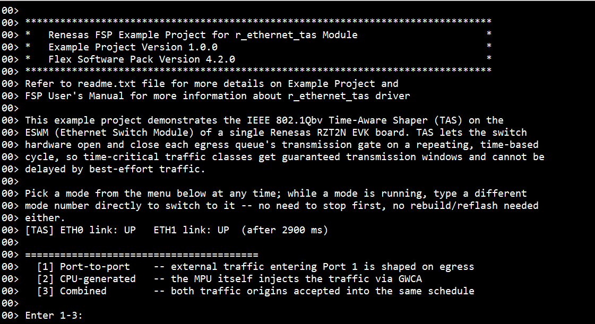

+ Console: Mode `[1]` Port-to-port Output:

  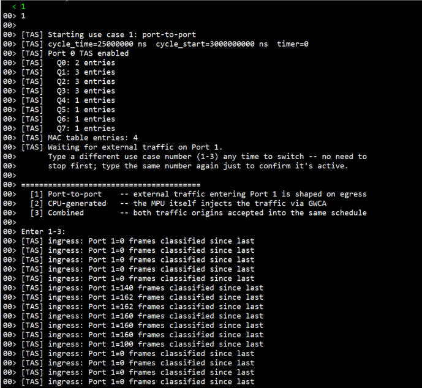

  Port 1 ingress reads 0 before the PC test script starts, settles around 140-160 frames/s
  while it runs, then drops back to 0 once it's stopped.

+ Console: Mode `[2]` CPU-generated Output:

  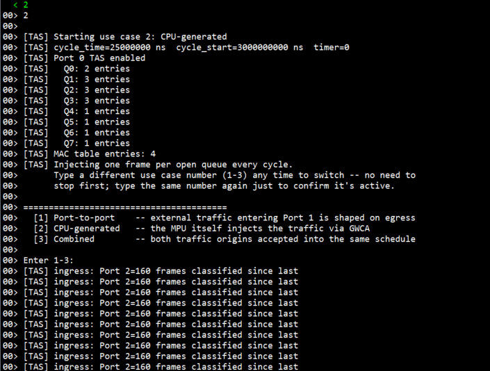

  Port 2 ingress holds steady at 160 frames/s the whole time - the board is its own traffic
  source, so there's no script to start/stop.

+ Console: Mode `[3]` Combined Output:

  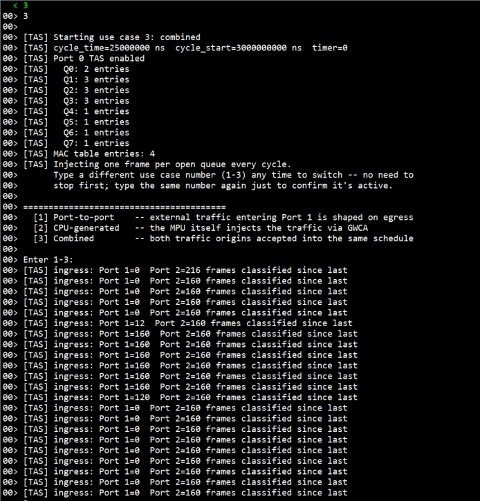

  Same pattern as the two modes above, seen together: Port 2 stays flat at 160 while Port 1
  tracks the script starting (0 -> ~160) and stopping (~160 -> 0).

+ Console: Switching to an Already-Active Mode:

  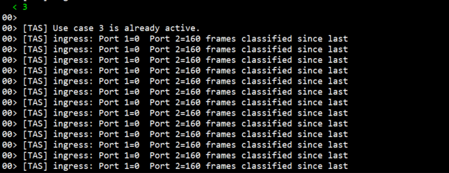

## Project Notes

### System-Level Block Diagram

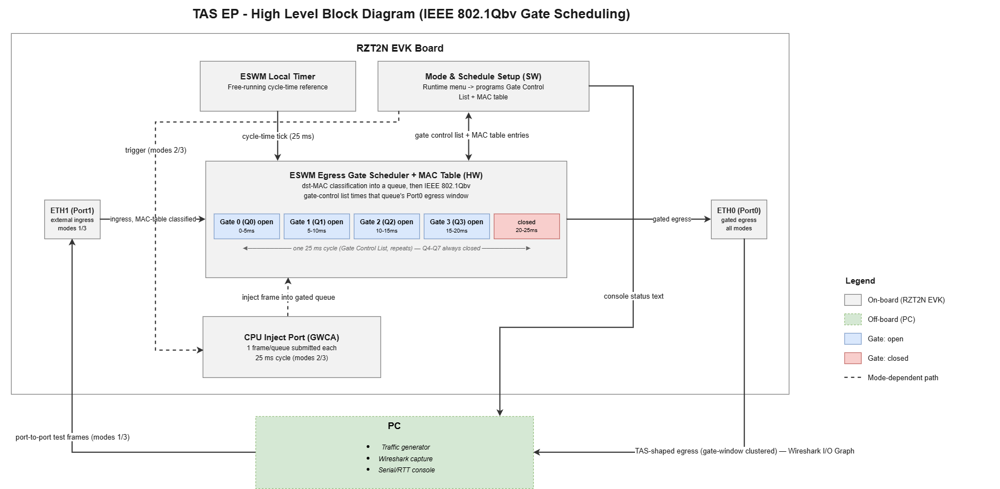

### FSP Modules Used

| Module Name | Usage | Searchable Keyword |
|---|---|---|
| Layer3 Switch | Controls ESWM TAS gate schedule, MAC table, CPU_INJECT GWCA TX, and table entry management | `r_layer3_switch` |
| gPTP | Provides the ESWM local free-running timer TAS gates against (standalone mode - no gPTP protocol sync in this EP) | `r_gptp` |
| Ethernet PHY | PHY setup, auto-negotiation/link detection for ETH0/ETH1 | `r_ether_phy` |
| Ethernet Selector | RGMII port mux configuration | `r_ether_selector` |
| SCI_UART | Console I/O - **Cortex-A55 only** (Cortex-R52 uses SEGGER RTT) | `r_sci_uart` |

### Module Configuration Notes

This section describes FSP Configurator properties which are important or different from those selected by default.

Configuration Properties for Layer3 Switch - `g_layer3_switch0` instance

Path: `configuration.xml > Stacks > g_layer3_switch0 Layer3 Ethernet Switch > Properties`

<div style="margin-left:2em; max-height:300px; overflow-y:auto; border:1px solid #ccc; border-radius:4px;">

| Module Property Path and Identifier | Default Value | Used Value | Reason |
| :----------------------------------: | :-----------: | :--------: | :----: |
| Module g_layer3_switch0 Layer3 Switch > Common > Time Aware Shaper | Disabled | Enabled | Without this, `ConfigureTAS()`/`EnableTAS()` return `FSP_ERR_UNSUPPORTED`. |
</div><br>

Path: `configuration.xml > Stacks > g_layer3_switch0 Layer3 Ethernet Switch > r_ether_phy0 ethernet (r_ether_phy) > g_ether_selector0 Ethernet SELECTOR (r_ether_selector) > Properties`

<div style="margin-left:2em; max-height:300px; overflow-y:auto; border:1px solid #ccc; border-radius:4px;">

| Module Property Path and Identifier | Default Value | Used Value | Reason |
| :----------------------------------: | :-----------: | :--------: | :----: |
| Module g_ether_selector0 Ethernet SELECTOR > Common > Ethernet Mode | Ethernet Switch + Ethernet Switch +Ethernet Switch + Ethernet MAC1 + Ethernet MAC2 | Layer3 Ethernet Switch + Layer3 Ethernet Switch + Ethernet MAC0 + Ethernet MAC1 + Ethernet MAC2 | Required peripheral personality for the `r_layer3_switch` API set.|
</div><br>

### API Usage
The link below lists the FSP-provided APIs used at the application layer.

* [Layer3 Switch Module APIs on FSP User Manual on GitHub](https://renesas.github.io/rz-fsp/group___r_z_t___l_a_y_e_r3___s_w_i_t_c_h.html)

### Memory Usage
Memory usage varies depending on target board, compiler, linker script, and enabled components.

**Reference Measurements:**

Measured using **Memory Usage view in e² studio** with the following conditions:
- Target: RZT2N EVK (R9A07G076)
- Core: Cortex-R52 (CR52_0)
- Compiler: GCC ARM
- Build: Debug

| Item | Approximate Size |
|---|---|
| Program / ROM image (Program + Constant + Initialized Data) | ~33.0 KB (33,816 bytes) |
| RAM (Initialized Data + Uninitialized Data + Data + Stack + Others) | ~75.1 KB (76,940 bytes) |
| Total on-chip RAM occupied (all Internal Ram regions, "Device Memory Usage" tab) | ~99.1 KB (101,496 bytes) |

Section sizes from the "Size" panel:

| Section | Bytes |
|---|---|
| Program (`.text`, code) | 18,444 |
| Constant (`.rodata`) | 6,112 |
| Initialized Data (`.data`) | 9,260 |
| Uninitialized Data (`.bss`) | 36,504 |
| Others (non-cached ETH buffers, FSP control blocks, TCM / vector sections) | 31,176 |
| Data / Stack | 0 / 0 (sized by the linker script, not a named section) |

Per-region occupancy from the "Device Memory Usage" tab:

| Internal Ram region | Used / Size | % |
|---|---|---|
| 0x00000000 - 0x0007FFFF | 62,104 / 524,288 | 11.85 % |
| 0x00100000 - 0x0010FFFF | 33,944 / 65,536 | 51.79 % |
| 0x10000000 - 0x101FFFFF | 5,448 / 2,097,152 | 0.26 % |
| ExternalRom / ExternalRam (0x40000000+, 0xA0000000+) | 0 | 0.00 % |

**Notes:**
* This Debug build links entirely into on-chip RAM (three `Internal Ram` windows); the External
  ROM and External RAM regions are unused. "Program / ROM image" is the loadable image size,
  not a separate flash figure.
* "Program / ROM image" and "RAM" overlap by the Initialized Data figure (9,260 bytes) - it is
  counted once as the load image and once as the live writable copy:
  `33,816 + 76,940 - 9,260 = 101,496`, the total on-chip RAM occupied.
* The DMA-visible TX buffers (`.noncache_buffer.eth`: `s_tx_desc[8][2]` and
  `s_tx_frame_buf[8][128]` from `tas_ep.o`, plus the FSP switch control block
  `g_layer3_switch0_ctrl` from `common_data.o`) are part of the `Others` figure and sit in the
  `0x10000000` SRAM window. For the exact section total, search `.noncache_buffer.eth` in
  `Debug/<project>.map`.
* Figures depend on linker-script configuration and the non-cached SRAM region layout.

**Accessing Memory Usage View in e² studio:**
```
Renesas Views -> C/C++ -> Memory Usage
```
Then select the target project in the Project Explorer to display memory details. For the
non-cached SRAM figure specifically, search `.noncache_buffer.eth` in the generated
`Debug/<project>.map` file.

### Clock Configuration

No special clock adjustments are necessary for this EP. TAS runs against the ESWM's local
free-running timer (`TAS_GPTP_TIMER=0`, standalone mode) - no gPTP protocol middleware is
required or used.

### Application Execution Flow

This section describes the sequence of events and API calls during the execution flow of the
application. The diagram shows the TAS operation flow: open the switch and start the timer
once, wait for both PHY links, then loop forever - apply the selected use case's schedule/MAC
table, run it (idle-wait or self-inject, plus external traffic for modes `[1]`/`[3]`), and poll
(non-blocking) for a different mode number to switch to, with no separate stop step.

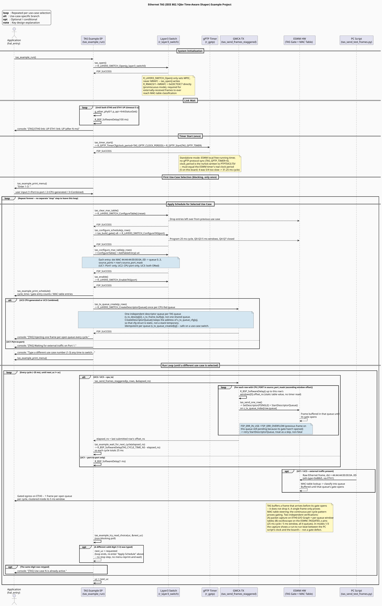

Refer to [`ethernet_tas_sequence_diagram.puml`](ethernet_tas_sequence_diagram.puml) for the
PlantUML source.

### Wireshark Verification Guide

#### What is Wireshark?

[Wireshark](https://www.wireshark.org/) is a free, open-source network packet analyzer. In this
EP, it is used to confirm that frames arrive on ETH0 (a) steered into the correct queue by
destination MAC and (b) clustered inside that queue's programmed 5 ms gate window rather than
spread uniformly across the 25 ms cycle - the actual signature of hardware gating, not just
MAC-table forwarding.

**Download and install:** https://www.wireshark.org/download.html - accept the default option
to install **Npcap**.

---

#### Basic filter syntax used in this EP

| Syntax | Meaning |
|---|---|
| `eth.dst == 44:44:44:00:00:0a` | Destination MAC address equals (Q0; `..0b`/`..0c`/`..0d` for Q1/Q2/Q3) |
| `eth.type == 0x88b5` | EtherType field equals 0x88B5 (this EP's test-frame EtherType) |
| `frame.len == 60` | Minimal-size frame - the board's own self-generated frames (modes `[2]`/`[3]`) |
| `frame.len == 1514` | Near-MTU frame - the PC script's externally-sent frames (modes `[1]`/`[3]`) |

---

#### Mode `[1]` Port-to-port Verification

**Recommended Wireshark setup:** Capture on the NIC connected to ETH0.

| Test case | Filter to apply | Expected |
|---|---|---|
| Frame steered to Q0 | `eth.dst == 44:44:44:00:00:0a` | **1 packet** appears (`--mode once`) |
| Same for Q1/Q2/Q3 | `..0b` / `..0c` / `..0d` | **1 packet** each |

Packet detail (expand **Ethernet II**): `Destination` = the target MAC, `Type` = `0x88b5`.

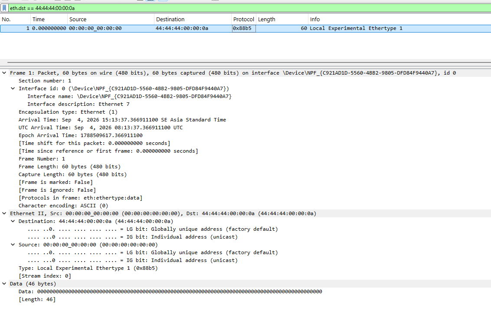

*Wireshark capture on ETH0 with filter `eth.dst == 44:44:44:00:00:0a` showing 1 packet received.*

**Gate-timing check (the actual TAS demonstration):** a single frame only proves MAC-table
steering works -- TAS *buffers* a late frame until the gate opens rather than dropping it, so
only *continuous* traffic actually demonstrates shaping.

1. Run `tas_send_test_frames.py --mode continuous` on the PC connected to ETH1.
2. On the ETH0 capture, use `eth.type == 0x88b5` and one graph line per destination MAC (4 colors).
3. Open **Statistics** tab -> I/O Graph, Y-axis unit = Packets, interval = 500 µs.
4. **Zoom into a 2-3 cycle window (~50-75 ms)** by click-drag on the graph rather than reading
   the whole capture at once - at full-capture zoom the bins compress too much to distinguish.

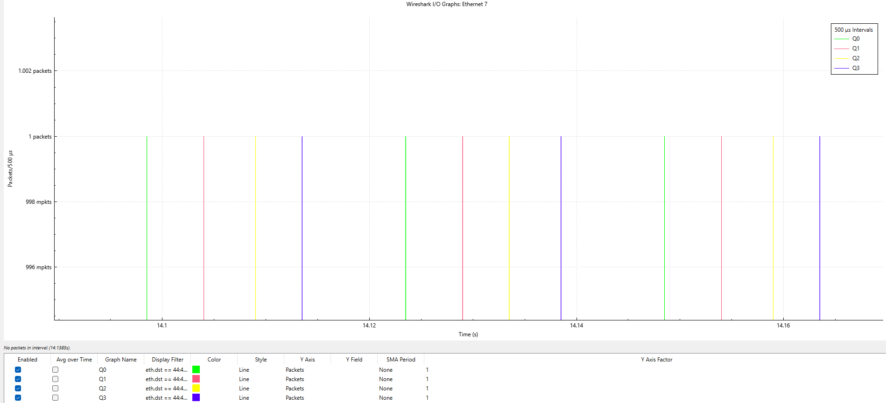

*I/O Graph, 500 µs interval, zoomed to 2-3 cycles: 4 colors (Q0-Q3), one burst per queue per 25 ms
cycle, non-overlapping. The PC script sends its 4 frames back-to-back within tens of µs, yet
arrivals on ETH0 spread across the cycle in a 5 ms grid - this can only happen if the board
holds each frame until its own gate opens, i.e. TAS is shaping the externally-sourced traffic,
not passing it through. The board's gate schedule itself is exact 25 ms / 5 ms (verified on the
oscilloscope, below); the small run-to-run variation visible here - one queue not reaching
height 2, uneven-looking gaps - is a beat artifact between the PC script's send clock and the
board's TAS clock (two independent, unsynchronized ~25 ms sources), not a gate error. Read
timing from the packet list, not from this graph.*

---

#### Mode `[2]` CPU-generated Verification

Fully self-contained - no PC script needed. Same I/O Graph procedure as mode `[1]`.

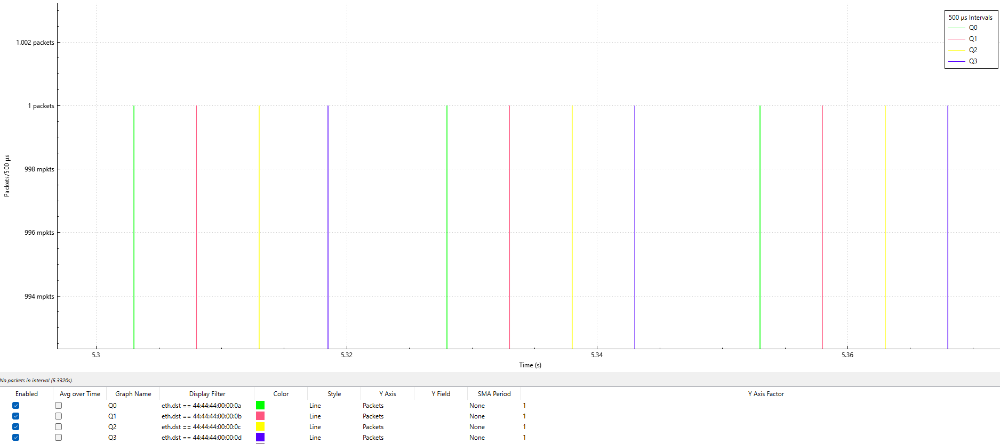

*I/O Graph for mode `[2]` - continuous packets to all 4 MACs with no PC script running,
confirming GWCA-originated frames are classified and gated exactly like externally-received
ones (MAC-table classification doesn't care how a frame entered the switch).*

**Quantitative gate-timing check.** Two complementary reads, both on a mode `[2]` capture
(single clock, no PC script):

*Aggregate count / duration:*
1. Filter `eth.type == 0x88b5`, let the capture run several seconds.
2. **Statistics -> Capture File Properties.**
3. Compare the packet count against `Time span, s / 0.025 x 4` (4 queues, one frame per queue
   per 25 ms cycle).

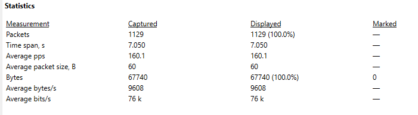

*Example: 1129 packets over a 7.050 s span -> `1129 / 7.050 = 160.1` pps total -> `40.0` pps
per queue -> `25.0 ms` average cycle, matching the programmed 25 ms schedule. Average packet
size 60 bytes = the board's own minimal self-generated frames. This aggregate check rules out
any dropped or duplicated cycle over the whole capture, more reliably than eyeballing individual
inter-arrival deltas.*

---

#### Mode `[3]` Combined Verification

The distinguishing property of combined mode: for each destination MAC, frames from **two
different origins** must land inside the **same** gate window.

1. Run the PC script (`--mode continuous`) while the board is on mode `[3]` (self-injecting at
   the same time).
2. Filter to one destination MAC. Add the **Length** column if not already visible
   (right-click any column header -> Column Preferences -> Add -> Length).
3. Find a pair of adjacent rows: one **~60 bytes** (board-origin) and one **~1514 bytes**
   (PC-origin).

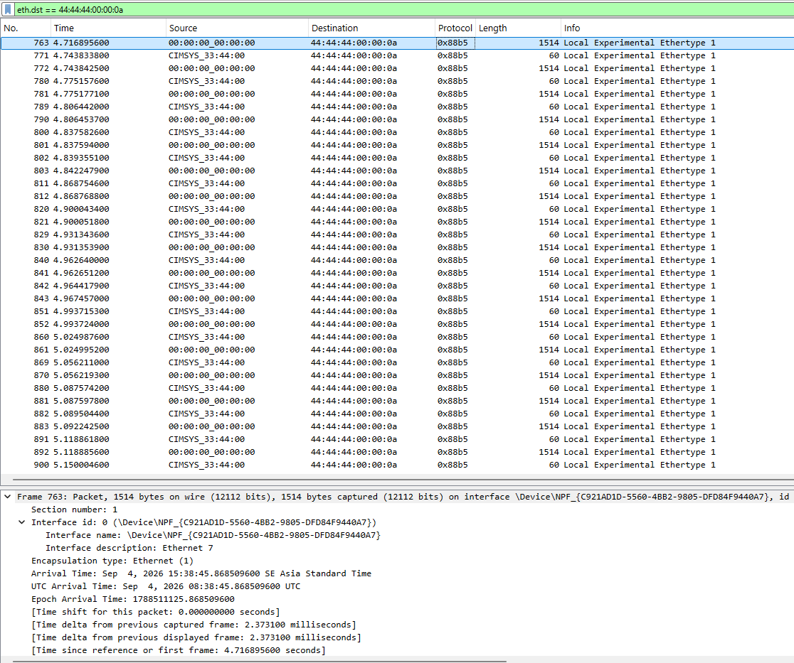

*Packet list filtered to `eth.dst == 44:44:44:00:00:0a`, alternating 1514-byte (PC) and 60-byte
(board) frames. A small time delta between two consecutive same-MAC frames of different origin,
both inside the same 5 ms gate window - confirming both origins are gated into the same window,
not just the same queue in isolation.*

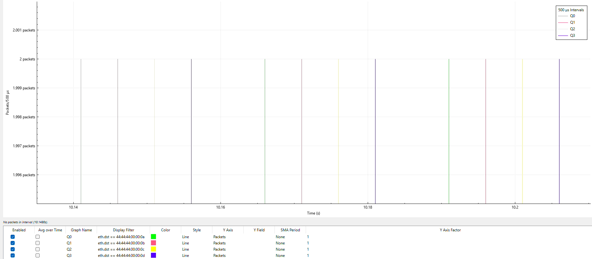

*I/O Graph for mode `[3]`, same 500 µs-bin setup as modes `[1]`/`[2]`. When the PC and board
clocks are momentarily in phase, both origins' frames for a queue land in the same 500 µs bin
and the spike reaches height 2; when they drift out of phase, they fall in adjacent bins (two
height-1 spikes). Which queues show which, and how it looks, changes run to run - the beat
between the two unsynchronized clocks (see the mode `[1]` graph caption). The gating itself is
correct in all cases: each queue's frames - both origins - stay inside that queue's 5 ms window.
Verify via the packet-list check and the oscilloscope, not this graph's exact appearance.*

---

#### Hardware gate-pin verification (oscilloscope)

Independent of any traffic or capture tool: the `ESWM_TASGATE0_x` pins output each queue's live
gate state directly. All 4 were probed on this EVK at these header positions:

| Queue | Signal | Board test point |
|---|---|---|
| Q0 | `ESWM_TASGATE0_0` | J26 pin 3 |
| Q1 | `ESWM_TASGATE0_1` | J50 pin 49 |
| Q2 | `ESWM_TASGATE0_2` | J26 pin 4 |
| Q3 | `ESWM_TASGATE0_3` | J52 pin 29 |

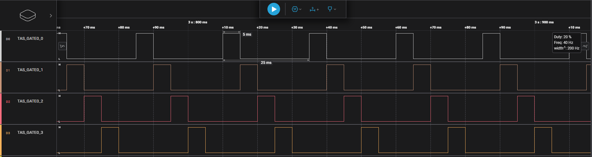

*Oscilloscope on an `ESWM_TASGATE0_x` pin, board running any mode: period exactly **25 ms**,
high pulse exactly **5 ms** (20 % duty) - the programmed schedule, measured at the silicon with
no software or capture tool in the path. All 4 queue pins measure the same 25 ms / 5 ms, each
offset by 5 ms from the previous (the schedule is identical across queues and modes). For the
schedule to run at this exact rate, `TAS_GPTP_CLOCK_PERIOD` in `tas_config.h` must match the
ESWM timer's real clock rate (5 ns/tick on this board).*

### Troubleshooting Tips

| Symptom | Likely Cause | Fix |
|---|---|---|
| `[TAS] ERROR: ... FSP_ERR_UNSUPPORTED` | `LAYER3_SWITCH_CFG_TAS_ENABLE` still 0 | Recheck FSP Configurator, regenerate, rebuild. |
| `ETH0 link: DOWN` / `ETH1 link: DOWN` right after reset | PHY auto-negotiation takes ~1-3 s | This line prints once, right after the link-wait loop; check cabling/LEDs if still DOWN after that. |
| Mode `[2]`/`[3]`: no self-generated packets at all | `s_tx_desc`/`s_tx_frame_buf` in `tas_ep.c` missing `BSP_ALIGN_VARIABLE(32)` / non-cached section placement | GWCA is a DMA engine and needs non-cached, aligned buffers. |
| Retyping the same mode number does nothing but print "already active" | Expected behavior, not a bug | No action needed - this is the type-to-switch console model. |

### Known Limitations

* `TAS_GPTP_TIMER` selects the ESWM's local free-running timer, not an IEEE 802.1AS-synchronized
  gPTP clock - no gPTP protocol middleware is vendored for RZT2N in the current FSP pack. A
  consequence: in modes `[1]`/`[3]` the PC test script and the board run on independent,
  unsynchronized ~25 ms clocks, so the I/O Graph for those modes shows a run-to-run beat
  artifact (one queue not reaching height 2, uneven-looking gaps, ~0.1 % of external frames a
  cycle late). This is a property of the two clocks, not a gate defect - the board's own
  CPU-origin traffic (mode `[2]`) is exact, and the gate pin measures exact 25 ms / 5 ms. For
  these two modes, verify by "each queue's frame lands inside its own 5 ms window", not
  "consecutive frames are 5 ms apart". The same effect shows up in the `[TAS] ingress: ...`
  console counter: Port 1 (external, modes `[1]`/`[3]`) reads a slightly different frame count
  each second (e.g. 140-162) instead of a flat number, while Port 2 (CPU-origin) holds exactly
  160 every time - expected, not a bug.
* RZT2N has an equivalent gate-status output under a different name - `ESWM_TASGATEn` (Hardware Manual
  sec. 31.6.3 / sec. 34.5.1.6.4). All 4 `ESWM_TASGATE0_x` pins were probed on this EVK (J26 pin 3 / J50
  pin 49 / J26 pin 4 / J52 pin 29 for Q0-Q3) and each measures exactly 25 ms / 5 ms.
* The gate schedule is fixed at build time (`tas_config.c`); only the *use case* (traffic
  source combination) is selectable at runtime, not the window timing itself.

## Special Topics

### GPTP Stack Configuration (required)

#### Background
The FSP Configurator's **HAL/Common Stacks** view shows an **"Add GPTP Driver to support TAS
feature or timestamp feature [Option]"** slot underneath `g_layer3_switch0 Layer3 Ethernet
Switch (r_layer3_switch)`. Despite being labeled **"[Option]"**, this stack is **required** for
this EP -- TAS depends on the ESWM's gPTP-derived cycle timer, and without this stack added the
project reports a Configurator stack error (the `g_layer3_switch0` stack itself is shown in red
with a warning icon until this is resolved).

#### Steps
##### Step 1: Add the GPTP stack under the Layer3 Ethernet Switch
- Open `configuration.xml` -> **HAL/Common Stacks** tab.
- Under `g_layer3_switch0 Layer3 Ethernet Switch (r_layer3_switch)`, locate the **"Add GPTP
  Driver to support TAS feature or timestamp feature [Option]"** slot.
- Click it -> **New -> Ethernet Generic PTP Timer (r_gptp)**.

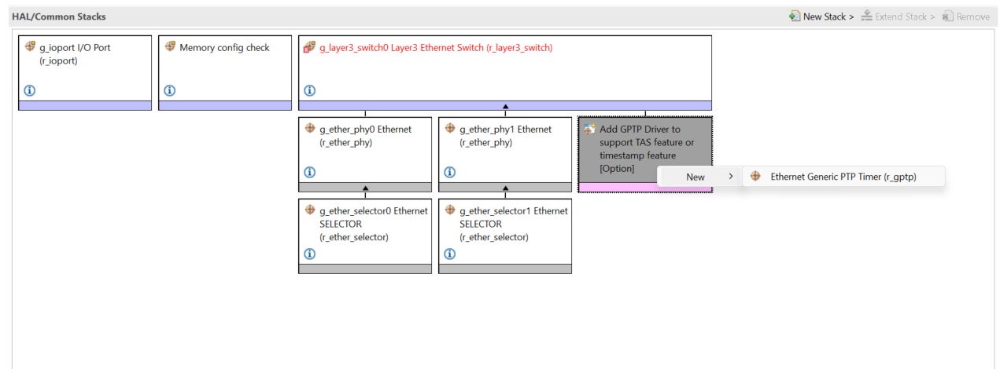

- Regenerate and rebuild. The `g_layer3_switch0` stack's red warning border should clear once
  the GPTP stack is added - if it doesn't, confirm the new `g_gptp0` stack is directly nested
  under `g_layer3_switch0`, not added as a separate top-level stack.

### CPU_INJECT path

`CPU_INJECT` is the internal GWCA/ESWM injection path used by modes `[2]`/`[3]` to submit
self-generated test frames into the switch. It is not a physical Ethernet connector - physical
output is always verified on ETH0.

### Why gate-timing needs continuous traffic, not a single frame

TAS *buffers* a frame that arrives before its queue's gate opens - it does not drop it. A
single injected frame therefore only proves MAC-table steering is correct, not that gating is
actually happening. Only continuous traffic - read via the I/O Graph clustering pattern, the
per-queue arrival check, or the oscilloscope on the gate pin - demonstrates the shaping
behavior itself.

## Conclusion and Next Steps
* To further explore TAS implementation on Renesas RZT2N:
  * Review the project source code in the `src/` directory (`tas_ep.c/h` is a reusable,
    print-free module - copy it plus `tas_ep.c` verbatim into another project; only
    `tas_config.{c,h}` needs to change).
  * Refer to the FSP User Manual for the `r_layer3_switch` driver for deeper technical detail.
  * Visit renesas.com for additional ESWM/TAS resources and application notes for RZT2N devices.

## References
* [FSP User Manual on GitHub](https://renesas.github.io/rz-fsp)
* [Example Project Usage Guide](https://github.com/renesas/rz-fsp-examples/blob/main/example_projects/Example%20Project%20Usage%20Guide.pdf)

## Notice

1. Descriptions of circuits, software and other related
information in this document are provided only to illustrate the
operation of semiconductor products and application examples. You are
fully responsible for the incorporation or any other use of the
circuits, software, and information in the design of your product or
system. Renesas Electronics disclaims any and all liability for any
losses and damages incurred by you or third parties arising from the use
of these circuits, software, or information. 

2. Renesas Electronics
hereby expressly disclaims any warranties against and liability for
infringement or any other claims involving patents, copyrights, or other
intellectual property rights of third parties, by or arising from the
use of Renesas Electronics products or technical information described
in this document, including but not limited to, the product data,
drawings, charts, programs, algorithms, and application examples. 

3. No license, express, implied or otherwise, is granted hereby under any
patents, copyrights or other intellectual property rights of Renesas
Electronics or others. 

4. You shall be responsible for determining what
licenses are required from any third parties, and obtaining such
licenses for the lawful import, export, manufacture, sales, utilization,
distribution or other disposal of any products incorporating Renesas
Electronics products, if required. 

5. You shall not alter, modify, copy,
or reverse engineer any Renesas Electronics product, whether in whole or
in part. Renesas Electronics disclaims any and all liability for any
losses or damages incurred by you or third parties arising from such
alteration, modification, copying or reverse engineering. 

6. Renesas Electronics products are classified according to the following two
quality grades: "Standard" and "High Quality". The intended applications
for each Renesas Electronics product depends on the product's quality
grade, as indicated below. "Standard": Computers; office equipment;
communications equipment; test and measurement equipment; audio and
visual equipment; home electronic appliances; machine tools; personal
electronic equipment; industrial robots; etc. "High Quality":
Transportation equipment (automobiles, trains, ships, etc.); traffic
control (traffic lights); large-scale communication equipment; key
financial terminal systems; safety control equipment; etc. Unless
expressly designated as a high reliability product or a product for
harsh environments in a Renesas Electronics data sheet or other Renesas
Electronics document, Renesas Electronics products are not intended or
authorized for use in products or systems that may pose a direct threat
to human life or bodily injury (artificial life support devices or
systems; surgical implantations; etc.), or may cause serious property
damage (space system; undersea repeaters; nuclear power control systems;
aircraft control systems; key plant systems; military equipment; etc.).
Renesas Electronics disclaims any and all liability for any damages or
losses incurred by you or any third parties arising from the use of any
Renesas Electronics product that is inconsistent with any Renesas
Electronics data sheet, user's manual or other Renesas Electronics
document. 

7. No semiconductor product is absolutely secure. Notwithstanding any security measures or features that may be implemented in Renesas Electronics hardware or software products, Renesas Electronics shall have absolutely no liability arising out of
any vulnerability or security breach, including but not limited to any unauthorized access to or use of a Renesas Electronics product or a system that uses a Renesas Electronics product. RENESAS ELECTRONICS DOES NOT WARRANT OR GUARANTEE THAT RENESAS ELECTRONICS PRODUCTS, OR ANY
SYSTEMS CREATED USING RENESAS ELECTRONICS PRODUCTS WILL BE INVULNERABLE OR FREE FROM CORRUPTION, ATTACK, VIRUSES, INTERFERENCE, HACKING, DATA LOSS OR THEFT, OR OTHER SECURITY INTRUSION ("Vulnerability Issues"). RENESAS ELECTRONICS DISCLAIMS ANY AND ALL RESPONSIBILITY OR LIABILITY
ARISING FROM OR RELATED TO ANY VULNERABILITY ISSUES. FURTHERMORE, TO THE EXTENT PERMITTED BY APPLICABLE LAW, RENESAS ELECTRONICS DISCLAIMS ANY AND ALL WARRANTIES, EXPRESS OR IMPLIED, WITH RESPECT TO THIS DOCUMENT
AND ANY RELATED OR ACCOMPANYING SOFTWARE OR HARDWARE, INCLUDING BUT NOT LIMITED TO THE IMPLIED WARRANTIES OF MERCHANTABILITY, OR FITNESS FOR A PARTICULAR PURPOSE. 

8. When using Renesas Electronics products, refer to the latest product information (data sheets, user's manuals, application notes, "General Notes for Handling and Using Semiconductor Devices" in
the reliability handbook, etc.), and ensure that usage conditions are within the ranges specified by Renesas Electronics with respect to
maximum ratings, operating power supply voltage range, heat dissipation characteristics, installation, etc. Renesas Electronics disclaims any
and all liability for any malfunctions, failure or accident arising out of the use of Renesas Electronics products outside of such specified
ranges. 

9. Although Renesas Electronics endeavors to improve the quality and reliability of Renesas Electronics products, semiconductor products
have specific characteristics, such as the occurrence of failure at a certain rate and malfunctions under certain use conditions. Unless
designated as a high reliability product or a product for harsh environments in a Renesas Electronics data sheet or other Renesas
Electronics document, Renesas Electronics products are not subject to radiation resistance design. You are responsible for implementing safety
measures to guard against the possibility of bodily injury, injury or damage caused by fire, and/or danger to the public in the event of a
failure or malfunction of Renesas Electronics products, such as safety design for hardware and software, including but not limited to
redundancy, fire control and malfunction prevention, appropriate treatment for aging degradation or any other appropriate measures.
Because the evaluation of microcomputer software alone is very difficult and impractical, you are responsible for evaluating the safety of the
final products or systems manufactured by you. 

10. Please contact a
Renesas Electronics sales office for details as to environmental matters such as the environmental compatibility of each Renesas Electronics
product. You are responsible for carefully and sufficiently investigating applicable laws and regulations that regulate the
inclusion or use of controlled substances, including without limitation, the EU RoHS Directive, and using Renesas Electronics products in
compliance with all these applicable laws and regulations. Renesas Electronics disclaims any and all liability for damages or losses
occurring as a result of your noncompliance with applicable laws and regulations. 

11. Renesas Electronics products and technologies shall not be used for or incorporated into any products or systems whose
manufacture, use, or sale is prohibited under any applicable domestic or foreign laws or regulations. You shall comply with any applicable export
control laws and regulations promulgated and administered by the governments of any countries asserting jurisdiction over the parties or
transactions. 

12. It is the responsibility of the buyer or distributor of Renesas Electronics products, or any other party who distributes,
disposes of, or otherwise sells or transfers the product to a third party, to notify such third party in advance of the contents and
conditions set forth in this document. 

13. This document shall not be
reprinted, reproduced or duplicated in any form, in whole or in part, without prior written consent of Renesas Electronics. 

14. Please contact a Renesas Electronics sales office if you have any questions regarding the information contained in this document or Renesas Electronics
products. (Note1) "Renesas Electronics" as used in this document means Renesas Electronics Corporation and also includes its directly or
indirectly controlled subsidiaries. (Note2) "Renesas Electronics product(s)" means any product developed or manufactured by or for
Renesas Electronics.

                                                                                   (Rev.5.0-1 October 2020)
## Corporate Headquarters 

Contact information TOYOSU FORESIA, 3-2-24

Toyosu, Koto-ku, Tokyo 135-0061, Japan 

www.renesas.com 

## Contact information 

For further information on a product, technology, the most up-to-date version of a
document, or your nearest sales office, please visit:
www.renesas.com/contact/. 

## Trademarks 
Renesas and the Renesas logo are trademarks of Renesas Electronics Corporation. All trademarks and
registered trademarks are the property of their respective owners.

							© 2026 Renesas Electronics Corporation. All rights reserved
