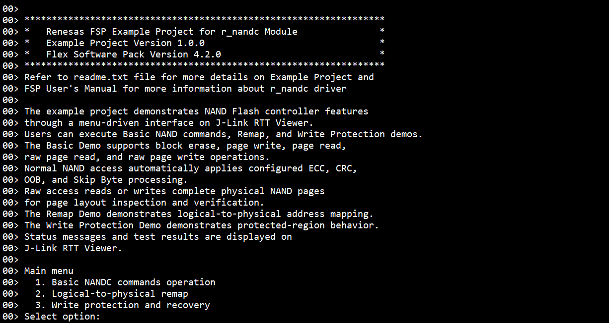
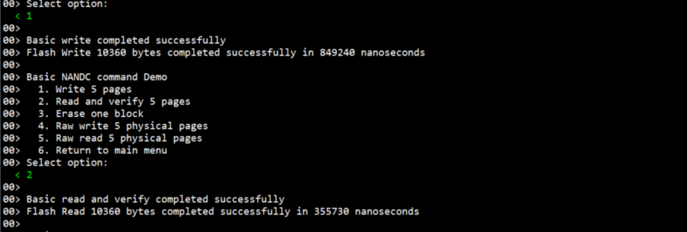
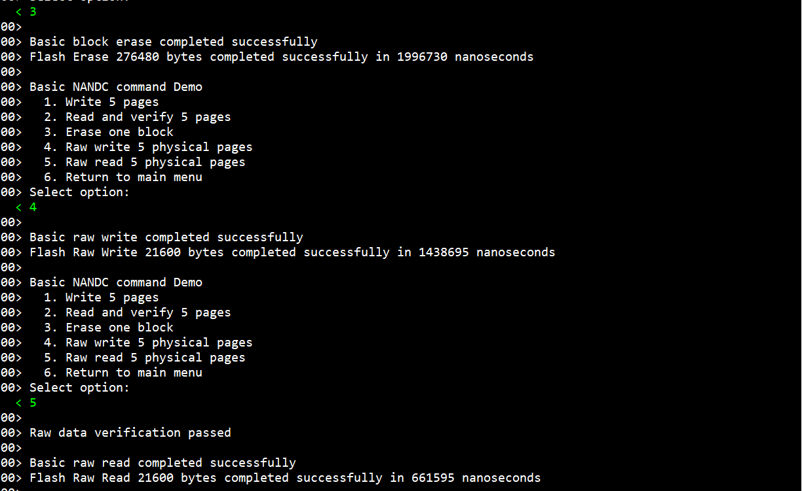
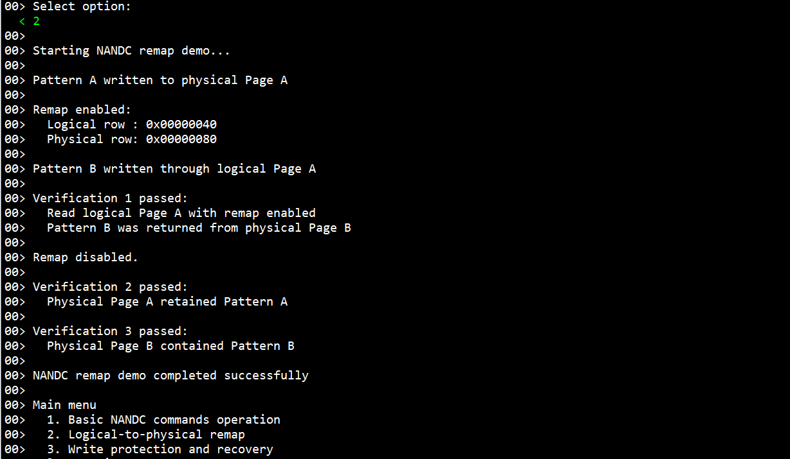
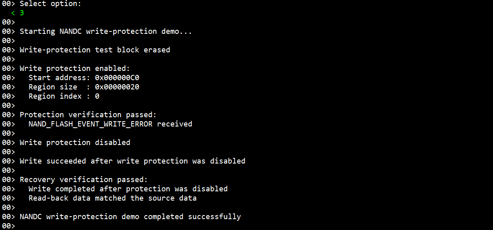
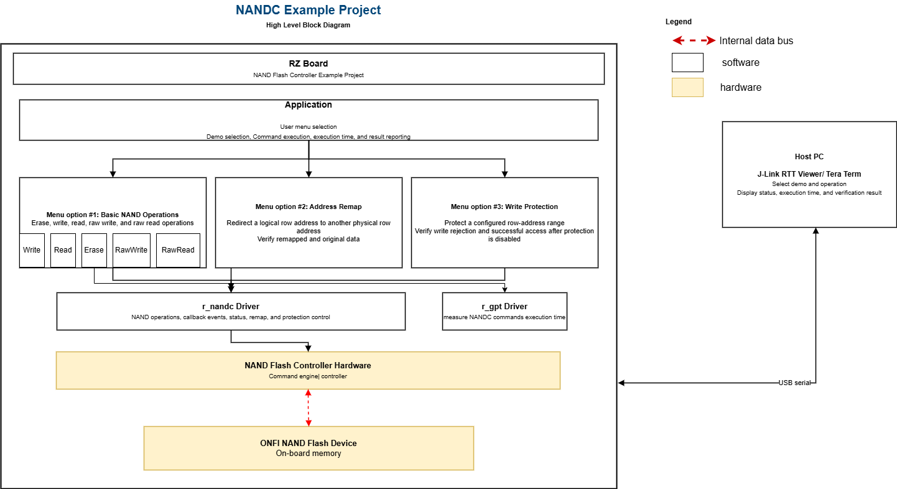
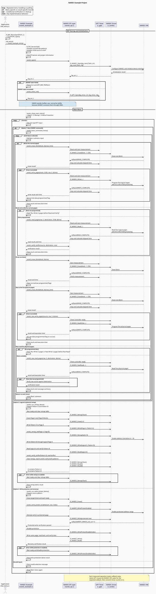

# NANDC Example Project on RZ board

## Table of Contents
- [NANDC Example Project on RZ board](#nandc-example-project-on-rz-board)
  - [Table of Contents](#table-of-contents)
  - [Introduction](#introduction)
    - [Supported Boards](#supported-boards)
  - [Required Resources](#required-resources)
    - [Hardware Requirements](#hardware-requirements)
      - [Common Hardware](#common-hardware)
    - [Software Requirements](#software-requirements)
  - [Application Execution](#application-execution)
  - [Project Notes](#project-notes)
    - [FSP Modules Used](#fsp-modules-used)
    - [Module Configuration Notes](#module-configuration-notes)
      - [Access Model and Constraints](#access-model-and-constraints)
    - [API Usage](#api-usage)
    - [Memory Usage](#memory-usage)
    - [Clock Configuration](#clock-configuration)
    - [Application Execution Flow](#application-execution-flow)
  - [Demo Verification](#demo-verification)
    - [Basic NAND Commands Demo Verification](#basic-nand-commands-demo-verification)
    - [Logical-to-Physical Remap Demo Verification](#logical-to-physical-remap-demo-verification)
    - [Write Protection Demo Verification](#write-protection-demo-verification)
  - [NANDC Example Project Performance Summary](#nandc-example-project-performance-summary)
  - [Troubleshooting Tips](#troubleshooting-tips)
  - [Known Limitations](#known-limitations)
  - [References](#references)
  - [Notice](#notice)
  - [Corporate Headquarters](#corporate-headquarters)
  - [Contact information](#contact-information)
  - [Trademarks](#trademarks)
## Introduction

The example project demonstrates NAND Flash controller features through a menu-driven interface on J-Link RTT Viewer/ Terminal Console Application.
Users can execute basic NAND commands, Remap, and Write Protection demos.
The Basic Demo supports block erase, page write, page read,raw page read, and raw page write operations.
Normal NAND access automatically applies configured ECC, CRC, OOB, and Skip Byte processing.
Raw access reads or writes complete physical NAND pages for page layout inspection and verification.
The Remap Demo demonstrates logical-to-physical address mapping.
The Write Protection Demo demonstrates protected-region behavior.
Status messages and test results are displayed on J-Link RTT Viewer/ Terminal Console Application.

Normal access uses the logical data layout configured in FSP. NANDC manages the associated page-formatting and data-protection fields. Raw access bypasses the logical sector layout and transfers every byte in the physical page.

Please refer to the [Example Project Usage Guide](https://github.com/renesas/rz-fsp-examples/blob/main/example_projects/Example%20Project%20Usage%20Guide.pdf) for general information on example projects.

### Supported Boards

| #  | Board | MPU | J-Link OB VCOM | SEGGER_RTT Address | Board-Specific Guide |
|----|-------|-----|----------------|----------------|----------------------|
| 1  | RZT2N EVK | R9A07G076M48GBG | ☑ | 0x101921e0 | [RZT2N EVK Guide](nandc_board_specific_notes.md#rzt2n-evk--board-specific-guide) |
...

 

**Note:**
* Boards marked with ☑ under **J-Link OB VCOM** support the J-Link On-Board Virtual COM Port.

## Required Resources
To build and run the NANDC example project, the following resources are needed.
### Hardware Requirements
#### Common Hardware
* RZ supported boards: RZ/T2N-EVK.
* 1 x Renesas RZ board.
* 1 x USB Type-C cable.
* 2 x USB Type-A to micro USB cables.

### Software Requirements

- Renesas Flexible Software Package (FSP): Version 4.2.0
- e² studio: Version 2026-07
- FSP Smart Configurator: Version 2026-07
- IAR: Version 9.60.3
- GCC ARM Embedded Toolchain: Version 13.3.1.arm-13-24 (for cortexR-52)
- GCC ARM A-Profile (AArch64 bare-metal): Version 13.2 rel1 (for cortexA-55)
- J-Link: Version 9.44
- J-Link RTT Viewer Version 9.44 (for cortexR-52)
- Terminal Console Application: Tera Term or a similar application (for cortexA-55)

**Note:** Refer to the [FSP version requirements](https://github.com/renesas/rz-fsp-examples/blob/main/example_projects/version_info_table.md) table per IDE to correctly download the needed [FSP release](https://github.com/renesas/rz-fsp/releases).

## Application Execution

1. Import the NANDC example project into e² studio / IAR.
2. Open the FSP Configuration editor/ FSP Smart Configurator and generate the project content.
3. Configure the hardware according to `nandc_board_specific_notes.md`.
4. Power on RZ board according to 'Debug and Power Connections' section in `nandc_board_specific_notes.md`.
5. Setup Terminal console to display.
   1. If using RTT Viewer: Open J-Link RTT Viewer for the active J-Link connection.
   2. If using Tera Term: Confirm the Renesas RZ board is recognized by the host PC as a COM port pair (e.g: COM5/COM6). Select the COM port with the higher number in the pair as the serial console port. If no output appears in the terminal while the program is running, reconnect using the other COM port in the pair.
      1. Set the configuration of Terminal Emulator (Tera Term) as follows:
          Speed: 115200 bps
          Data: 8 bit  
          Parity: none
          Stop bits: 1 bit
          Flow control: none
          * Set the terminal software reception line feed code to [AUTO].

6. Download the example project to Renesas RZ board.
   e² studio:
   * In [Project Explorer] view, right click the node of the project to be debugged and select [Debug As]->[Debug Configurations...] menu.
   * Select "nandc_rzt2n_evk_{cortex}_ep Debug_Flat" in the Renesas GDB Hardware Debugging node
and select [Debugger]->[Connection Settings].
   * Select [...] next to J-Link Serial value. When window is displayed, select one
of found probe and press the "OK" button.
   * Press [Debug] button.
   * When "Proceed with launch" window is displayed, select [Yes].
   * When "Confirm Perspective Switch" window is displayed, select [Switch].
   * Press the "Resume" button. The program will break at "hal_entry();"in main.

   IAR:
   * Click on the [Download and debug] button in the "Project" toolbar.
     The program will break at the first code in "main".
   * Press the [Go] button again to execute the program.

7. Select a demonstration from the main menu:
   - `1`: Basic NANDC Command Demo.
   - `2`: Remap Demo.
   - `3`: Write Protection Demo.
8.  Observe success, error, diagnostic, and execution-time messages.
9.  After an operation completes, select another operation or return to the main menu.

Example runtime menu:

+ EP Information Banner
   

+ NANDC Write, Read Output:

   

+ NANDC Erase, RawWrite, RawRead Output:

   

+ NANDC Remap address Output:

   

+ NANDC Write Protection Output:

   

## Project Notes

### FSP Modules Used
List of important modules used in this example project. Refer to the FSP User Manual for further details on each module listed below.
| Module  Name| Searchable Keyword | Usage |
|---|---|---|
| NAND Controller | `r_nandc` | Executes normal and raw NAND access, ECC/CRC processing, remap, and write protection |
| I/O Port | `r_ioport` | Provides board pin configuration |
| General PWM Timer | `r_gpt` | Measures NAND operation execution time |
| SCI UART | `r_sci_uart` | Handles serial data communication with host PC (CortexA-55 project only) |

### Module Configuration Notes

This section describes FSP Configurator properties which are important or different from those selected by default.

Configuration Properties for NAND Flash - `g_nand_flash` instance 

Path: `configuration.xml > Stacks > NAND Flash (r_nandc) > Properties`

| Module Property Path and Identifier | Default Value | Used Value | Reason |
| :----------------------------------: | :-----------: | :--------: | :----: |
| Data Size Configuration per Page > Main Data > Sector Bytes | 8192 | 2048 | 2048-byte main-data buffer used for each normal page operation. This value is also within the supported ECC sector-size range |
| Data Size Configuration per Page > OOB Data Bytes | 0  | 24 | Reserve 24 bytes of application OOB/control data per page |
| Signal Timings > Controller Signal Timings > RE# signal > RE# pulse width (NF_CLK cycles) | 25 | 6 | matching the Timing Mode 3 minimum `tRP`. |
| Signal Timings > Controller Signal Timings > RE# signal > RE# hold time (NF_CLK cycles) | 25 | 4 | matching the Timing Mode 3 minimum `tREH` | 
| Signal Timings > Controller Signal Timings > WE# signal > WE# pulse width (NF_CLK cycles) | 25 | 6 | matching the Timing Mode 3 minimum `tWP` |
| Signal Timings > Controller Signal Timings > WE# signal > WE# hold time (NF_CLK cycles) | 25 | 4 | matching the Timing Mode 3 minimum `tWH` |
| Signal Timings > Controller Signal Timings > RE# high to WE# low (NF_CLK cycles)  | 256 | 157  | Use the minimum value supported by the NANDC `TRHW` |
| Signal Timings > Controller Signal Timings > WE# high to RE# low (NF_CLK cycles) | 257 | 24 | matching the Timing Mode 3 minimum `tWHR` |
|Signal Timings > Controller Signal Timings > ALE to data loading time (NF_CLK cycles)  | 312 | 57 | Use the minimum value supported by the NANDC `TADL |
| Signal Timings > Controller Signal Timings > Command end to SR[6] low (NF_CLK cycles) | 266 | 52 |Use the minimum value supported by the NANDC `TWB`  |
| Signal Timings > Controller Signal Timings > RE# high to output hi-Z (NF_CLK cycles) | 257 | 40  | matching the Timing Mode 3 minimum `tRHZ` |
|Signal Timings > Controller Signal Timings > CE# setup time (NF_CLK cycles)  | 74 | 11 | matching the Timing Mode 3  |
| Signal Timings > Controller Signal Timings > CE# high hold time (NF_CLK cycles) | 64 | 8 | matching `tCEH` |
| Signal Timings > Controller Signal Timings > Interface and Timing Mode Change time (NF_CLK cycles) | 1341 | 400 | matching the required `tITC` interval after Set Feature or Reset |
| Signal Timings > NAND Flash Timing Mode > Timing Mode | Timing Mode 0 | Timing Mode 3 | Use the biggest timing mode supported  |
| Command Specifications > Skip Bytes for Marker Preservation > Skip Bytes Offset | 0 | 4096  | Position the preserved marker at the beginning of the physical spare area, immediately after the 4096-byte main area |
| Command Specifications > Skip Bytes for Marker Preservation > Skip Bytes Size | 0 | 2 | Preserve two marker bytes at physical page offsets |
| Command Specifications > Remap > Remap Enable | Disabled | Enabled | Enable logical-to-physical address translation required by the Remap Demo |
| Error Detection > CRC > Detect Error in Controller Data Path by CRC| Disabled | Enabled (8-byte CRC checksum added) | Detect errors in the NANDC controller data path. NANDC inserts an 8-byte CRC checksum after each sector.|
Error Detection > ECC > ECC Enable  | Disabled | Enabled | Enable automatic NAND data correction during normal Read and Write operations. |
| Error Detection > ECC > Correction Ability per Sector  | 8 bits (16 check bytes added) | 16 bits (30 check bytes added) | Provide 16-bit correction for each 2048-byte sector. NANDC inserts 30 ECC check bytes after each sector |

 

#### Access Model and Constraints

- Normal Read/Write application buffers contain only the configured logical main data and application OOB data.
- ECC bytes, CRC bytes, and Skip Bytes are managed by NANDC and are not included in normal application buffer sizes.
- Raw access transfers the complete 4320-byte physical page independently of the logical sector configuration.
- Raw access requires the command-complete interrupt.
- The application must wait for raw-access completion before invoking normal read, write, erase, copyback, or reset operations.
- Read, write, and raw buffers must be in an uncached region because NANDC uses internal DMA.
- The driver accesses the NAND device connected to `CE0#`. Chip-select arguments are ignored. `CE1#` through `CE3#` are not supported.
- Driver ONFI support is limited to ONFI v1.0.

### API Usage

| # | API | Usage in the Example Project |
|---:|---|---|
| 1 | `R_NANDC_Open()` | Initializes the NAND controller instance during startup |
| 2 | `R_NANDC_Write()` | Programs logical NAND page data using controller-managed formatting, ECC, and CRC |
| 3 | `R_NANDC_Read()` | Reads logical page data and supports programmed-data verification |
| 4 | `R_NANDC_Erase()` | Erases a NAND block before programming |
| 5 | `R_NANDC_RawWrite()` | Programs complete physical pages through raw access |
| 6 | `R_NANDC_RawRead()` | Reads complete physical pages for inspection |
| 7 | `R_NANDC_ControllerStatusGet()` | Checks controller readiness before the next operation |
| 8 | `R_NANDC_RemapSet()` | Configures logical-to-physical row-address remapping |
| 9 | `R_NANDC_RemapClear()` | Clears remap entries and restores normal addressing |
| 10 | `R_NANDC_WriteProtectEnable()` | Protects a configured NAND row-address range |
| 11 | `R_NANDC_WriteProtectDisable()` | Disables protect a configured NAND row-address range |
| 12 | `R_GPT_Open()` | Initializes the GPT timer instance |
| 13 | `R_GPT_Start()` | Starts timer in periodic counting mode|
| 14 | `R_GPT_Reset()` | Resets the timer counter value to 0 |
| 15 | `R_GPT_Stop()` | Stops timer |
| 16 | `R_GPT_StatusGet()` | Gets current timer status |
| 17 | `R_GPT_InfoGet()` | Gets timer information |

The links below list the FSP-provided APIs used at the application layer.
- [RZ/T NAND Flash Controller API](https://renesas.github.io/rz-fsp/group___r_z_t___n_a_n_d_c.html)
- [FSP Introduction and User Manual on GitHub](https://renesas.github.io/rz-fsp/)
### Memory Usage

Memory usage varies depending on the target board, compiler, linker script, and enabled components.

Reference notes:
- NANDC buffers must be placed in Non-cached memory.
- Stack, heap, callback state, and driver control data are additional to the transfer-buffer sizes above.

To review the linked image size in e² studio:

1. Open **Renesas Views > C/C++ > Memory Usage**.
2. Select the NANDC example project in **Project Explorer**.
3. Review ROM, RAM, and uncached-memory section allocations for the active build configuration.

### Clock Configuration

The NANDC uses NF_CLK for its clock source: NF_CLK 400.0MHz.

NF_CLK frequencies can be set on the Clocks tab of the FSP Configuration editor.

Besides, the example project uses GPT for time measurement with the PCLKGPTL clock source: 400.0MHz.

### Application Execution Flow

This section describes the sequence of events and API calls during application execution. The diagram shows the NANDC operation flow: initialize the NANDC driver and GPT timer once, then continuously process RTT menu selections. The Basic NANDC Commands Demo supports block erase, normal page write and read, and raw page write and read. Each command reports its execution time; Read and Raw Read also verify the data. The Remap Demo verifies logical-to-physical address translation using two data patterns, while the Write Protection Demo confirms that protected writes are rejected and that normal write and read-back operations succeed after protection is disabled. After each operation or demo completes, the application returns to the corresponding menu and waits for the next selection.

Refer to [`nandc_Sequence_Diagram.puml`](nandc_sequence_diagram.puml) for the PlantUML source.

## Demo Verification

### Basic NAND Commands Demo Verification

| Step | User Action / Operation | Verification |
|---:|---|---|
| 1 | Select **Basic Demo > Write** | Confirm block erase completes, five logical pages are programmed, a success message is printed, and execution time is reported |
| 2 | Select **Basic Demo > Read** | Confirm five logical pages are read and every main-data buffer matches the programmed source pattern |
| 3 | Select **Basic Demo > RawRead** after Write | Confirm one five-page raw read completes and the destination buffer can be inspected via adding 'g_basic_raw_destination' variable into "Expressions" tab while debugging on e² studio ; main data begins at offset `0` |
| 4 | Select **Basic Demo > RawWrite** | Confirm five physical pages are programmed, the write-complete event is received, and execution time is reported |
| 5 | Select **Basic Demo > RawRead** after RawWrite | Confirm the raw destination content matches the expected physical-page data layout |
| 6 | Select **Basic Demo > Erase** | Confirm one block is erased and both Basic and raw programmed-data states are cleared |
| 7 | Select **Read** after Erase | Confirm the application blocks the request and instructs the user to program data first |

### Logical-to-Physical Remap Demo Verification

| Step | Verification |
|---:|---|
| 1 | With remap disabled, program pattern A at Logical page A |
| 2 | Configure `R_NANDC_RemapSet()` to map Logical page A to Physical page B |
| 3 | Address Logical page A and program pattern B; confirm NANDC redirects the access to Physical page B |
| 4 | Read Logical page A while remap is enabled; verify pattern B |
| 5 | Call `R_NANDC_RemapClear()` |
| 6 | Read page A; verify the original pattern A remains unchanged |
| 7 | Read Physical page B directly; verify pattern B |

The demo passes only when all three final data checks succeed: mapped `Read(A)` returns pattern B, unmapped `Read(A)` returns pattern A, and direct `Read(B)` returns pattern B.

### Write Protection Demo Verification

| Step | Verification |
|---:|---|
| 1 | Erase the target block before configuring protection |
| 2 | Enable write protection for the target row-address range with `R_NANDC_WriteProtectEnable()` |
| 3 | Attempt to program a protected page; confirm the write does not complete successfully |
| 4 | Confirm the callback reports a command error and the protection-error status is asserted |
| 5 | Disable the protected range with `R_NANDC_WriteProtectDisable()` |
| 6 | Program the same page again; confirm the write completes without a protection error |
| 7 | Read back the page and compare it with the source buffer |

The demo passes only when the protected write is rejected and the post-disable write and read-back comparison both succeed.

## NANDC Example Project Performance Summary

| Operation | Pages / Blocks     | Data Size (Bytes) | Avg. Execution Time (µs) | Avg.Throughput (MB/s) | Throughput Calculation Basis |
| --------- | ------------------ | ----------------: | ------------------: | ----------------: |-------------------------------------: |
| Read      | 5 pages            |            10,360 (10.12 KB) |              355.16 |             29.17 | Based on the amount of user data returned by R_NANDC_Read(), including main data and OOB data only. ECC correction, CRC checking, scrambling/descrambling, and skip-byte handling are performed internally by the NANDC hardware. |
| Write     | 5 pages            |            10,360 (10.12 KB) |              871.62 |             11.88 | Based on the amount of user data written by R_NANDC_Write(), including main data and OOB data. ECC bytes, CRC bytes, and skip bytes are excluded because they are automatically generated and handled by the NANDC hardware. |
| Raw Read  | 5 physical pages   |            21,600 (21.09 KB) |              661.51 |             32.65 | Calculated using the entire physical page image returned by R_NANDC_RawRead(), including main data, OOB data, ECC bytes, CRC bytes, and skip-byte regions.  | 
| Raw Write | 5 physical pages   |            21,600 (21.09 KB) |            1,417.11 |             15.24 | Calculated using the entire physical page image supplied to R_NANDC_RawWrite(), including main data, OOB data, ECC bytes, CRC bytes, and skip-byte regions. |
| Erase     | 1 block (64 pages) |           276,480 (270.00 KB)|              704.63 |               N/A | Measured for one physical erase block containing 64 pages. |

Measurement conditions:
  - Target Device: RZ/T2N_EVK on CortexR-52, MT29F8G08ABACAWP ONFI NAND Flash
  - Build Configuration: Debug Build
  - Compiler Optimization Level: -O2
  - Averaging Method: Arithmetic mean of 10 consecutive measurement runs
  
Notes:
- Throughput uses decimal MB/s: `data size (bytes) / execution time (second) / 1,000,000`.
- Erase throughput is marked `N/A` because erase changes the NAND block state rather than transferring the listed block capacity through an application data buffer.
- Erase timing was measured on a block that had been previously programmed by the write test. The measured value therefore represents the time required to erase a programmed block.
- Values are measured results for the documented project configuration. They are not NAND device datasheet limits.

## Troubleshooting Tips

| Symptom | Likely Cause | Recommended Check |
|---|---|---|
| Normal read verification fails | Data was not programmed, wrong row was accessed, or buffers are not coherent | Run Write first; check row addresses and uncached buffer placement |
| Raw access does not complete | Command-complete interrupt is disabled or callback state is incorrect | Enable the interrupt and verify callback/event handling |
| Operation after RawRead/RawWrite fails | The next command was issued before raw access completed | Wait for the completion event and confirm controller-ready status |
| DMA-related data corruption | Buffer is in cached memory | Place all NAND read/write/raw buffers in the configured uncached region |
| Protected write unexpectedly succeeds | Protected range, size, or index does not cover the target row | Verify start address, protected size, index, and target row |
| Remap verification fails | Logical/physical row pair or remap state is incorrect | Verify the mapping pair and clear remap before checking original addresses |

## Known Limitations

- Only the NAND device connected to `CE0#` is supported by the driver configuration described here. `CE1#` through `CE3#` are not supported.
- ONFI support is limited to ONFI v1.0.

## References

- [RZ/T NAND Flash Controller Reference on GitHub](https://renesas.github.io/rz-fsp/group___r_z_t___n_a_n_d_c.html)
- [RZ Flexible Software Package Documentation](https://renesas.github.io/rz-fsp/)
- [Example Project Usage Guide](https://github.com/renesas/rz-fsp-examples/blob/main/example_projects/Example%20Project%20Usage%20Guide.pdf)

## Notice

1. Descriptions of circuits, software and other related
information in this document are provided only to illustrate the
operation of semiconductor products and application examples. You are
fully responsible for the incorporation or any other use of the
circuits, software, and information in the design of your product or
system. Renesas Electronics disclaims any and all liability for any
losses and damages incurred by you or third parties arising from the use
of these circuits, software, or information. 

2. Renesas Electronics
hereby expressly disclaims any warranties against and liability for
infringement or any other claims involving patents, copyrights, or other
intellectual property rights of third parties, by or arising from the
use of Renesas Electronics products or technical information described
in this document, including but not limited to, the product data,
drawings, charts, programs, algorithms, and application examples. 

3. No license, express, implied or otherwise, is granted hereby under any
patents, copyrights or other intellectual property rights of Renesas
Electronics or others. 

4. You shall be responsible for determining what
licenses are required from any third parties, and obtaining such
licenses for the lawful import, export, manufacture, sales, utilization,
distribution or other disposal of any products incorporating Renesas
Electronics products, if required. 

5. You shall not alter, modify, copy,
or reverse engineer any Renesas Electronics product, whether in whole or
in part. Renesas Electronics disclaims any and all liability for any
losses or damages incurred by you or third parties arising from such
alteration, modification, copying or reverse engineering. 

6. Renesas Electronics products are classified according to the following two
quality grades: "Standard" and "High Quality". The intended applications
for each Renesas Electronics product depends on the product's quality
grade, as indicated below. "Standard": Computers; office equipment;
communications equipment; test and measurement equipment; audio and
visual equipment; home electronic appliances; machine tools; personal
electronic equipment; industrial robots; etc. "High Quality":
Transportation equipment (automobiles, trains, ships, etc.); traffic
control (traffic lights); large-scale communication equipment; key
financial terminal systems; safety control equipment; etc. Unless
expressly designated as a high reliability product or a product for
harsh environments in a Renesas Electronics data sheet or other Renesas
Electronics document, Renesas Electronics products are not intended or
authorized for use in products or systems that may pose a direct threat
to human life or bodily injury (artificial life support devices or
systems; surgical implantations; etc.), or may cause serious property
damage (space system; undersea repeaters; nuclear power control systems;
aircraft control systems; key plant systems; military equipment; etc.).
Renesas Electronics disclaims any and all liability for any damages or
losses incurred by you or any third parties arising from the use of any
Renesas Electronics product that is inconsistent with any Renesas
Electronics data sheet, user's manual or other Renesas Electronics
document. 

7. No semiconductor product is absolutely secure. Notwithstanding any security measures or features that may be implemented in Renesas Electronics hardware or software products, Renesas Electronics shall have absolutely no liability arising out of
any vulnerability or security breach, including but not limited to any unauthorized access to or use of a Renesas Electronics product or a system that uses a Renesas Electronics product. RENESAS ELECTRONICS DOES NOT WARRANT OR GUARANTEE THAT RENESAS ELECTRONICS PRODUCTS, OR ANY
SYSTEMS CREATED USING RENESAS ELECTRONICS PRODUCTS WILL BE INVULNERABLE OR FREE FROM CORRUPTION, ATTACK, VIRUSES, INTERFERENCE, HACKING, DATA LOSS OR THEFT, OR OTHER SECURITY INTRUSION ("Vulnerability Issues"). RENESAS ELECTRONICS DISCLAIMS ANY AND ALL RESPONSIBILITY OR LIABILITY
ARISING FROM OR RELATED TO ANY VULNERABILITY ISSUES. FURTHERMORE, TO THE EXTENT PERMITTED BY APPLICABLE LAW, RENESAS ELECTRONICS DISCLAIMS ANY AND ALL WARRANTIES, EXPRESS OR IMPLIED, WITH RESPECT TO THIS DOCUMENT
AND ANY RELATED OR ACCOMPANYING SOFTWARE OR HARDWARE, INCLUDING BUT NOT LIMITED TO THE IMPLIED WARRANTIES OF MERCHANTABILITY, OR FITNESS FOR A PARTICULAR PURPOSE. 

8. When using Renesas Electronics products, refer to the latest product information (data sheets, user's manuals, application notes, "General Notes for Handling and Using Semiconductor Devices" in
the reliability handbook, etc.), and ensure that usage conditions are within the ranges specified by Renesas Electronics with respect to
maximum ratings, operating power supply voltage range, heat dissipation characteristics, installation, etc. Renesas Electronics disclaims any
and all liability for any malfunctions, failure or accident arising out of the use of Renesas Electronics products outside of such specified
ranges. 

9. Although Renesas Electronics endeavors to improve the quality and reliability of Renesas Electronics products, semiconductor products
have specific characteristics, such as the occurrence of failure at a certain rate and malfunctions under certain use conditions. Unless
designated as a high reliability product or a product for harsh environments in a Renesas Electronics data sheet or other Renesas
Electronics document, Renesas Electronics products are not subject to radiation resistance design. You are responsible for implementing safety
measures to guard against the possibility of bodily injury, injury or damage caused by fire, and/or danger to the public in the event of a
failure or malfunction of Renesas Electronics products, such as safety design for hardware and software, including but not limited to
redundancy, fire control and malfunction prevention, appropriate treatment for aging degradation or any other appropriate measures.
Because the evaluation of microcomputer software alone is very difficult and impractical, you are responsible for evaluating the safety of the
final products or systems manufactured by you. 

10. Please contact a
Renesas Electronics sales office for details as to environmental matters such as the environmental compatibility of each Renesas Electronics
product. You are responsible for carefully and sufficiently investigating applicable laws and regulations that regulate the
inclusion or use of controlled substances, including without limitation, the EU RoHS Directive, and using Renesas Electronics products in
compliance with all these applicable laws and regulations. Renesas Electronics disclaims any and all liability for damages or losses
occurring as a result of your noncompliance with applicable laws and regulations. 

11. Renesas Electronics products and technologies shall not be used for or incorporated into any products or systems whose
manufacture, use, or sale is prohibited under any applicable domestic or foreign laws or regulations. You shall comply with any applicable export
control laws and regulations promulgated and administered by the governments of any countries asserting jurisdiction over the parties or
transactions. 

12. It is the responsibility of the buyer or distributor of Renesas Electronics products, or any other party who distributes,
disposes of, or otherwise sells or transfers the product to a third party, to notify such third party in advance of the contents and
conditions set forth in this document. 

13. This document shall not be
reprinted, reproduced or duplicated in any form, in whole or in part, without prior written consent of Renesas Electronics. 

14. Please contact a Renesas Electronics sales office if you have any questions regarding the information contained in this document or Renesas Electronics
products. (Note1) "Renesas Electronics" as used in this document means Renesas Electronics Corporation and also includes its directly or
indirectly controlled subsidiaries. (Note2) "Renesas Electronics product(s)" means any product developed or manufactured by or for
Renesas Electronics.

                                                                                   (Rev.5.0-1 October 2020)
## Corporate Headquarters 

Contact information TOYOSU FORESIA, 3-2-24

Toyosu, Koto-ku, Tokyo 135-0061, Japan 

www.renesas.com 

## Contact information 

For further information on a product, technology, the most up-to-date version of a
document, or your nearest sales office, please visit:
www.renesas.com/contact/. 

## Trademarks 
Renesas and the Renesas logo are trademarks of Renesas Electronics Corporation. All trademarks and
registered trademarks are the property of their respective owners.

							© 2026 Renesas Electronics Corporation. All rights reserved
