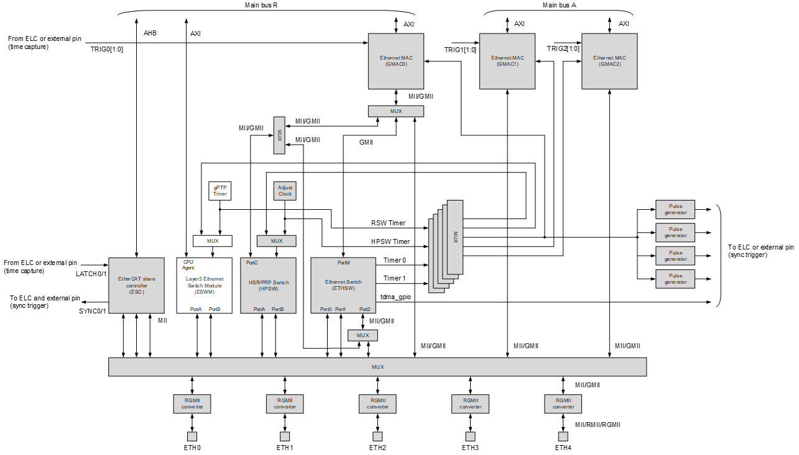
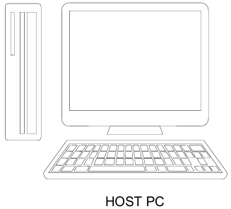
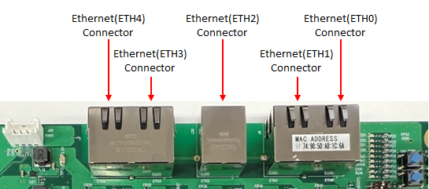
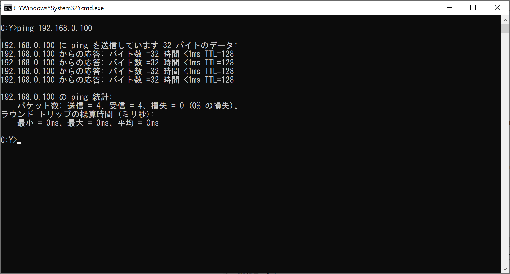
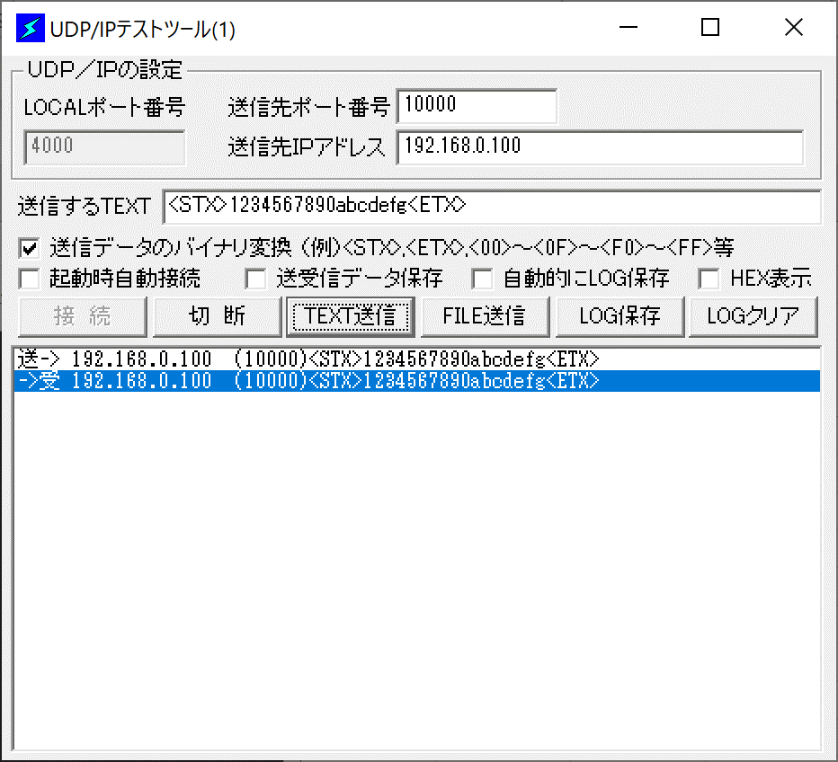
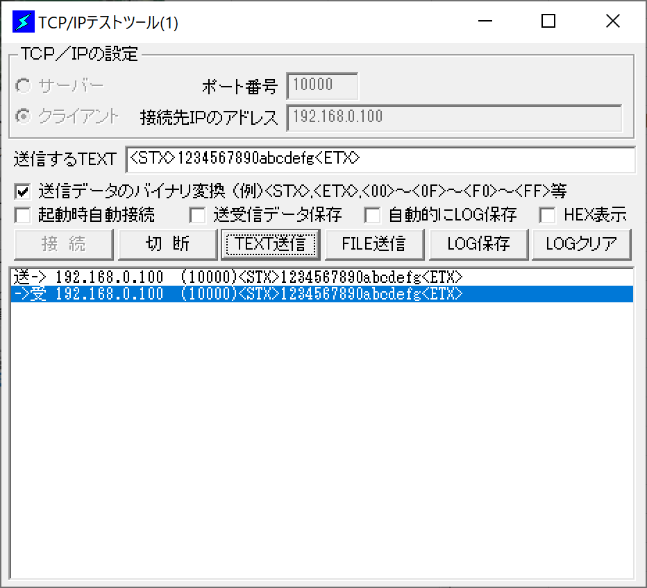

# Introduction #

Project name: `FreeRTOSplusTCP_rzt2n_evk_cr52_0_ep`

This project demonstrates the basic functionality of FreeRTOS+TCP on Renesas RZ/T2N MCUs based on
the Renesas RZ FSP. The sample uses the RZ/T2N Ethernet driver and brings up GMAC0, which is connected
to the ETH0, ETH1 and ETH2 ports through the Ethernet switch (ETHSW). Once the board has linked up,
it responds to ICMP echo requests on the address 192.168.0.100 and runs a UDP echo server and a TCP
echo server on port 10000. LED2 blinks at a one second cycle to indicate that the RTOS scheduler is
running.

Please refer to [readme.txt](./readme.txt) for specifics of operation, including board switch settings
and the debugging procedure for each toolchain.

## Required Resources ##
To build and run the FreeRTOS+TCP example project, the following resources are needed.

### Hardware ###
* 1 x RZ/T2N Evaluation board (target core: Cortex-R52 CPU0, operating frequency 800MHz)
* 1 x IAR I-jet (for debugging in IAR EWARM)
* 1 x USB Micro-B cable (for J-Link OB)
* 1 x USB Type-C cable supporting power delivery (PD) and 15V/3A DC (for power supply)
* 1 x AC adapter for USB supporting 15V/3A
* 3 x Ethernet cable
* 1 x Host PC with 3 Ethernet ports (only 1 port is needed unless 3-port simultaneous communication is evaluated)

Refer to [readme.txt](./readme.txt) for information on how to connect the hardware.

### Software ###
1. IAR Embedded Workbench for ARM 9.60.3 + patch, with Smart Configurator and RZ_FSP_Packs_v4.2.0
2. e²studio 2026-07 with RZ FSP 4.2.0, toolchain GNU ARM Embedded 13.3.1.arm-13-24
3. J-Link v9.44
4. A packet sending tool on the host PC for the UDP and TCP echo tests

## Related Collateral References ##
The following documents can be referred to for enhancing your understanding of
the operation of this example project:
- [FSP User Manual on GitHub](https://renesas.github.io/fsp/)
- [FreeRTOS+TCP Documentation](https://www.freertos.org/FreeRTOS-Plus/FreeRTOS_Plus_TCP/index.html)
- [FSP Known Issues](https://github.com/renesas/fsp/issues)

# Project Notes #

## System Level Block Diagram ##
High level block diagram

GMAC0 is the only GMAC supported by this sample program; GMAC1 and GMAC2 are not supported.
Communication on ETH3 and ETH4 is not supported either. On the RZ/T2N Evaluation board, ETH0, ETH1 and
ETH2 can only be used in RGMII mode.

## FSP Modules Used ##
List of important modules that are used in this example project. Refer to the FSP User Manual for
further details on each module listed below.

| Module Name | Usage | Searchable Keyword |
|-------------|-----------------------------------------------|-----------------------------------------------|
| FreeRTOS | Real-time kernel providing the threads used by this example project. | FreeRTOS |
| FreeRTOS+TCP | TCP/IP stack providing the ICMP, UDP and TCP services exercised by this example project. | FreeRTOS+TCP |
| Ethernet Driver (GMAC) | Provides the MAC layer used by FreeRTOS+TCP. GMAC0 is used in this example project. | r_gmac |
| Ethernet Switch (ETHSW) | Connects GMAC0 to the ETH0, ETH1 and ETH2 ports of the Evaluation board. | r_ethsw |

*Note: confirm the module names and searchable keywords above against `configuration.xml` in the
delivered project before submission.*

## Module Configuration Notes ##
This section describes FSP Configurator properties which are important or different than those
selected by default.

**Common Configuration properties**

|   Module Property Path and Identifier   |   Default Value   |   Used Value   |   Reason   |
| :-------------------------------------: | :---------------: | :------------: | :--------: |
| configuration.xml > BSP > Properties > Settings > Property > Main Stack Size (bytes) | - | - | To be filled in from the delivered project. |
| configuration.xml > BSP > Properties > Settings > Property > Heap Size (bytes) | - | - | To be filled in from the delivered project. |
| configuration.xml > FreeRTOS+TCP > Properties > Settings > Property > IP Address | - | 192.168.0.100 | Fixed address the sample program responds on. |
| configuration.xml > Ethernet > Properties > Settings > Property > PHY Interface | - | RGMII | ETH0, ETH1 and ETH2 on the Evaluation board can only be used in RGMII mode. |

*Note: the property paths above follow the FSP Configurator tree. Fill in the default and used values
from the delivered project before submission.*

The table below lists the FSP provided API used at the application layer by this example project.

| API Name | Usage |
|-------------|--------------------------------------------------------------------------------|
| FreeRTOS_IPInit | This API is used to initialize the FreeRTOS+TCP stack |
| FreeRTOS_socket | This API is used to create a UDP or TCP socket |
| FreeRTOS_bind | This API is used to bind a socket to a port number |
| FreeRTOS_listen | This API is used to place a TCP socket into the listening state |
| FreeRTOS_accept | This API is used to accept an incoming TCP connection |
| FreeRTOS_recvfrom | This API is used to receive a UDP datagram |
| FreeRTOS_sendto | This API is used to send a UDP datagram |
| FreeRTOS_recv | This API is used to receive data on a TCP connection |
| FreeRTOS_send | This API is used to send data on a TCP connection |
| FreeRTOS_closesocket | This API is used to close a socket |

*Note: confirm the API list above against the delivered source files before submission.*

## Verifying operation ##
1. Import, generate and build the example project.
2. Set the board switches as described in [readme.txt](./readme.txt) and connect the Ethernet cables
   between the host PC and the "ETH0", "ETH1" or "ETH2" connector on the board.
3. Set the IP address of the host PC Ethernet port so that it belongs to the same network as the
   board address 192.168.0.100.
4. Start debugging and run the application program.
5. Enter the `ping 192.168.0.100` command from the host PC command prompt and confirm that there is a
   ping response.

   

6. Check that "LED2" on the board blinks at a 1 second cycle.
7. Send a UDP packet from the host PC to IP address 192.168.0.100 and port number 10000, and confirm
   that there is an echo response.

   

8. Send a TCP packet from the host PC to IP address 192.168.0.100 and port number 10000, and confirm
   that there is an echo response.

   

* Note:
When evaluating 3-port simultaneous communication, three Ethernet ports are required on the host PC side.
Since this sample program executes from RAM, it is prohibited to press the "Reset" button during debugging.
