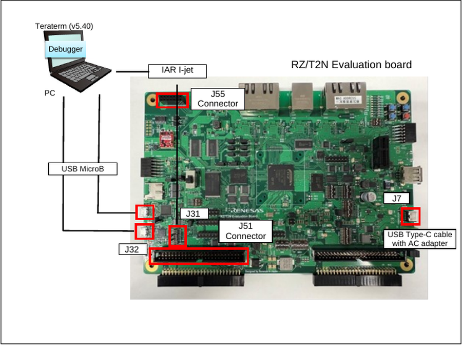
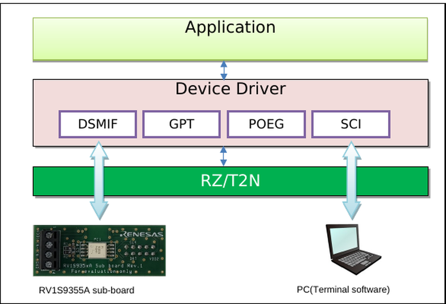
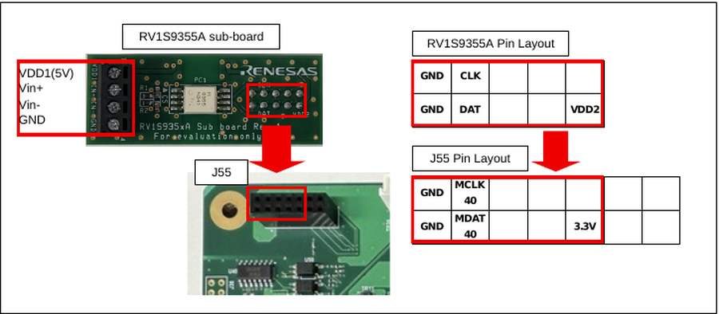
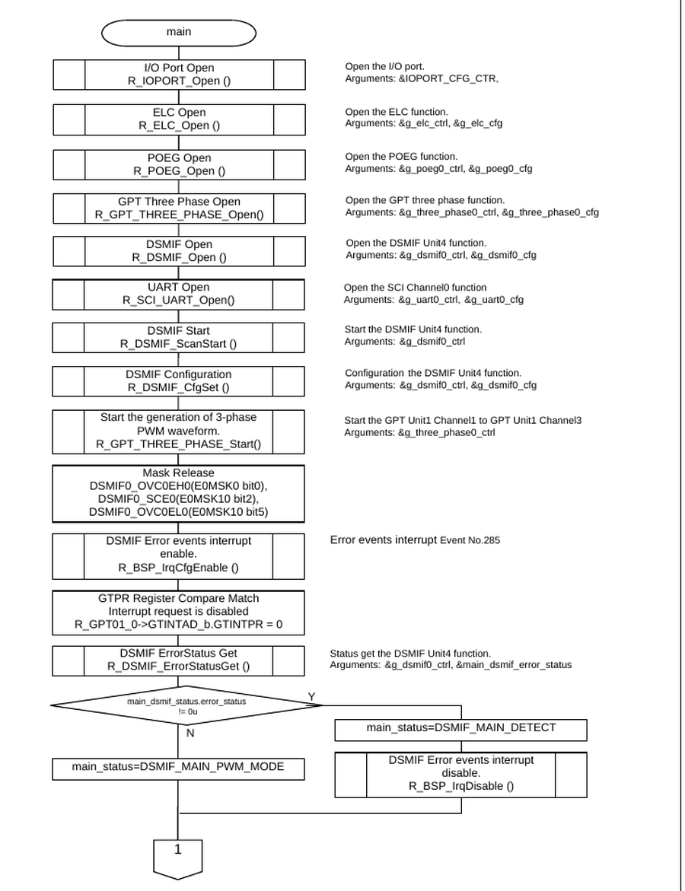
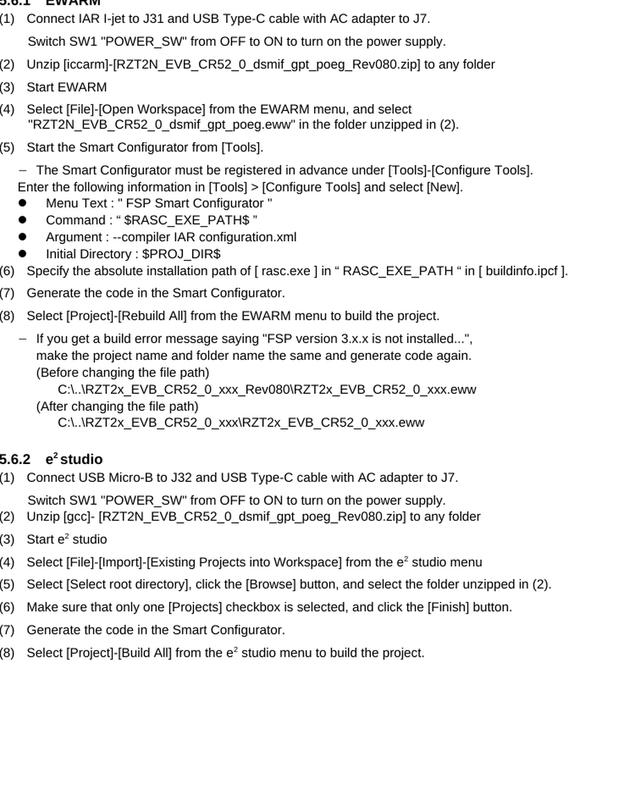
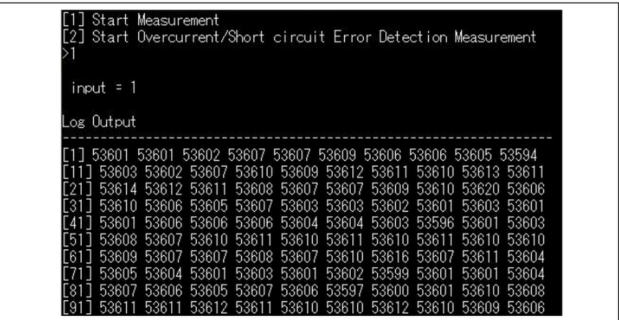
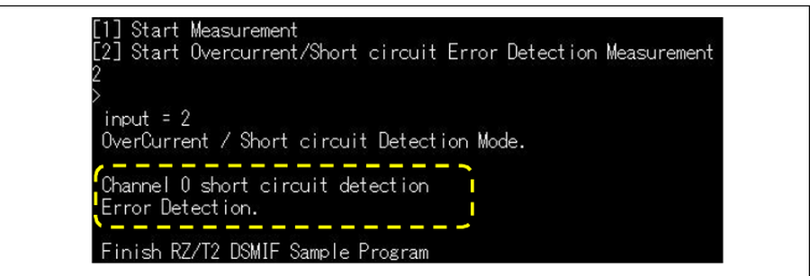
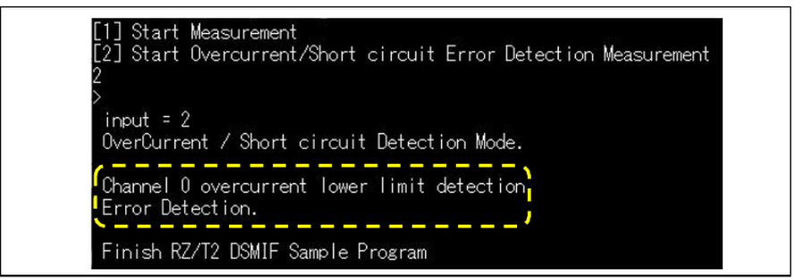
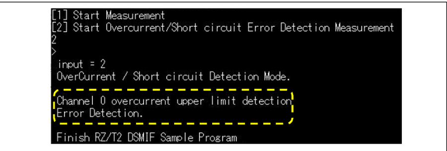
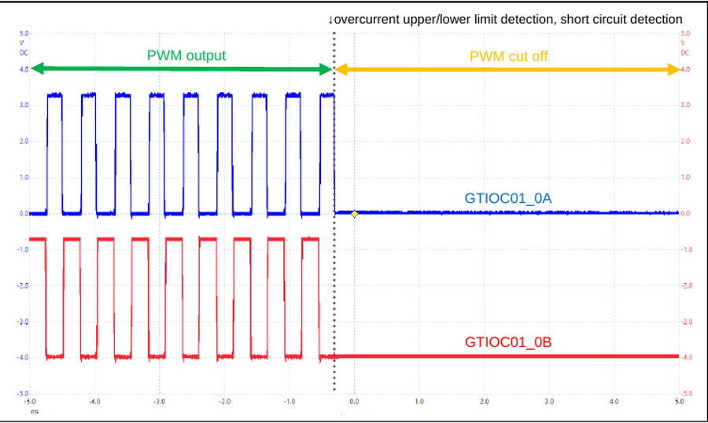

# RZ/T2N DSMIF / GPT / POEG Example Project #

Project name: `dsmif_gpt_poeg_rzt2n_evk_cr52_0_ep`

For the operating environment, switch settings and the build / debug procedure, see [readme.txt](./readme.txt).

## Introduction ##

This example project demonstrates the ΔΣ interface (DSMIF) of the RZ/T2N together with the
general PWM timer (GPT) and the port output enable for GPT (POEG).

RZ/T2N microcontrollers have 5 units of DSMIF with 3 channels (U, V, W) per unit, for a total of
15 channels. Delta-sigma modulated 1-bit digital input data can be filtered and converted to
16-bit digital data. This sample program uses DSMIF Unit4 ch0.

The three things this example project verifies are:

1. DSMIF converts the delta-sigma signal from the RV1S9355A sub-board into 16-bit current data.
2. GPT outputs a three-phase complementary PWM.
3. When DSMIF detects a fault, POEG cuts off the GPT PWM output.

| Peripheral Function | Application |
|---|---|
| Serial communication interface (SCI) | For communication with terminal software |
| ΔΣ Interface (DSMIF Unit4 ch0) | Filter 1-bit digital data from an external delta-sigma modulator and convert this into 16-bit data. |
| General PWM timer (GPT) | Use for complementary PWM output of GPT1 ch0 to ch2 |
| Interrupt controller (ICU) | Over current detection, short circuit detection, GPT overflow interrupt and SCI transmit/receive interrupt are used |
| Port Output Enable for GPT (POEG) | When overcurrent detection or short circuit detection is detected by DSMIF, the PWM output is cut off. |

## Required Resources ##

### Hardware ###

- RZ/T2N Evaluation board x 1
- RV1S9355A sub-board (external delta-sigma modulator)
- RZ/T2N Group MPU, CPU Core0 (Arm Cortex-R52) @ 800 MHz, operating voltage 3.3V / 1.8V / 1.1V
- 1 x USB Micro-B cable (for J-Link OB)
- 1 x USB Micro-B cable (for serial communication)
- 1 x IAR I-jet (for debugging in IAR EWARM)
- 1 x USB Type-C cable supporting power delivery (PD) and 15V/3A DC, and an AC adapter for USB
  supporting 15V/3A (for power supply)
- 1 x stabilized power supply with 2 output channels (5.0 V for VDD1, 0.2 V for Vin+/Vin-)
- 1 x oscilloscope with 2 or more channels (for observing the complementary PWM output)



### Software ###

- IAR Embedded Workbench for ARM 9.60.3 + patch, Smart Configurator + RZ_FSP_Packs_v4.2.0
- e²studio_2026-07 with RZ FSP, toolchain GNU ARM Embedded (Version:13.3.1.arm-13-24)
- RZ FSP version 4.2.0, SEGGER J-Link Base Ver.11.0
- Terminal Emulator (Tera Term v5.40)

## Related Collateral References ##

- RZ/T2N Group User's Manual: Hardware
- RZ Flexible Software Package Documentation
- RZ/T2N Evaluation Board User's Manual

## Project Notes ##

- The boot mode of this example project is RAM execution. It is prohibited to press the "Reset"
  button on the board during debugging.
- Set the reception line feed code of the terminal software to `AUTO`.
- ★ Use the RZ/T2N connector names. Older internal notes written for the RZ/T2H and RZ/N2H
  boards use connector names such as `CN21`, `CN24`, `CN45` and `CN49`. Those numbers do not
  apply to the RZ/T2N Evaluation board; use J55 for the DSMIF and J51 for the GPT as described
  below.
- ★ Never connect the 5 V output to Vin+ / Vin- of the RV1S9355A. The 5 V output is only for
  VDD1. Vin+ / Vin- take about 0.2 V.
- ★ Turn on the power of the Evaluation board first, and the stabilized power supply after it.
- After an error is detected with the menu item `[2]`, the program finishes. To output the
  current data again, restart the sample program.

## System Level Block Diagram ##

The software configuration of this sample program is shown below.



The RV1S9355A sub-board is connected to the J55 connector of the Evaluation board. The pin
layout of both sides is shown below.



## FSP Modules Used ##

| Module | Role in this example project |
|---|---|
| DSMIF (`R_DSMIF`) | Unit4 ch0, converts the delta-sigma input into 16-bit current data |
| GPT Three-Phase (`R_GPT_THREE_PHASE`) | Complementary PWM output of GPT1 ch0 to ch2 |
| POEG (`R_POEG`) | Cuts off the GPT PWM output on a DSMIF fault |
| ELC (`R_ELC`) | Links the DSMIF error event to the POEG |
| SCI UART (`R_SCI_UART`) | Menu input and log output through the terminal software |
| I/O Port (`R_IOPORT`) | Port initialization |

DSMIF driver functions.

| Function | Description |
|---|---|
| `R_DSMIF_Open` | DSMIF open function. |
| `R_DSMIF_ScanStart` | DSMIF start function. |
| `R_DSMIF_ScanStop` | DSMIF stop function. |
| `R_DSMIF_CfgSet` | DSMIF configuration function. |
| `R_DSMIF_StatusGet` | DSMIF status getting function. |
| `R_DSMIF_ErrorStatusGet` | DSMIF error status getting function. |
| `R_DSMIF_Read` | DSMIF current data reading function. |
| `R_DSMIF_Close` | DSMIF close function. |
| `R_DSMIF_CallbackSet` | DSMIF callback function |

Interrupts used by the sample program.

| Interrupt | Priority | Description |
|---|---|---|
| Interrupt Controller (ICU)(DSMIF_ERR0) | 12 | DSMIF error detection. Scan operation is stopped on over current detection and short circuit detection. |
| GPT1 GTCNT overflow interrupt of GPT | 12 | Read capture current data by GPT1 GTCNT overflow interrupt. |
| Serial Communications Interface_ch0 (SCI0) | 12 | Key input detection |

## Module Configuration Notes ##

Pins and pin functions.

| Pin Name | I/O | Function |
|---|---|---|
| MCLK40 | Input | Clock I/O pin |
| MDAT40 | Input | Data input pin |
| GTIOC01_0A | Output | GPT1 Channel0 output |
| GTIOC01_0B | Output | GPT1 Channel0' output (inverted-phase waveform output of GPT1 Channel0 output) |
| GTIOC01_1A | Output | GPT1 Channel1 output |
| GTIOC01_1B | Output | GPT1 Channel1' output (inverted-phase waveform output of GPT1 Channel1 output) |
| GTIOC01_2A | Output | GPT1 Channel2 output |
| GTIOC01_2B | Output | GPT1 Channel2' output (inverted-phase waveform output of GPT1 Channel2 output) |

Connection points on the RZ/T2N Evaluation board.

| Function | Connector | Pin | Signal | IOPORT |
|---|---|---|---|---|
| DSMIF (Unit 4) | J55 | 4 | MCLK40 | P12_5 |
| | | 3 | MDAT40 | P12_6 |
| GPT | INV3 (J51) | 28 | GTIOC01_0A | P03_6 |
| | | 29 | GTIOC01_0B | P03_7 |
| | | 30 | GTIOC01_1A | P04_1 |
| | | 31 | GTIOC01_1B | P04_0 |
| | | 32 | GTIOC01_2A | P04_2 |
| | | 33 | GTIOC01_2B | P04_3 |

Switch settings.

| Switch | Setting |
|---|---|
| SW8 | 1 : ON, 2 : OFF, 3 : ON (xSPI1 boot mode, x1 boot serial flash) |
| SW10 | 10 : ON (2nd Boot CPU : Cortex-R52 CPU0) |
| SW7 | 1 : OFF |

### Converting the A/D value to a voltage ###

When using the RV1S9355A and the current data is 32768 (= 0 mV) or more:

```
Voltage [mV] = (current data - 0x8000) * 320 [mV] / 0x7FFF
```

When the current data is 32768 (= 0 mV) or less:

```
Voltage [mV] = (current data - 0x8000) * 320 [mV] / 0x8000
```

For example, a current data of 53606 is 203.521836 mV.
With about +0.2 V applied to the modulator, values in the 53xxx region are expected. They do not
have to be exactly 53606.

## Verifying operation ##

The flowchart of the main function is shown below.





### Wiring summary ###

```
                       PC
                ┌──────┴──────┐
                │             │
               J32           J33
             Debugger      Tera Term
                │             │
                ▼             ▼
                   RZ/T2N EVB
                    │       │
                J55 │       │ J51 (INV3)
                    ▼       ▼
              RV1S9355A   oscilloscope
        ┌───────────────┐   CH-A : J51-28  GTIOC01_0A
5.0V + >│ VDD1 (5 V)    │   CH-B : J51-29  GTIOC01_0B
5.0V - >│ GND           │   GND  : verified board GND
0.2V + >│ Vin+          │
0.2V - >│ Vin-          │   J55-4 = MCLK40 / P12_5
        └───────────────┘   J55-3 = MDAT40 / P12_6
```

Power-up order: board power (J7 / SW1) first, then the 5.0 V output, then the 0.2 V output.

### Test A — normal measurement ###

Both stabilized power supply outputs ON. Enter `1` and press Enter.

100 converted values are printed, 10 per line.



Check all of the following.

| Check | Expected |
|---|---|
| Number of values | 100 |
| Value range | around 53xxx with about +0.2 V applied |
| Stability | reasonably stable, not jumping across the whole 16-bit range |
| Not stuck | not all `0`, not all `65535` |
| Oscilloscope | complementary PWM continues on J51-28 / J51-29 |

### Test B — short circuit detection ###

Return to the menu, enter `2` and press Enter to go into the OverCurrent / Short circuit
Detection Mode, then **turn OFF** the stabilized power supply.



### Test C — overcurrent lower limit detection ###

This test depends on the power-up order. Do it exactly in this order.

1. Stop debugging.
2. Turn OFF the stabilized power supply.
3. Start debugging while the supply is still OFF, and run the application.
4. At the menu, enter `2` and press Enter.
5. **Now turn ON** the stabilized power supply.



### Test D — overcurrent upper limit detection ###

Record the original Upper Limit value of the DSMIF stack first. Then, in the FSP configuration
of the DSMIF stack, set Upper Limit `Limit Value` to `50000`, generate the code and build again.

Turn ON the stabilized power supply, start debugging, run the application, enter `2` and press
Enter.



After the test, restore the original Upper Limit value, generate the code and build again.
Do not leave the value `50000` in the delivered project.

### PWM cut-off waveform ###

In test B, C and D the GPT PWM output must stop at the moment of the detection and stay at a
fixed level.



### Pass criteria ###

| Test | Terminal | Oscilloscope |
|---|---|---|
| A : normal measurement | 100 DSMIF samples in the 53xxx region | complementary PWM |
| B : short circuit | `Channel 0 short circuit detection` | PWM cut off |
| C : overcurrent lower limit | `Channel 0 overcurrent lower limit detection` | PWM cut off |
| D : overcurrent upper limit | `Channel 0 overcurrent upper limit detection` | PWM cut off |

The example project is fully verified when all four tests pass, that is when the DSMIF
conversion, the GPT complementary PWM, the DSMIF error detection and the POEG PWM protection
are all confirmed.