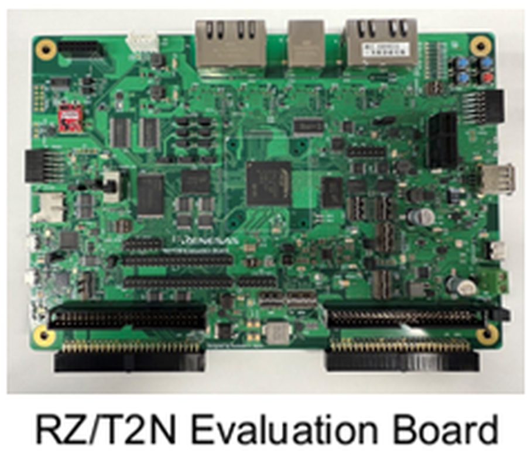
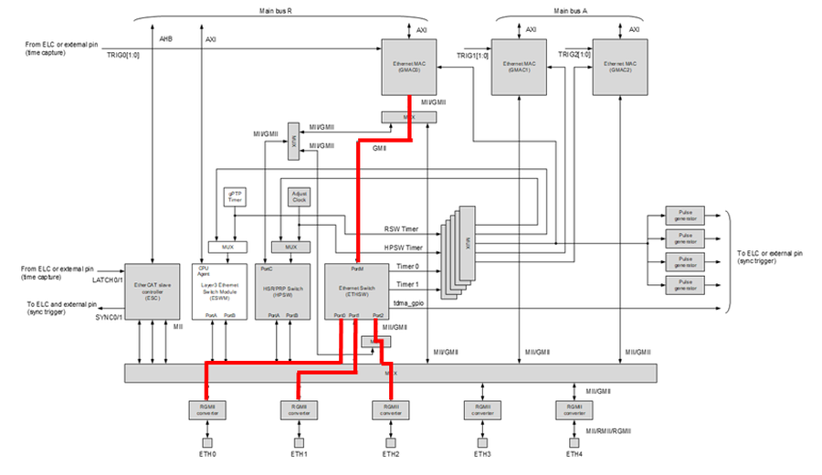
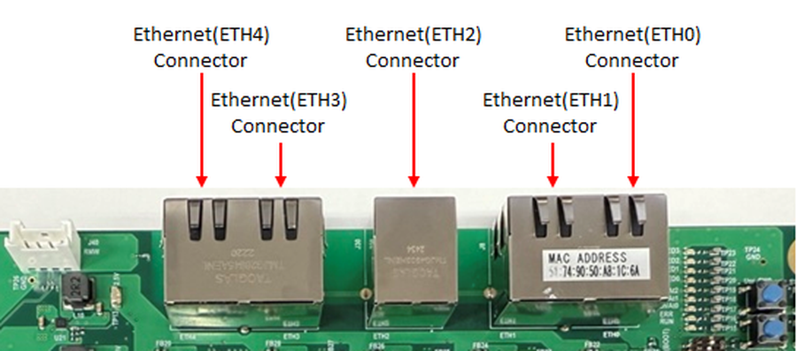
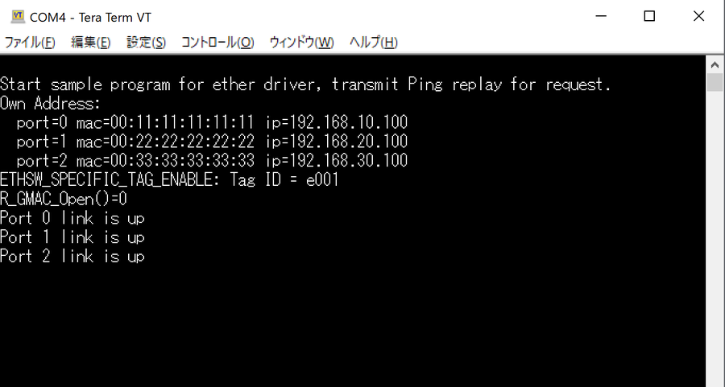
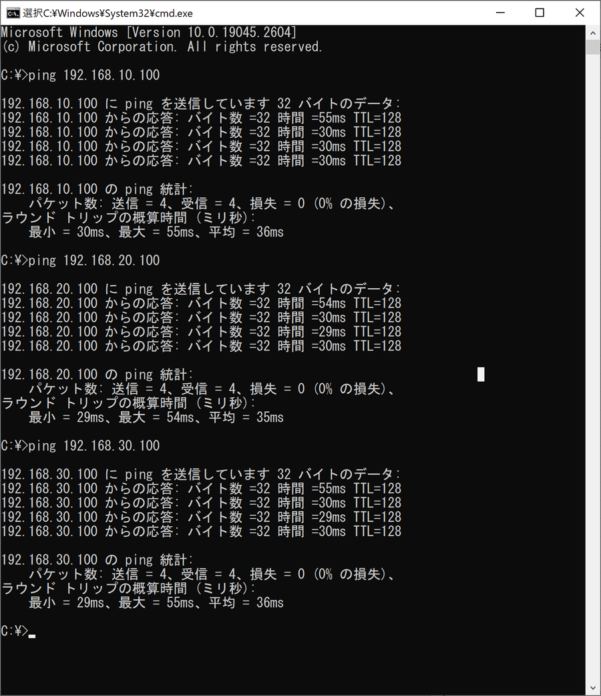
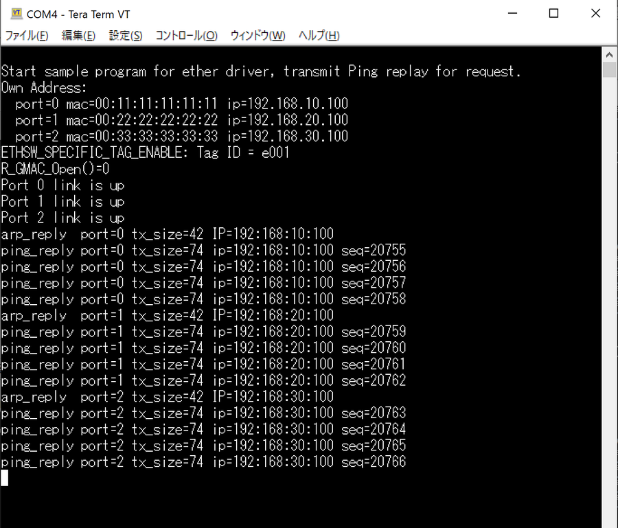

# RZ/T2N Ethernet (ETHSW) Example Project #

Project name: `ethernet_rzt2n_evk_ca55_0_ep`

For the operating environment, switch settings and the build / debug procedure, see [readme.txt](./readme.txt).

## Introduction ##

This example project is a sample program that performs a ping response using the Ethernet
driver for the RZ/T2N, on the Renesas RZ/T2N Evaluation board.

This sample software performs Ethernet communication with 3 ports ETH0, ETH1 and ETH2 in the
default state. GMAC0 is connected to ETH0, ETH1 and ETH2 via the ETHSW (Ethernet Switch). When
evaluating 3-port simultaneous communication, 3 Ethernet ports are required on the HOST PC
side.

| Item | Value |
|---|---|
| Supported ports | ETH0, ETH1, ETH2 |
| Not supported | ETH3, ETH4 |
| Supported GMAC | GMAC0 only (GMAC1 and GMAC2 are not supported) |
| Interface mode | RGMII only, on the RZ/T2N Evaluation Board |

## Required Resources ##

### Hardware ###

- RZ/T2N Evaluation board x 1
- RZ/T2N, Cortex-A55 Core0 @ 1200 MHz
- 1 x USB Micro-B cable (for J-Link OB)
- 1 x USB Micro-B cable (for serial communication)
- 1 x IAR I-jet (for debugging in IAR EWARM)
- 1 x USB Type-C cable supporting power delivery (PD) and 15V/3A DC, and an AC adapter for USB
  supporting 15V/3A (for power supply)
- 3 x Ethernet cable
- A host PC with 3 Ethernet ports, when evaluating 3-port simultaneous communication



### Software ###

- IAR Embedded Workbench for ARM 9.60.3 + patch, Smart Configurator + RZ_FSP_Packs_v4.2.0
- e²studio_2026-07 with RZ FSP, toolchain GCC ARM A-Profile (AArch64 bare-metal) (Version:13.2.1.arm-13-7)
- RZ FSP version 4.2.0, J-Link v9.44
- Terminal Emulator (Tera Term)

## Related Collateral References ##

- RZ/T2N Group User's Manual: Hardware
- RZ Flexible Software Package Documentation
- RZ/T2N Evaluation Board User's Manual

## Project Notes ##

- The boot mode of this example project is RAM execution. It is prohibited to press the "Reset"
  button on the board during debugging.
- Set the reception line feed code of the terminal software to `LF`. Without this setting the
  log is not displayed correctly.
- ETH3 and ETH4 are present on the board but are not used by this sample program.
- The MAC address of each port is fixed in the sample program: port 0 is `00:11:11:11:11:11`,
  port 1 is `00:22:22:22:22:22` and port 2 is `00:33:33:33:33:33`.

## System Level Block Diagram ##

GMAC0 is connected to ETH0, ETH1 and ETH2 through the Ethernet Switch (ETHSW) and the RGMII
converters. The path used by this sample program is highlighted in the figure below.



The Ethernet connectors on the RZ/T2N Evaluation Board are placed as below. This sample program
uses ETH0, ETH1 and ETH2.



## FSP Modules Used ##

| Module | Role in this example project |
|---|---|
| Ethernet (`R_GMAC`) | GMAC0, the Ethernet MAC used by the sample program |
| Ethernet PHY (`R_ETHER_PHY`) | One instance for each of the 3 ports |
| Ethernet selector (`R_ETHER_SELECTOR`) | Selects the interface mode of each port (RGMII) |
| Ethernet switch (`R_ETHSW`) | Connects GMAC0 to ETH0, ETH1 and ETH2 |
| SCI UART (`R_SCI_UART`) | Log output to the terminal software |

## Module Configuration Notes ##

IP address assignment on the board side.

| Port | IP address | MAC address |
|---|---|---|
| ETH0 | 192.168.10.100 | 00:11:11:11:11:11 |
| ETH1 | 192.168.20.100 | 00:22:22:22:22:22 |
| ETH2 | 192.168.30.100 | 00:33:33:33:33:33 |

The IP address of the Ethernet port on the host PC side connected to each port must be set to
the same network as the board side port.

Switch and jumper settings.

| Switch / Jumper | Setting |
|---|---|
| SW8 | 1 : ON, 2 : OFF, 3 : ON (xSPI1 boot mode, x1 boot serial flash) |
| SW10 | 10 : OFF (2nd Boot CPU : Cortex-A55 Core0) |
| SW7 | 2 : ON (Use Ethernet) |
| SW10 | 2 : ON (Use Ethernet) |
| SW12 | 3 : ON, 4 : ON (Use Ethernet) |
| J15 | 1-2 short |
| J41 | 2-3 short |

## Verifying operation ##

1. Build the project and start debugging as described in [readme.txt](./readme.txt).

2. Confirm that the start-up log appears on the terminal software. It shows the MAC address and
   the IP address of each port, and that the link of port 0, 1 and 2 is up.

   

3. Enter the following commands from the command prompt of the host PC.

   ```
   ping 192.168.10.100
   ping 192.168.20.100
   ping 192.168.30.100
   ```

   

4. Confirm that the ping replies appear on the terminal software, with the port number, the
   transmit size, the IP address and the sequence number of each reply.

   