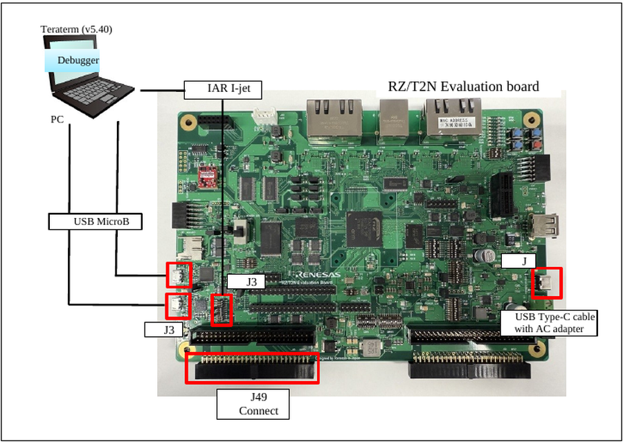
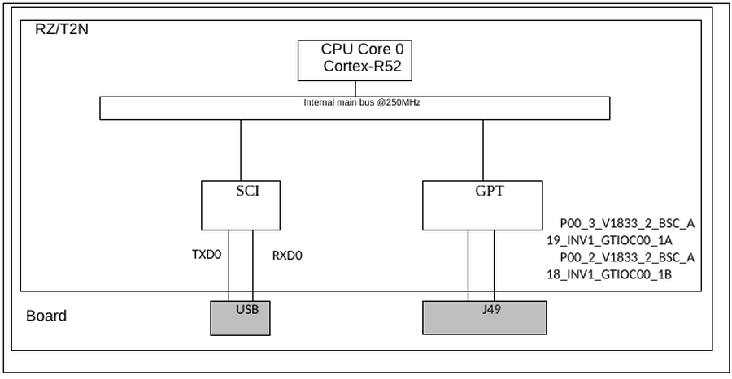
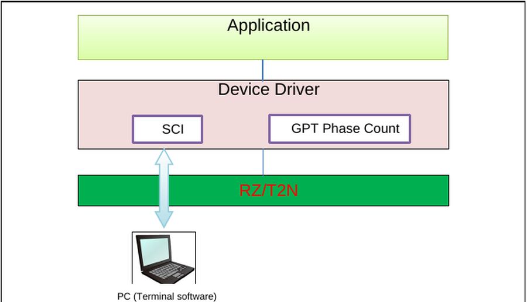
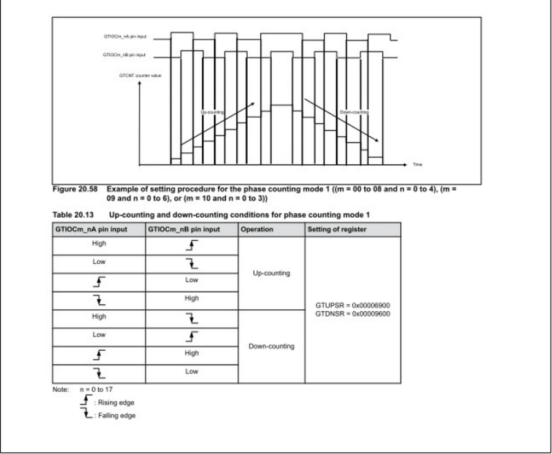
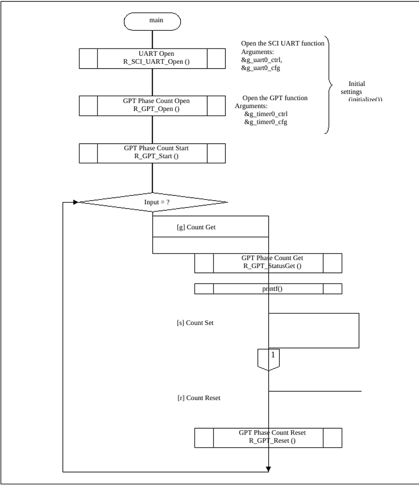
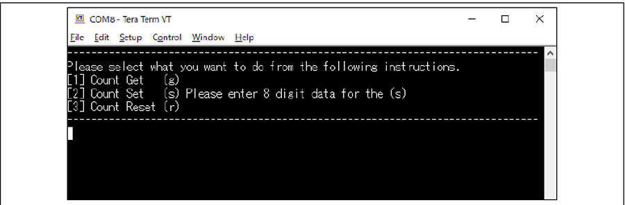

# RZ/T2N GPT Phase Count Example Project #

Project name: `gpt_phase_count_rzt2n_evk_cr52_0_ep`

For the operating environment, switch settings and the build / debug procedure, see [readme.txt](./readme.txt).

## Introduction ##

This example project uses the phase counting mode (phase counting mode 1) function of the
general purpose PWM timer (GPT) of the RZ/T2N, and counts the number of pulses of a two-phase
encoder (A phase, B phase) on the Renesas RZ/T2N Evaluation board.

The main function of the program is listed below.

- Command input from the terminal acquires the count value of the two-phase encoder (A phase,
  B phase) pulse number, sets the count value, and resets the count value.

| Peripheral Function | Application |
|---|---|
| Serial communication interface (SCI) | Used for setting instructions from the terminal. (Get, Set or Reset instructions) |
| General PWM Timer (GPT) | Counts the number of pulses of a two-phase encoder (A phase, B phase). |

For the basics of the operating modes, the serial communication interface (SCI), the general PWM
timer (GPT) and the general I/O ports, refer to the RZ/T2N Group User's Manual.

## Required Resources ##

### Hardware ###

- RZ/T2N Evaluation board x 1
- RZ/T2N Group MPU, CPU Core0 (Arm Cortex-R52) @ 800 MHz, operating voltage 3.3V / 1.8V / 1.1V
- Encoder (Motor) : MB057GA140
- Conversion board : RS-485 board
- 1 x USB Micro-B cable (for J-Link OB)
- 1 x USB Micro-B cable (for serial communication)
- 1 x IAR I-jet (for debugging in IAR EWARM)
- 1 x SEGGER J-Link Base Ver.11.0 (for debugging in e²studio)
- 1 x USB Type-C cable supporting power delivery (PD) and 15V/3A DC, and an AC adapter for USB
  supporting 15V/3A (for power supply)

### Software ###

- IAR Embedded Workbench for ARM 9.60.3 + patch, Smart Configurator + RZ_FSP_Packs_v4.2.0
- e²studio_2026-07 with RZ FSP, toolchain GNU ARM Embedded (Version:13.3.1.arm-13-24)
- RZ FSP version 4.2.0
- Terminal Emulator (Tera Term v5.40)

## Related Collateral References ##

- RZ/T2N Group User's Manual: Hardware
- RZ Flexible Software Package Documentation
- RZ/T2N Evaluation Board User's Manual

## Project Notes ##

- The boot mode of this example project is RAM execution. It is prohibited to press the "Reset"
  button on the board during debugging.
- The commands of the sample program must be entered in lower case only.
- For the Count Set operation, if 9 or more characters are entered for the data, the 8
  characters counted from the beginning are used for writing. For example, for
  `Data: 123456789` the data is `12345678`.
- The SCI asynchronous communication is used to talk to the host PC through the RS-232
  interface COM port.

## System Level Block Diagram ##

The operating environment of this example project is shown below.

The hardware configuration is shown below.

The software configuration is shown below.

## FSP Modules Used ##

| Module | Role in this example project |
|---|---|
| SCI UART (`R_SCI_UART`) | Command input and result output through the terminal software |
| GPT (`R_GPT`) | Counts the two-phase encoder pulses in phase counting mode 1 |

SCI module functions.

| Function | Description |
|---|---|
| `R_SCI_UART_Open` | SCI_UART open function |
| `R_SCI_UART_Close` | SCI_UART close function |
| `R_SCI_UART_Read` | Read from UART device |
| `R_SCI_UART_Write` | Write to UART device |
| `R_SCI_UART_CallbackSet` | User callback function |
| `R_SCI_UART_BaudSet` | Update SCI_UART baud rate |
| `R_SCI_UART_InfoGet` | Provides driver information |
| `R_SCI_UART_Abort` | Provides an API to abort an in-progress transfer |
| `R_SCI_UART_ReadStop` | Provides an API to abort a read in progress |
| `R_SCI_UART_BaudCalculate` | Calculate the set value of the baud rate register |

GPT module functions.

| Function | Description |
|---|---|
| `R_GPT_Open` | GPT module open function |
| `R_GPT_Stop` | Stop the GPT module |
| `R_GPT_Start` | Start the GPT module |
| `R_GPT_Reset` | Reset the GPT Phase Count timer |
| `R_GPT_Enable` | Enables external event triggers. |
| `R_GPT_Disable` | Disables external event triggers. |
| `R_GPT_PeriodSet` | Sets period value provided. |
| `R_GPT_DutyCycleSet` | Sets duty cycle on requested pin. |
| `R_GPT_CompareMatchSet` | Sets the value of the compare match function |
| `R_GPT_InfoGet` | Get information such as GPT timer cycle settings. |
| `R_GPT_StatusGet` | Get the status of GPT timer such as timer count value. |

For the details of each function, refer to the "RZ Flexible Software Package Documentation".

## Module Configuration Notes ##

Application functions of the sample program.

| Layer / Block | Function Name | Description |
|---|---|---|
| Application | `hal_entry ()` | Master side main routine of the sample software |
| | `initialize ()` | Initializes SCI_UART, SCI_UART_Baud and GPT Phase Count |
| | `input_data_check ()` | Checks that the input consists only of `0~9, a~f, A~F` and converts it to a sendable type |
| | `convert_char_to_hex ()` | Character to hexadecimal conversion |
| | `user_uart_callback ()` | SCI_UART user callback |
| | `handle_error ()` | Error handling |

Constants of the sample program.

| Constant Name | Setting Value | Description |
|---|---|---|
| `CHARACTER_LENGTH_BYTE` | 20 | Maximum data length of character string (unit: Byte) |
| `DATA_LENGTH_BYTE` | 4 | Maximum data length that can be entered (unit: Byte) |

Pins and functions.

| Pin name | I/O | Function |
|---|---|---|
| TXD0(P11_4) | Output | Send data to terminal |
| RXD0(P11_3) | Input | Receive data from terminal |
| P00_3_V1833_2_BSC_A19_INV1_GTIOC00_1A (P00_3) | Input | Two-phase encoder Phase A signal |
| P00_2_V1833_2_BSC_A18_INV1_GTIOC00_1B (P00_2) | Input | Two-phase encoder Phase B signal |

Connector assignment.

| Function | Connector | Pin | Signal | Condition |
|---|---|---|---|---|
| SCI | J33 | RXD0(P11_3) / TXD0(P11_4) | P11_3_FT2232_RXD0 / P11_4_FT2232_TXD0 | USB on RZ/T2N Evaluation board |
| GPT | J49-30 | GTIOC00_1A(P00_3) | P00_3_V1833_2_BSC_A19_INV1_GTIOC00_1A | Pin header on RZ/T2N Evaluation board |
| GPT | J49-31 | GTIOC00_1B(P00_2) | P00_2_V1833_2_BSC_A18_INV1_GTIOC00_1B | Pin header on RZ/T2N Evaluation board |

Switch and jumper settings.

| Switch / Jumper | Setting |
|---|---|
| SW8 | 1 : ON, 2 : OFF, 3 : ON |
| SW10 | 2 : ON, 3 : ON, 10 : ON |
| SW7 | 3 : OFF |
| J15 | 1-2 short |
| J18 | 1-2 short |

### About phase counting mode 1 ###

This example project uses phase counting mode 1. The up-counting and down-counting conditions
of that mode are shown below.

The source document also describes the other phase counting modes (2(00), 2(01), 2(1X), 3(00),
3(01), 3(1X), 4, 5(0X) and 5(1X)) for reference. Refer to the RZ/T2N Group User's Manual for
the details of each mode.

## Verifying operation ##

The flowchart of the main function is shown below.

1. Build the project and start debugging as described in [readme.txt](./readme.txt).

2. Connect J33 on the board and the USB connector of the host PC with a USB Micro-B cable, and
   confirm that the board is recognized as a COM port by the host PC. Two COM ports are
   recognized; the one with the higher number is used. If no characters are output to the
   terminal when the program is running, connect the other COM port.

3. Start the terminal software on the host PC, select that COM port and set the baud rate to
   115200.

4. Run the program. When communication becomes possible, the sample program menu is displayed
   on the terminal software. Enter commands in lower case only.

   

5. Count Get operation: enter `g` and press Enter to read the GPT counter value.

6. Count Set operation: enter `s` and press Enter to transition to setting mode, then enter the
   counter value to be set. If 9 or more characters are entered for the data, the 8 characters
   counted from the beginning are used for writing.

7. Count Reset operation: enter `r` and press Enter to clear the GPT counter value.