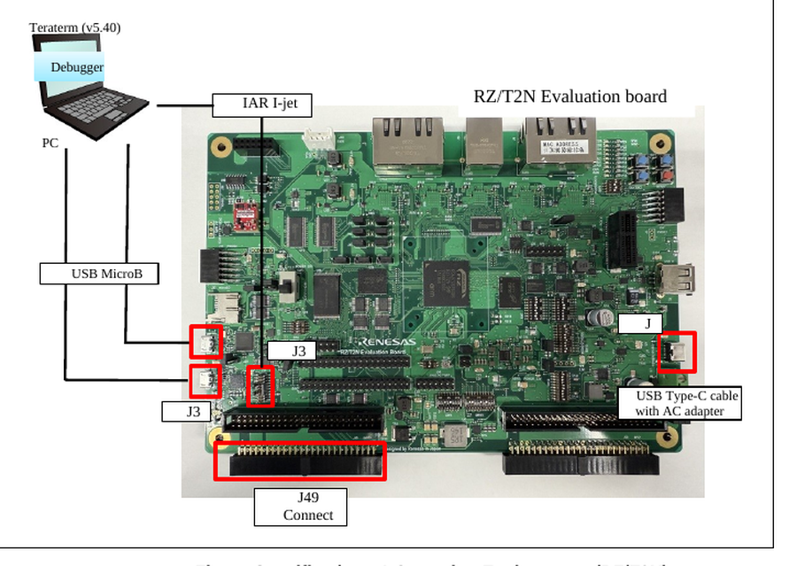
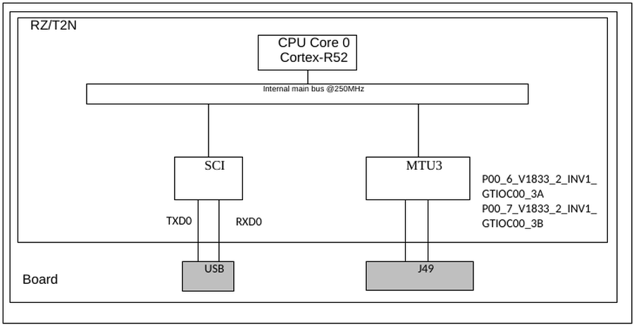
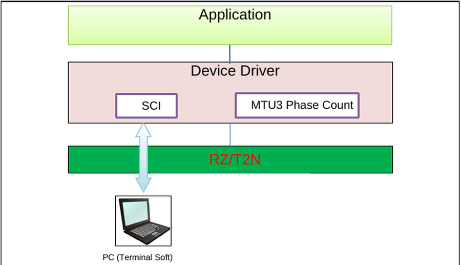
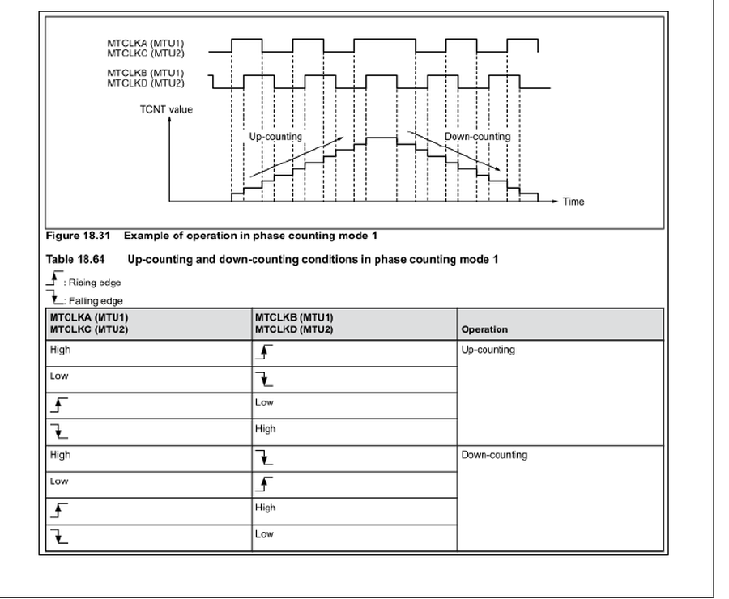
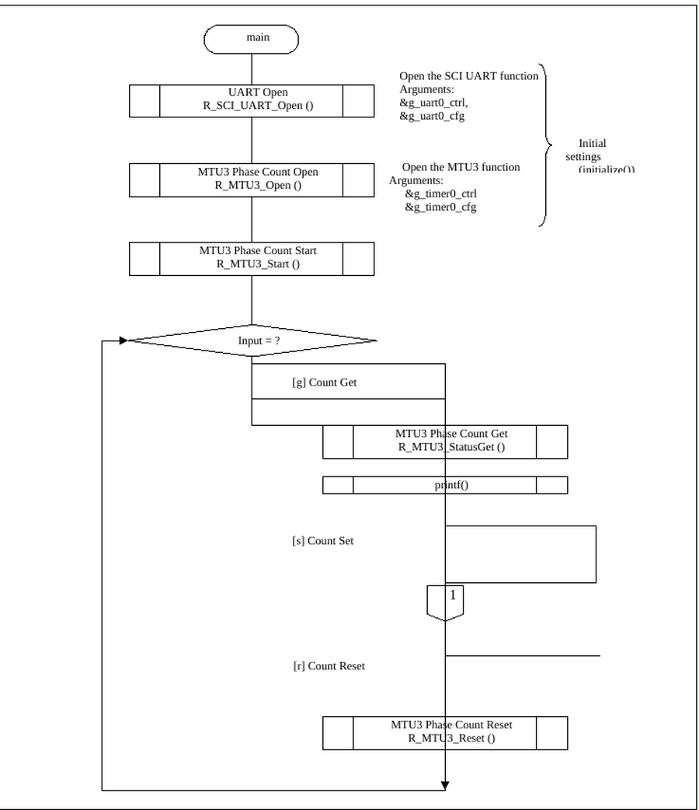

# RZ/T2N MTU3 Phase Count Example Project #

Project name: `mtu3_phase_count_rzt2n_evk_ca55_0_ep`

For the operating environment, switch settings and the build / debug procedure, see [readme.txt](./readme.txt).

## Introduction ##

This example project uses the phase counting mode (phase counting mode 1) function of the
multi-function timer pulse unit 3 (MTU3) of the RZ/T2N, and counts the number of pulses of a
two-phase encoder (A phase, B phase) on the Renesas RZ/T2N Evaluation board.

The main function of the program is listed below.

- Command input from the terminal acquires the count value of the two-phase encoder (A phase,
  B phase) pulse number, sets the count value, and resets the count value.

| Peripheral Function | Application |
|---|---|
| Serial communication interface (SCI) | Used for setting instructions from the terminal. (Get, Set or Reset instructions) |
| Multi-Function Timer Pulse Unit 3 (MTU3) | Counts the number of pulses of a two-phase encoder (A phase, B phase). |

For the basics of the operating modes, the serial communication interface (SCI), the
multi-function timer pulse unit 3 (MTU3) and the general I/O ports, refer to the RZ/T2N Group
User's Manual.

## Required Resources ##

### Hardware ###

- RZ/T2N Evaluation board x 1
- RZ/T2N Group MPU, CPU Core0 (Arm Cortex-A55) @ 1200 MHz, operating voltage 3.3V / 1.8V / 1.1V
- Encoder (Motor) : MB057GA140
- Conversion board : RS-485 board
- 1 x USB Micro-B cable (for J-Link OB)
- 1 x USB Micro-B cable (for serial communication)
- 1 x IAR I-jet (for debugging in IAR EWARM)
- 1 x SEGGER J-Link Base Ver.11.0 (for debugging in e²studio)
- 1 x USB Type-C cable supporting power delivery (PD) and 15V/3A DC, and an AC adapter for USB
  supporting 15V/3A (for power supply)

### Software ###

- IAR Embedded Workbench for ARM 9.60.3 + patch, Smart Configurator + RZ_FSP_Packs_v4.2.0
- e²studio_2026-07 with RZ FSP, toolchain GCC ARM A-Profile (AArch64 bare-metal) (Version:13.2.1.arm-13-7)
- RZ FSP version 4.2.0
- Terminal Emulator (Tera Term v5.40)

## Related Collateral References ##

- RZ/T2N Group User's Manual: Hardware
- RZ Flexible Software Package Documentation
- RZ/T2N Evaluation Board User's Manual

## Project Notes ##

- The boot mode of this example project is RAM execution. It is prohibited to press the "Reset"
  button on the board during debugging.
- The commands of the sample program must be entered in lower case only.
- For the Count Set operation, if 5 or more characters are entered for the data, the 4
  characters counted from the beginning are used for writing. For example, for `Data: 12345`
  the data is `1234`. Note that this differs from the GPT phase count example project, where
  `DATA_LENGTH_BYTE` is 4 and 8 characters are used.
- SW9.5 must be ON. It selects the P00_6 / P00_7 line that carries MTCLKA / MTCLKB to the MTU3.
  If it is left OFF, no pulse reaches the MTU3 and the counter value never changes.
- The SCI asynchronous communication is used to talk to the host PC through the RS-232
  interface COM port.

### Relation to the GPT phase count example project ###

This example project is almost the same test as the GPT phase count example project. It uses
the same encoder and the same RS-485 conversion board, and only the input pins of the two
encoder phases and one switch differ.

| Item | GPT phase count | MTU3 phase count |
|---|---|---|
| Timer module | GPT (`R_GPT`) | MTU3 (`R_MTU3`) |
| Phase A input | J49-30, GTIOC00_1A (P00_3) | J49-37, MTCLKA (P00_6) |
| Phase B input | J49-31, GTIOC00_1B (P00_2) | J49-38, MTCLKB (P00_7) |
| SW9 | (not used) | SW9.5 : ON |
| `DATA_LENGTH_BYTE` | 4 | 2 |
| Counter read function | `R_GPT_StatusGet()` | `R_MTU3_StatusGet()` |

Everything else — the motor, the RS-485 conversion board, their power supply and GND wiring,
SW8, SW10, SW7.3, J15 and J18, the terminal settings and the `g` / `s` / `r` commands — stays
the same.

If a third RS-485 board is used for the Z / index phase, this example project does not need it:
only the A phase and the B phase are used.

## System Level Block Diagram ##

The operating environment of this example project is shown below.

The hardware configuration is shown below.

The software configuration is shown below.

## FSP Modules Used ##

| Module | Role in this example project |
|---|---|
| SCI UART (`R_SCI_UART`) | Command input and result output through the terminal software |
| MTU3 (`R_MTU3`) | Counts the two-phase encoder pulses in phase counting mode 1 |

SCI module functions.

| Function | Description |
|---|---|
| `R_SCI_UART_Open` | SCI_UART open function |
| `R_SCI_UART_Close` | SCI_UART close function |
| `R_SCI_UART_Read` | Read from UART device |
| `R_SCI_UART_Write` | Write to UART device |
| `R_SCI_UART_CallbackSet` | User callback function |
| `R_SCI_UART_BaudSet` | Update SCI_UART baud rate |
| `R_SCI_UART_InfoGet` | Provides driver information |
| `R_SCI_UART_Abort` | Provides an API to abort an in-progress transfer |
| `R_SCI_UART_ReadStop` | Provides an API to abort a read in progress |
| `R_SCI_UART_BaudCalculate` | Calculate the set value of the baud rate register |

MTU3 module functions.

| Function | Description |
|---|---|
| `R_MTU3_Open` | MTU3 module open function |
| `R_MTU3_Stop` | Stop the MTU3 module |
| `R_MTU3_Start` | Start the MTU3 module |
| `R_MTU3_Reset` | Reset the MTU3 Phase Count timer |
| `R_MTU3_PeriodSet` | Sets period value provided. |
| `R_MTU3_DutyCycleSet` | Set the duty cycle |
| `R_MTU3_CompareMatchSet` | Sets the value of the compare match function |
| `R_MTU3_InfoGet` | Get information such as MTU3 timer cycle settings. |
| `R_MTU3_StatusGet` | Get the status of MTU3 timer such as timer count value. |
| `R_MTU3_CounterSet` | Sets the MTU3 Phase Count timer counter value |
| `R_MTU3_OutputEnable` | Enable output for MTIOCA and/or MTIOCB. |
| `R_MTU3_OutputDisable` | Disable output for MTIOCA and/or MTIOCB. |
| `R_MTU3_Enable` | Enable external event triggers to capture counters |
| `R_MTU3_Disable` | Disable external event triggers that capture counters |
| `R_MTU3_AdcTriggerSet` | Sets the compare match value for the A/D converter start request |
| `R_MTU3_CallbackSet` | User callback function |
| `R_MTU3_Close` | MTU3 module close function |

For the details of each function, refer to the "RZ Flexible Software Package Documentation".

## Module Configuration Notes ##

Application functions of the sample program.

| Layer / Block | Function Name | Description |
|---|---|---|
| Application | `hal_entry ()` | Master side main routine of the sample software |
| | `initialize ()` | Initializes SCI_UART, SCI_UART_Baud and MTU3 Phase Count |
| | `input_data_check ()` | Checks that the input consists only of `0~9, a~f, A~F` and converts it to a sendable type |
| | `convert_char_to_hex ()` | Character to hexadecimal conversion |
| | `user_uart_callback ()` | SCI_UART user callback |
| | `handle_error ()` | Error handling |

Constants of the sample program.

| Constant Name | Setting Value | Description |
|---|---|---|
| `CHARACTER_LENGTH_BYTE` | 20 | Maximum data length of character string (unit: Byte) |
| `DATA_LENGTH_BYTE` | 2 | Maximum data length that can be entered (unit: Byte) |

Pins and functions.

| Pin name | I/O | Function |
|---|---|---|
| TXD1(P11_2) | Output | Send data to terminal |
| RXD1(P11_1) | Input | Receive data from terminal |
| P00_6_V1833_2_INV1_GTIOC00_3A | Input | Two-phase encoder Phase A signal |
| P00_7_V1833_2_INV1_GTIOC00_3B | Input | Two-phase encoder Phase B signal |

Connector assignment.

| Function | Connector | Pin | Signal | Condition |
|---|---|---|---|---|
| SCI | J33 | RXD1(P11_1) / TXD1(P11_2) | P11_1_FT2232_RXD1 / P11_2_FT2232_TXD1 | USB on RZ/T2N Evaluation board |
| MTU3 | J49-37 | MTCLKA(P00_6) | P00_6_V1833_2_INV1_GTIOC00_3A | Pin header on RZ/T2N Evaluation board |
| MTU3 | J49-38 | MTCLKB(P00_7) | P00_7_V1833_2_INV1_GTIOC00_3B | Pin header on RZ/T2N Evaluation board |

Switch and jumper settings.

| Switch / Jumper | Setting |
|---|---|
| SW8 | 1 : ON, 2 : OFF, 3 : ON |
| SW10 | 2 : ON, 3 : ON, 10 : OFF |
| SW7 | 3 : OFF |
| SW9 | 5 : ON |
| J15 | 1-2 short |
| J18 | 1-2 short |

### About phase counting mode 1 ###

This example project uses phase counting mode 1. The up-counting and down-counting conditions
of that mode are shown below. The order of the A phase and the B phase decides the counting
direction, so the two signal leads must not be swapped.

The source document also describes the other phase counting modes for reference. Refer to the
RZ/T2N Group User's Manual for the details of each mode.

## Verifying operation ##

The flowchart of the main function is shown below.

1. Wire the encoder as described in [readme.txt](./readme.txt): Phase A to J49-37, Phase B to
   J49-38, GND to the GND of the Evaluation board, and set SW9.5 to ON.

2. Build the project and start debugging.

3. Connect J33 on the board and the USB connector of the host PC with a USB Micro-B cable, and
   confirm that the board is recognized as a COM port by the host PC. Two COM ports are
   recognized; the one with the smaller number is used. If no characters are output to the
   terminal when the program is running, connect the other COM port.

4. Start the terminal software on the host PC, select that COM port and set the baud rate to
   115200.

5. Run the program. When communication becomes possible, the sample program menu is displayed
   on the terminal software. Enter commands in lower case only.

   

6. Check the operation in the following order.

   | Step | Input / action | Expected result |
   |---|---|---|
   | 1 | `g` | The initial counter value is displayed |
   | 2 | Turn the motor in one direction, then `g` | The counter value has changed |
   | 3 | Turn the motor in the opposite direction, then `g` | The counter value changes in the opposite direction |
   | 4 | `s`, then enter a value | The entered counter value is set |
   | 5 | `r` | The counter value is cleared |
   | 6 | `g` | The counter value is 0 |

   If the counter value never changes while the motor is turning, check SW9.5 first, then check
   that the Phase A and Phase B leads are on J49-37 and J49-38.