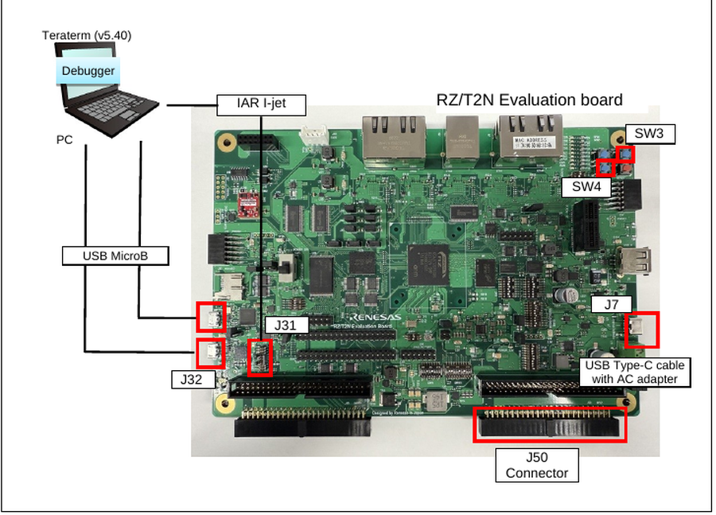
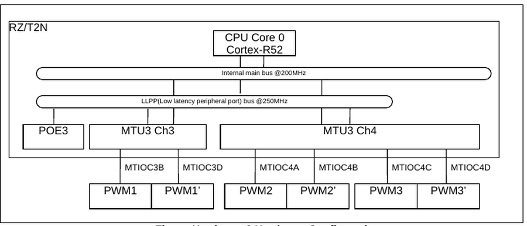
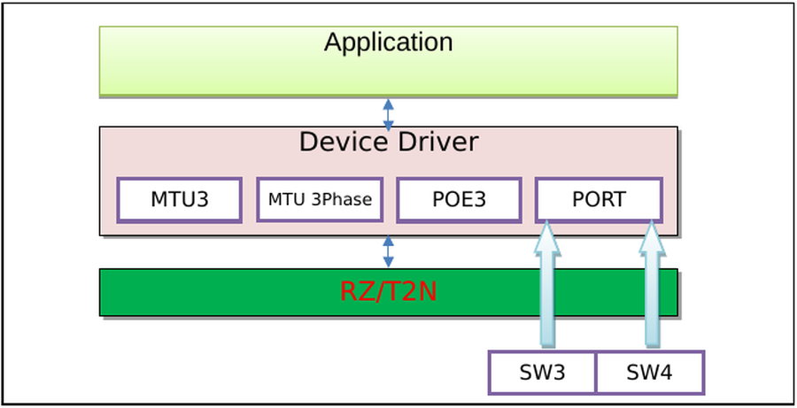
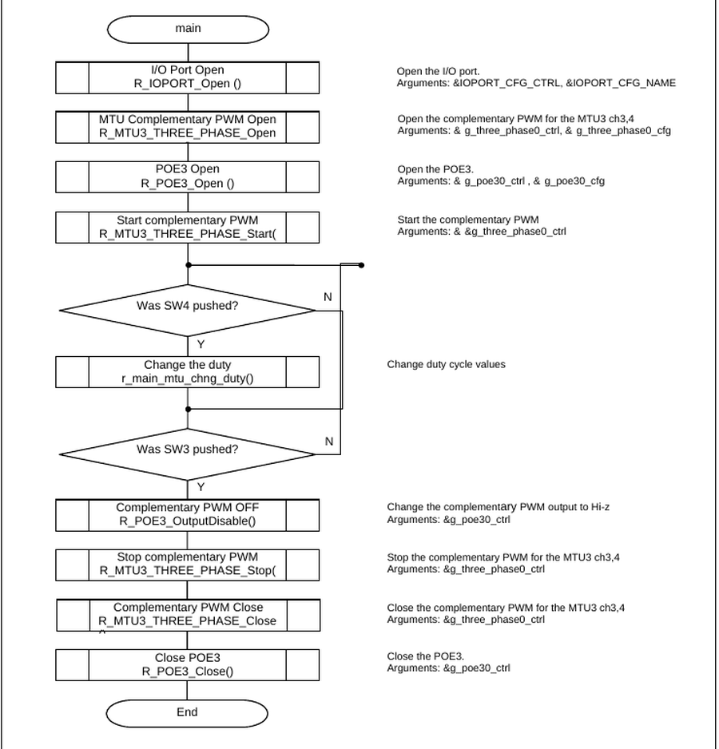
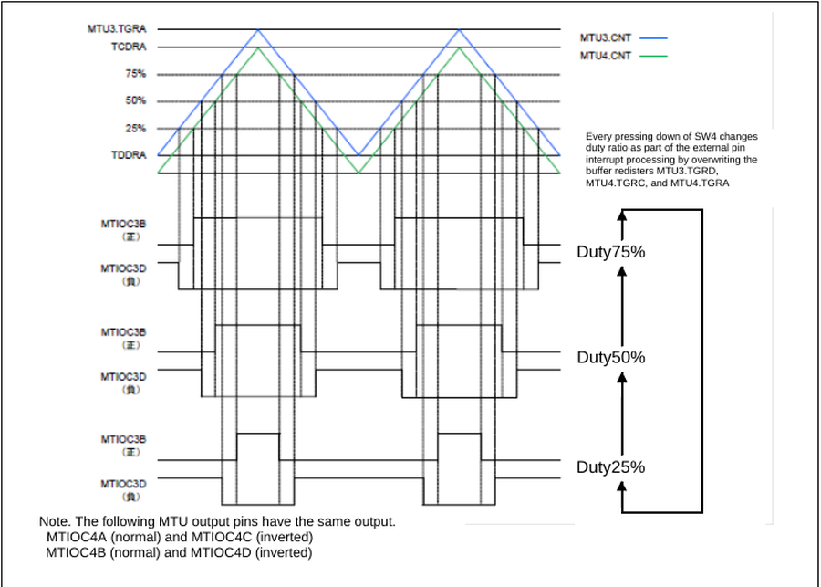

# RZ/T2N MTU3 Complementary PWM / POE3 Example Project #

Project name: `mtu3_poe3_rzt2n_evk_ca55_0_ep`

For the operating environment, switch settings and the build / debug procedure, see [readme.txt](./readme.txt).

## Introduction ##

This example project outputs a three-phase (positive and negative, in total of 6 phases)
dead-time PWM waveform by using the complementary PWM mode of the multi-function timer pulse
unit3 (MTU3), MTU3 and MTU4, on the Renesas RZ/T2N Evaluation board. The port output enable3
(POE3) is used to cut off the complementary PWM output.

The major features of the program are listed below.

- Output of complementary PWM waveform with the cycle of the carrier (100 us) by using MTU3 and
  MTU4 and dead time (2 us).
- Switching of PWM duty ratio by every press-down of Usr_SW2 (SW4) to 25%, 50%, and
  75% (repeatedly).
- When Usr_SW1 (SW3) is pushed, POE3 cuts off the complementary PWM output and the
  sample program is finished.

| Peripheral Function | Application |
|---|---|
| Multi-function timer pulse unit3 (MTU3) | The MTU is used for complementary PWM output of the MTU3 ch3 and MTU3 ch4 |
| Port output enable3 (POE3) | Cut off the complementary PWM output |

For the basics of the multi-function timer pulse unit3 (MTU3) and the port output enable3
(POE3), refer to the RZ/T2N Group User's Manual: Hardware.

## Required Resources ##

### Hardware ###

- RZ/T2N Evaluation board x 1
- RZ/T2N Group MPU, CPU Core0 (Arm Cortex-A55) @ 1200 MHz, operating voltage 3.3V / 1.8V / 1.1V
- 1 x USB Micro-B cable (for J-Link OB)
- 1 x IAR I-jet (for debugging in IAR EWARM)
- 1 x SEGGER J-Link Base Ver.11.0 (for debugging in e²studio)
- 1 x USB Type-C cable supporting power delivery (PD) and 15V/3A DC, and an AC adapter for USB
  supporting 15V/3A (for power supply)
- 1 x oscilloscope or logic analyzer with 2 or more channels (for observing one complementary
  pair of the PWM waveform on the J50 connector at the same time)

### Software ###

- IAR Embedded Workbench for ARM 9.60.3 + patch, Smart Configurator + RZ_FSP_Packs_v4.2.0
- e²studio_2026-07 with RZ FSP, toolchain GCC ARM A-Profile (AArch64 bare-metal) (Version:13.2.1.arm-13-7)
- RZ FSP version 4.2.0
- Terminal Emulator (Tera Term v5.40)

## Related Collateral References ##

- RZ/T2N Group User's Manual: Hardware
- RZ Flexible Software Package Documentation
- RZ/T2N Evaluation Board User's Manual

## Project Notes ##

- The boot mode of this example project is RAM execution. It is prohibited to press the "Reset"
  button on the board during debugging.
- The 2nd boot CPU of this project is Cortex-A55 Core0, so SW10.10 must be OFF. This is the
  only switch setting that differs from the Cortex-R52 version of this example project.
- The following MTU output pins have the same output.
  - MTIOC4A (normal) and MTIOC4C (inverted)
  - MTIOC4B (normal) and MTIOC4D (inverted)
- The inputs from Usr_SW1 (SW3) and Usr_SW2 (SW4) are polled in the main loop in
  `hal_entry()`.
- Each press of Usr_SW2 (SW4) updates the buffer registers MTU3.TGRD, MTU4.TGRC and
  MTU4.TGRA by calling `R_MTU3_THREE_PHASE_DutyCycleSet()`.
- In the source code the user switches are named `MAIN_SW1` for Usr_SW1 (SW3, P08_1)
  and `MAIN_SW2` for Usr_SW2 (SW4, P12_4).
- The dead time is defined by `#define MTU_DEAD_TIME (0x64)`, which gives 2 us. The cycle of
  the carrier is 100 us, that is about 10 kHz.
- The PWM output starts with a duty ratio of 25%.
- In the POE3 configuration, the groups MTIOC3B/MTIOC3D, MTIOC4A/MTIOC4C and MTIOC4B/MTIOC4D
  are all set to Hi-z when the POE3 output is disabled.

## System Level Block Diagram ##

The operating environment of this example project is shown below.

The hardware configuration is shown below. On the Cortex-A55 core the internal main bus runs at
250 MHz and the LLPP (low latency peripheral port) bus at 500 MHz.

The software configuration is shown below.

## FSP Modules Used ##

| Module | Role in this example project |
|---|---|
| MTU3 Three-Phase (`R_MTU3_THREE_PHASE`) | Complementary PWM output of the MTU3 ch3 and ch4 |
| POE3 (`R_POE3`) | Cuts off the complementary PWM output |
| I/O Port (`R_IOPORT`) | Port initialization, Usr_SW1 (SW3) / Usr_SW2 (SW4) input |

MTU3 driver functions.

| Function | Description |
|---|---|
| `R_MTU3_THREE_PHASE_Open` | Initializes the complementary PWM module (and associated timers) and applies configurations. |
| `R_MTU3_THREE_PHASE_Stop` | Stops all timers synchronously. |
| `R_MTU3_THREE_PHASE_Start` | Starts all timers synchronously. |
| `R_MTU3_THREE_PHASE_Reset` | Resets the counter values to 0. |
| `R_MTU3_THREE_PHASE_DutyCycleSet` | Sets duty cycle for all three timers. |
| `R_MTU3_THREE_PHASE_CallbackSet` | Updates the user callback for the MTU3 U-channel with the option to provide memory for the callback argument structure. |
| `R_MTU3_THREE_PHASE_Close` | Stops counters, disables output pins, and clears internal driver data. |

POE3 driver functions.

| Function | Description |
|---|---|
| `R_POE3_Open` | POE3 Open function |
| `R_POE3_OutputDisable` | Disables MTU3 output pins. |
| `R_POE3_Reset` | Resets the status flags |
| `R_POE3_StatusGet` | Get current POE3 status |
| `R_POE3_Close` | POE3 Close function |

For the details of each function, refer to the "RZ Flexible Software Package Documentation".

## Module Configuration Notes ##

| Function | Description |
|---|---|
| Channel | MTU3 Channel 3 (MTU3), MTU3 channel 4 (MTU4) |
| PWM output | Three phases for positive and negative (in total of 6), cycle of carrier (100 us), dead time (2 us) |
| Operating mode | Complementary PWM mode 1 (transferred at crest) |
| Clock | PCLKH/4 (= 50.0 MHz), rising edge |
| Duty ratio | 25%, 50%, and 75% common to all phases |

Pins and pin functions.

| Pin Name | I/O | Function |
|---|---|---|
| MTIOC3B | Output | PWM Output 1 |
| MTIOC3D | Output | PWM Output 1' (inverted-phase waveform output of PWM output 1) |
| MTIOC4A | Output | PWM Output 2 |
| MTIOC4C | Output | PWM Output 2' (inverted-phase waveform output of PWM output 2) |
| MTIOC4B | Output | PWM Output 3 |
| MTIOC4D | Output | PWM Output 3' (inverted-phase waveform output of PWM output 3) |

The pins are assigned to the J50 connector of the RZ/T2N Evaluation board as below.

| Function | Connector | Pin | Signal | IOPORT |
|---|---|---|---|---|
| MTU3 ch3 | J50 Connector | 28 | MTIOC3B | P14_1 |
| MTU3 ch4 | | 29 | MTIOC3D | P14_2 |
| | | 30 | MTIOC4A | P14_4 |
| | | 31 | MTIOC4C | P14_5 |
| | | 32 | MTIOC4B | P14_6 |
| | | 33 | MTIOC4D | P14_7 |

The switch settings of the RZ/T2N Evaluation board are as below.

| Switch | Setting |
|---|---|
| SW8 | 1 : ON, 2 : OFF, 3 : ON (xSPI1 boot mode, x1 boot serial flash) |
| SW10 | 10 : OFF (2nd Boot CPU : Cortex-A55 Core0) |
| SW11 | 5 : OFF, 6 : OFF, 7 : ON |

## Verifying operation ##

The flowchart of the main function is shown below.

1. Build the project and start debugging as described in [readme.txt](./readme.txt).

2. Connect the probes of the oscilloscope to one complementary pair of the J50 connector.
   Pair 1 is the easiest one to start with.

   | Probe | J50 pin | Signal |
   |---|---|---|
   | Channel A signal | J50-28 | MTIOC3B / P14_1 |
   | Channel A GND | J50-27 | GND |
   | Channel B signal | J50-29 | MTIOC3D / P14_2 |
   | Channel B GND | J50-34 | GND |

   J50-28 to J50-33 are signal pins; never connect a ground lead to them. To check the other
   pairs, move only the two signal leads (pair 2 : J50-30 and J50-31, pair 3 : J50-32 and
   J50-33) and leave the ground leads where they are.

3. Run the program. The two channels show a complementary pair: while one channel is HIGH the
   other is LOW, with a dead time of 2 us where both are OFF at every change of the state. The
   cycle of the carrier is 100 us, that is about 10 kHz. The duty ratio at the start is 25%.

4. Every press-down of Usr_SW2 (SW4) changes the duty ratio of all phases in the order
   25% -> 50% -> 75% -> 25% (repeatedly). Confirm that the duty ratio on the oscilloscope
   changes accordingly.

5. When Usr_SW1 (SW3) is pushed, POE3 changes the complementary PWM output to Hi-z.
   The complementary PWM is stopped and closed, and the sample program is finished. Because
   the pins are no longer
   driven, the level observed on the oscilloscope is not necessarily 0 V and may float
   depending on the conditions. What has to be confirmed is that the PWM waveform is no longer
   output.

The timing diagram of the complementary PWM output is shown below.

